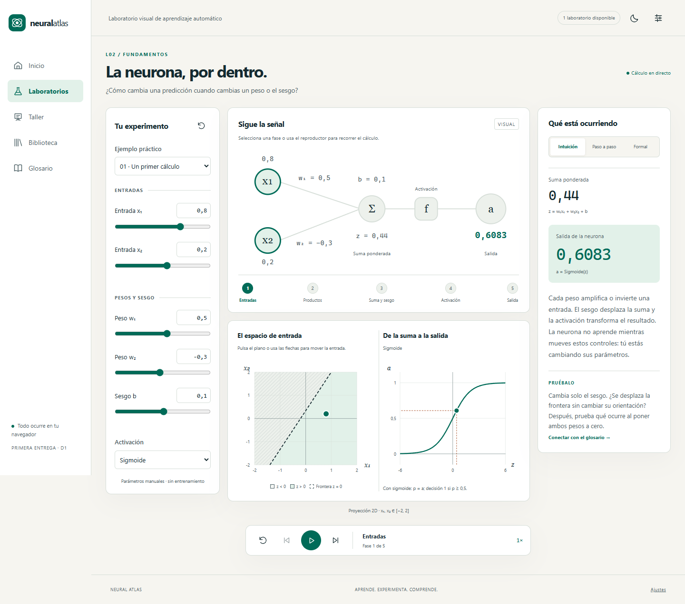

# Neural Atlas

Laboratorio visual de aprendizaje automático para FP de especialización y universidad. Vue 3 Composition API, TypeScript, Tailwind, Pinia, Vue Router y D3.

**Versión 0.3 · primera implementación D1.** Ya se puede experimentar con una neurona: cinco ejemplos, seis activaciones, frontera interactiva, cálculo explicado y animación ajustable. Incluye temas claro/oscuro, modo presentación, ajustes locales y glosario inicial en tres niveles.



## Arrancar

Node **24.19.0**; versión indicada también en `.nvmrc`.

```powershell
npm ci --ignore-scripts
npm run dev
```

Abre [Neural Atlas local](http://127.0.0.1:5173/neural-atlas/). Para producción: `npm run build` y `npm run preview` (puerto 4173).

## Verificar

```powershell
npm run check
npx playwright install chromium firefox webkit
npm run test:e2e
```

Tipos, lint, unidades/integración, cobertura con umbrales, build, presupuesto y documentación. Playwright comprueba recorridos, accesibilidad automática, teclado, persistencia, temas, responsive y CSP sobre producción. Informes: `coverage/` y `playwright-report/`.

La [entrega D1](docs/23-implementacion-d1.md) documenta arquitectura real, uso, trazabilidad y resultados. Firefox de pruebas tiene una incidencia local de arranque en Windows documentada; su comprobación permanece configurada en CI y no se da por aprobada sin ejecución.

## Alcance y continuidad

D1 permite modificar parámetros manualmente; el entrenamiento, los datasets, el taller, la biblioteca y el 3D llegarán en sus fases. La neurona conserva su sesión entre rutas; LocalStorage guarda preferencias. El [diseño completo](docs/README.md) mantiene **88 requisitos funcionales, 24 no funcionales, 65 historias, 12 laboratorios, 12 talleres, 152 conceptos ampliables y 26 diagramas Mermaid**. Quince conceptos tienen contenido publicado en esta entrega.

El proyecto original permanece en la carpeta hermana `simulador-redes-neuronales`. Repositorio independiente, commits por incremento y fusiones explícitas. [Código en GitHub](https://github.com/franmatias/neural-atlas); la aplicación aún no está desplegada en GitHub Pages.
