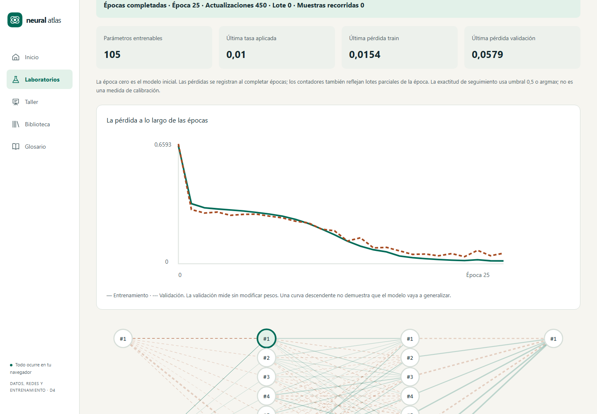

# Neural Atlas

**v1.4.0 · Descenso simultáneo y cierre técnico de X2.** [Diseño y evidencia](docs/57-cierre-x2-y-descenso-guiado.md): contornos 2D y malla 3D sincronizados, cinco ejemplos de descenso con cálculo del paso, guías contextualizadas en los laboratorios, historial de configuración de entrenamiento (50 estados), datasets UCI Iris/Wine con atribución y sonificación voluntaria en Neurona, Entrenamiento y Paisajes. D1–D10, X1 y X2 están implementados; la aceptación docente con alumnado permanece abierta.

El catálogo conserva **752 fichas: 152 actividades y 600 referencias**, incluidas [C1001–C1100](docs/56-cien-conceptos-ia.md). Los párrafos de entregas que siguen documentan sus estados históricos; el informe actual es el de v1.4.0.

Preparado el [paquete de validación docente](docs/58-validacion-docente.md): protocolo, doce actividades para los catorce laboratorios, cuestionarios antes/después, rúbrica y registros vacíos. [Descargar materiales](docs/downloads/neural-atlas-aula-v1.4.0.zip). La observación con alumnado y el acta de aceptación deben realizarse con resultados reales.

[Aplicación](https://franmatias.github.io/neural-atlas/) · [Repaso](https://franmatias.github.io/neural-atlas/#/repaso) · [Docencia](https://franmatias.github.io/neural-atlas/#/docencia) · [Sin conexión](https://franmatias.github.io/neural-atlas/#/sin-conexion)

Las notas de entregas siguientes conservan su contexto histórico. Para el estado actual, consultar la entrega de importancia X1.3, la ampliación de cien fichas y el cierre v1.1.


Laboratorio visual de aprendizaje automático para FP de especialización y universidad. Vue 3 Composition API, TypeScript, Tailwind, Pinia, Vue Router, D3 y Three.js.

**Versión 0.16.0 · catorce laboratorios disponibles, doce talleres POE y recuperación automática.** Experimenta con datos, una neurona, arquitectura/XOR, activaciones y propagación. Constructor MLP, perceptrón en Worker, mapas reales, softmax/Jacobiano y una actualización de pesos comprobable numéricamente. Entrenamiento en Worker con SGD/Momentum/RMSprop/Adam, calendarios, pasos por lote/época, pausa/cancelación y recuperación automática en RAM; evaluación de clasificación/regresión y predicción de nuevas muestras. Guarda manualmente experimentos completos en IndexedDB, recupera el siguiente lote después de recargar e importa/exporta JSON con datos y optimizador. Exporta también modelos sin filas y predice en un espacio independiente conservando su pipeline. Generadores, fallos, split/pipeline sin fuga e intercambio CSV/JSON de datasets. Temas claro/oscuro, responsive, ajustes y animaciones regulables.



Los nuevos [laboratorios visuales de decisión](docs/43-laboratorios-visuales-de-decision.md) permiten separar dos clases o explorar tres/cuatro clases con Softmax: mapa de regiones, red sincronizada, puntos editables, pasos de entrenamiento y modelos exportables. Tienen tarjetas propias en el catálogo: **L13 · Sandbox de dos clases** y **L14 · Clasificador visual multiclase**. El recorrido actual contiene 14 laboratorios, todos disponibles; se conservan los enlaces desde Arquitectura y Clasificación.

La entrega [D7 completa](docs/44-cierre-d7.md) añade derivadas declarativas, dispersión de predicciones entre semillas, tres escenarios de deriva, comparador A/B para proyección con presupuestos por épocas/actualizaciones/tiempo y segmentos reanudables al cambiar tasa/optimizador o reiniciar pesos. Acceso a [Robustez](https://franmatias.github.io/neural-atlas/#/lab/experimentos/robustez), [Comparación](https://franmatias.github.io/neural-atlas/#/lab/experimentos) y [Entrenamiento](https://franmatias.github.io/neural-atlas/#/lab/entrenamiento). D8 reúne evaluación, funciones y ética; D9–D10 y la validación docente mantienen su alcance pendiente.

La primera entrega de [D8 · Evaluación probabilística](docs/45-evaluacion-probabilidades.md) añade en L09 Brier, fiabilidad, ROC/PR, AP y costes con selección del umbral en validación. La actividad de ética se incorpora en D8.3.

El modo [Construir una función · D8.2](docs/46-aproximacion-funciones.md) añade seno, valor absoluto y escalón, 1/2/8/32 neuronas, contribuciones exactas y reproducción de instantáneas reales. Acceso desde L10, sin sustituir la sesión activa; informes, modelos y checkpoints exportables. La actividad de ética completa el alcance funcional de D8.

[Ética y métricas por grupos · D8.3](docs/47-etica-y-cierre-d8.md) completa las cuatro historias de D8: cohortes sintéticas, dos políticas, costes por canal, soporte/denominadores, cambios y reflexión contextual, con informes locales. No se certifica justicia por exactitud ni se recomienda una política automáticamente. D9/D10 y la validación docente en aula permanecen pendientes.

[Paisajes de pérdida · D9.1](docs/48-paisajes-perdida.md) incorpora L07: contornos D3 y malla Three.js, cuatro optimizadores, clipping, reproducción y cortes reales de dos parámetros de una red congelada. La CNN, los talleres restantes de D9 y D10 siguen en desarrollo.

[Del píxel al mapa · D9.2](docs/49-vision-kernels.md) incorpora L11: imagen dibujable, kernels 3×3/5×5, correlación cruzada, padding, stride, ReLU y max-pooling con inspectores y reproducción. No entrena una CNN. Los talleres restantes de D9 y D10 siguen pendientes.

[Talleres de investigación · D9.3](docs/50-talleres-investigacion.md) completa T01–T12 y añade ocho casos de diagnóstico con modos seguros, hipótesis, evidencia, reflexión y experimentos reproducibles exportables. D10 y la aceptación docente en aula continúan pendientes.

## Arrancar

Node **24.19.0**; versión indicada también en `.nvmrc`.

```powershell
npm ci --ignore-scripts
npm run dev
```

Abre [Neural Atlas local](http://127.0.0.1:5173/neural-atlas/). Para producción: `npm run build` y `npm run preview` (puerto 4173).

## Verificar

```powershell
npm run check
npx playwright install chromium firefox webkit
npm run test:e2e
```

Tipos, lint, unidades/integración, cobertura con umbrales, build, presupuesto y documentación. Playwright comprueba recorridos, accesibilidad automática, teclado, persistencia, temas, responsive y CSP sobre producción. Informes: `coverage/` y `playwright-report/`.

La [entrega D4](docs/29-implementacion-d4.md) describe entrenamiento, evaluación, recuperación, presupuesto y límites. D4 incorporó 25 recorridos por motor, incluidos Workers nativos, pérdida de conexión y P-Max.

El [primer incremento D5](docs/30-biblioteca-d5.md) incorporó biblioteca transaccional, revisiones entre pestañas, archivos reproducibles y seis recorridos adicionales por motor. Su evidencia histórica de 0.6.1 recoge 236 pruebas unitarias/integración, 93 recorridos en CI y cobertura de líneas del 97,32%.

El [segundo incremento D5](docs/31-modelos-inferencia-d5.md) añade archivos `neural-atlas.model` de hasta 8 MiB e inferencia en Worker sin las filas ni el optimizador. Importar un modelo conserva el laboratorio. Incluye clasificación binaria/multiclase, regresión, imputación, categorías desconocidas, vector transformado y copia en memoria entre rutas. **250 pruebas unitarias/integración, 97,42% de cobertura de líneas y 35 recorridos por motor (105 en CI)**. Guardado manual de experimentos; D5 y la puerta MVP siguen abiertos.

El [tercer incremento D5](docs/32-taller-poe-d5.md) incorpora cinco talleres con medidas reales, actividades compartibles y evidencias exportables. **267 pruebas unitarias/integración y 44 recorridos por motor (132 en CI)**. La migración de IndexedDB conserva los experimentos anteriores; se comprueban recarga, almacenamiento denegado y conflictos entre pestañas. La rúbrica requiere valoración humana.

El [cuarto incremento D5](docs/33-recuperacion-disco-d5.md) conserva dos puntos de recuperación en disco, cada 30 segundos o cinco épocas y en fronteras estables. Un Worker dedicado valida y guarda la sesión completa; la recuperación es explícita y conserva Adam, cursor y bloqueo de test. **275 pruebas unitarias/integración y 48 recorridos por motor (144 en CI)**. La copia automática está limitada a 10 MiB por slot, sin desalojar Biblioteca.

El [primer incremento D6](docs/34-generalizacion-d6.md) incorpora L08: comparación emparejada de L1, L2 y recorte global con curvas reales y test reservado. Los controles también están disponibles en L06, con normas antes/después, objetivo separado de pérdida de datos, exportación v2 y reanudación exacta. **295 pruebas unitarias/integración y 53 recorridos por motor (159 en CI)**. Ese incremento incorporó lectura de experimentos v1 y v2.

El [segundo incremento D6](docs/35-parada-temprana-d6.md) añade parada temprana con restauración completa del mejor estado, trayectoria observada, continuación explícita y comparación L08. Lee experimentos v1/v2/v3. **314 pruebas unitarias/integración y 57 recorridos por motor (171 en CI)**. D6 sigue abierto para dropout, BN, aumento de datos y comparación multisemilla.

El [tercer incremento D6](docs/36-dropout-d6.md) incorpora dropout invertido por muestra, visualización de máscaras reales, comparación con la red completa y estado aleatorio reproducible al recuperar o restaurar el mejor modelo. Lee experimentos v1–v4 y conserva el formato de inferencia v1. **336 pruebas unitarias/integración y 60 recorridos por motor (180 en CI)**. BN, aumento de datos y comparación multisemilla siguen pendientes.

El [cuarto incremento D6](docs/37-normalizacion-lotes-d6.md) añade normalización por lotes real, gamma/beta entrenables, medias móviles y exploración de la transformación. Se combina con dropout y parada temprana, conserva la cola de una muestra y exporta experimentos v5 y modelos de inferencia v2. **367 pruebas unitarias/integración y 63 recorridos por motor (189 en CI)**. Aumento de datos y comparación multisemilla siguen pendientes.

El [quinto incremento D6](docs/38-aumento-datos-d6.md) añade aumento conservador de train para círculos y XOR: copias fijas, oráculo de etiqueta, radio/margen acotados y rechazo trazable. El pipeline y las métricas conservan los originales; el presupuesto declara filas y actualizaciones adicionales. Lee experimentos v1–v6 y mantiene los modelos de inferencia v1/v2. **385 pruebas unitarias/integración y 66 recorridos por motor (198 en CI)**. La comparación multisemilla se incorpora en el siguiente incremento.

El [sexto incremento D6](docs/39-comparacion-multisemilla-d6.md) añade 3/5/10 parejas con datos fijos y semillas de entrenamiento distintas, diferencias emparejadas, media y desviación muestral, gráfico D3 y exportación del informe. Cada ensayo conserva su inspección, exportación y apertura explícita. **398 pruebas unitarias/integración y 68 recorridos por motor (204 en CI)**. D6 mantiene pendientes las curvas por tamaño de datos/capacidad de RF-042 y su aceptación global; después continúa D7.

El [séptimo incremento D6](docs/40-capacidad-y-tamano-d6.md) compara tres arquitecturas y curvas con 24/48/72 filas de train anidadas, validación fija y pipelines reajustados sin fuga. Incluye 3/5 semillas, dispersión, exportación e inspección de 27/45 ensayos y recuperación del subconjunto exacto. **414 pruebas unitarias/integración y 71 recorridos por motor (213 en CI)**. Dataset v2 solo para selecciones; los datasets ordinarios mantienen v1. El bloque técnico D6 está implementado; siguen D7–D10 y la validación docente.

El [primer incremento D7](docs/41-experimentos-y-validacion-cruzada-d7.md) abre L12: comparador A/B con hipótesis, diferencias y sondas compartidas, y CV aleatoria/estratificada/por grupos con K=2–10. Cada fold ajusta desde cero su pipeline y modelo, sin early stopping ni evaluación del test final. Informe ponderado, modelos y experimentos exportables, dataset v3 y recuperación del fold en disco. **433 pruebas unitarias/integración y 77 recorridos por motor (231 en CI)**. D7 conserva pendientes transformaciones avanzadas, deriva, segmentos y ampliación de proyección.

El [segundo incremento D7](docs/42-escalado-robusto-d7.md) incorpora mediana/IQR en L01 y L12, parámetros visibles y comparación de escaladores con train aislado. Conserva los formatos anteriores y permite recuperar experimentos v7 y predecir con modelos v3 sin dataset.

La [entrega D3](docs/26-implementacion-d3.md) documenta uso, arquitectura, contratos y límites: 184 pruebas unitarias/integración y 98,74% de cobertura de líneas. En D3 se verificaron 18 recorridos por motor; CI exige Chromium, Firefox y WebKit en Linux. [D1](docs/23-implementacion-d1.md) y [D2](docs/25-implementacion-d2.md) conservan su evidencia histórica, incluida la incidencia local de Firefox en Windows.

## Alcance y continuidad

Los datos, modelos y trazas son locales. La sesión activa vive en memoria; los experimentos guardados manualmente sobreviven a la recarga en IndexedDB y LocalStorage conserva preferencias. El entrenamiento general CPU, su evaluación básica, la biblioteca y los archivos de modelo independientes están disponibles. Los doce talleres T01–T12 incorporan hipótesis, ejecución en Worker, contraste, explicación, rúbrica manual y cuadernos locales. La recuperación automática en disco está disponible para el motor CPU actual. Los módulos de comparación, paisajes 2D/3D y visión están implementados. D10 completa el catálogo, repaso, paquetes docentes y uso sin conexión. El [diseño inicial](docs/README.md) conserva **88 requisitos funcionales, 24 no funcionales, 65 historias, 12 laboratorios, 12 talleres y 652 conceptos ampliables**. Hay **652 fichas publicadas: 152 desarrolladas y 500 de consulta**, con búsqueda bilingüe, filtros por 20 temas nuevos, [paginación numerada y tamaños ajustables](docs/28-paginador-glosario.md), y enlaces estables. Los IDs originales se conservan; C143–C146 y C151 incluyen actividad implementada; el alcance técnico de X1 está completo. La [ampliación editorial](docs/27-ampliacion-conceptos.md) documenta cada ficha y cómo seguir ampliando el catálogo. Hay 30 diagramas Mermaid en el catálogo y veinticuatro adicionales en los documentos de D5/D6.

El proyecto original permanece en la carpeta hermana `simulador-redes-neuronales`. Repositorio independiente, commits por incremento y fusiones explícitas. [Código en GitHub](https://github.com/franmatias/neural-atlas) · [Aplicación en GitHub Pages](https://franmatias.github.io/neural-atlas/).

El [plan de despliegue continuo](docs/24-despliegue-pages.md) publica `main` después de superar todos los controles de CI y verifica la aplicación HTTPS. Los cambios en desarrollo permanecen en sus ramas hasta estar listos.
