# Diagramas de diseño

Documento generado desde los archivos `.mmd`. Editar las fuentes y ejecutar `npm run docs:diagrams`. Mermaid admite clases, secuencias y estados UML; para componentes, paquetes, actividades y despliegue se emplea flowchart como aproximación explícita, no notación UML estricta. Las fuentes son editables y no dependen de un servicio remoto.

## 01 · Contexto del sistema

Contexto, en flowchart: personas, aplicación y almacenamiento. No representa un backend.

[Fuente Mermaid](diagrams/01-contexto.mmd) · [SVG exportado](diagrams/rendered/01-contexto.svg)

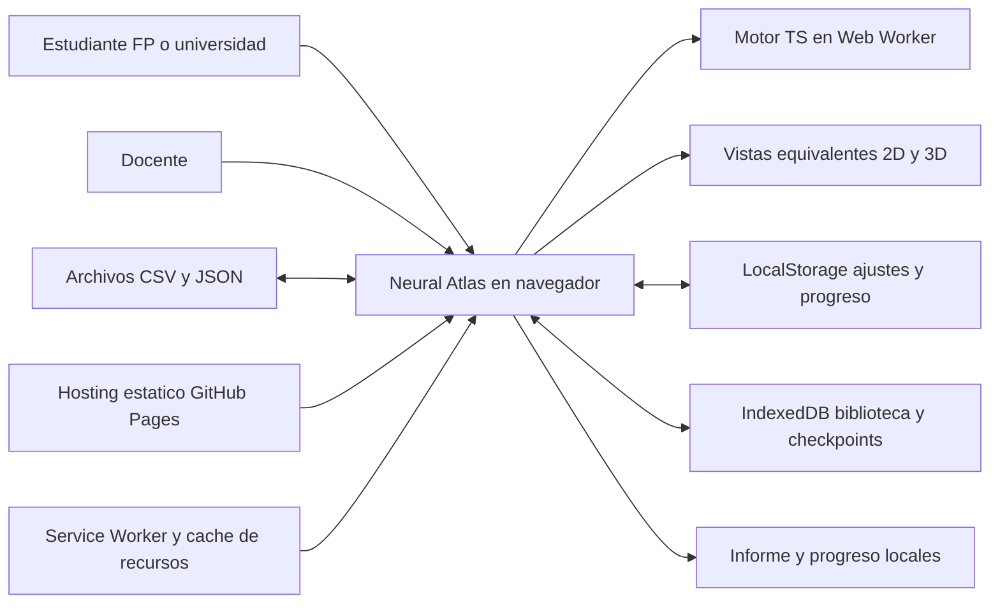

## 02 · Componentes y ejecución

Vista de componentes expresada mediante flowchart; explicita la frontera entre hilo principal y Worker.

[Fuente Mermaid](diagrams/02-componentes.mmd) · [SVG exportado](diagrams/rendered/02-componentes.svg)

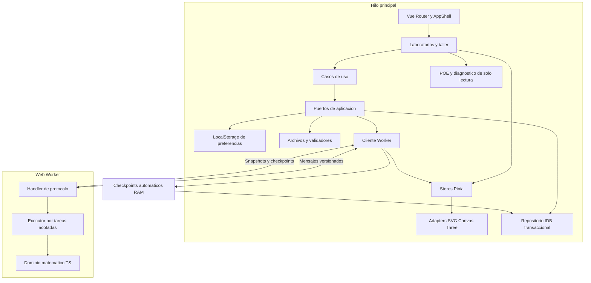

## 03 · Clases de dominio

UML de clases: composición del experimento, dataset, partición, pipeline, red y checkpoints.

[Fuente Mermaid](diagrams/03-clases-dominio.mmd) · [SVG exportado](diagrams/rendered/03-clases-dominio.svg)

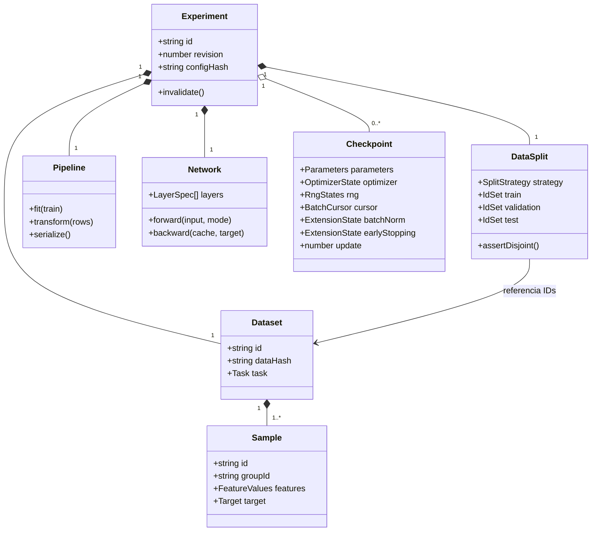

## 04 · Dependencias entre paquetes

Vista de paquetes aproximada en flowchart; las flechas indican importaciones permitidas.

[Fuente Mermaid](diagrams/04-paquetes.mmd) · [SVG exportado](diagrams/rendered/04-paquetes.svg)

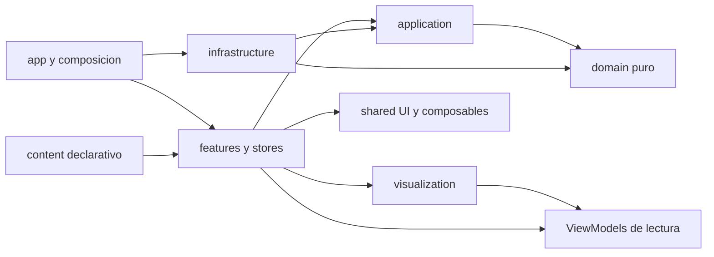

## 05 · Secuencia de entrenamiento

UML de secuencia: INIT, RUN, snapshots y finalización. Los mensajes están versionados.

[Fuente Mermaid](diagrams/05-secuencia-entrenamiento.mmd) · [SVG exportado](diagrams/rendered/05-secuencia-entrenamiento.svg)

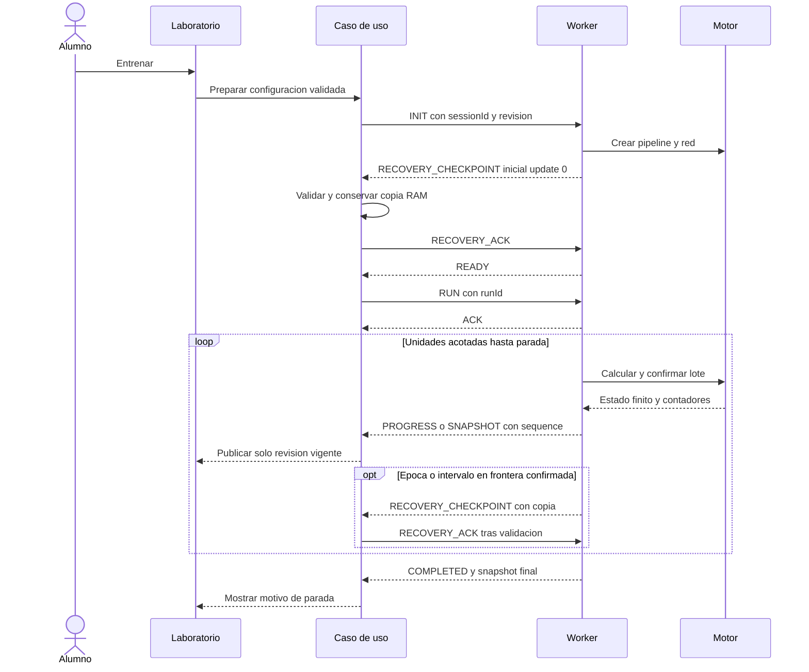

## 06 · Secuencia de importación

UML de secuencia: comprobar tamaño, mapear columnas y confirmar una sesión válida.

[Fuente Mermaid](diagrams/06-secuencia-importacion.mmd) · [SVG exportado](diagrams/rendered/06-secuencia-importacion.svg)

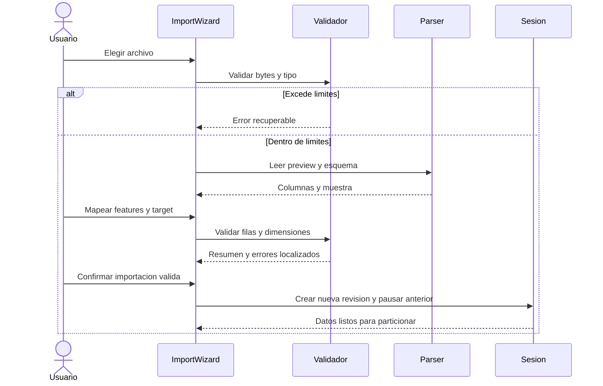

## 07 · Estados de sesión

UML de estados: ejecución, pausa, cancelación y recuperación. Cerrar mientras se ejecuta exige cancelar primero.

[Fuente Mermaid](diagrams/07-estados-sesion.mmd) · [SVG exportado](diagrams/rendered/07-estados-sesion.svg)

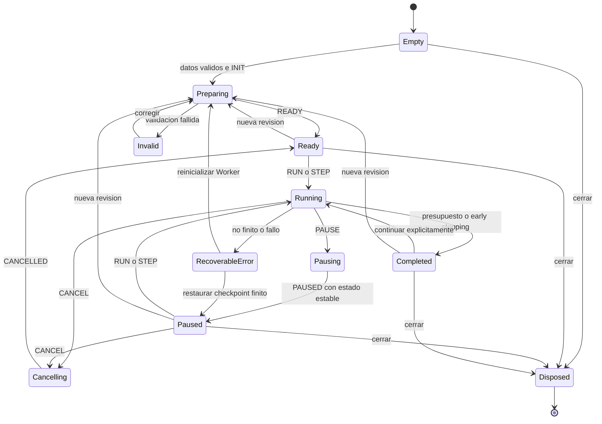

## 08 · Actividad del pipeline

Actividad representada en flowchart: ajustar solo con train y reservar test hasta congelar selección.

[Fuente Mermaid](diagrams/08-actividad-pipeline.mmd) · [SVG exportado](diagrams/rendered/08-actividad-pipeline.svg)


## 09 · Secuencia de guardado

UML de secuencia: checkpoint estable, presupuesto y transacción IndexedDB con revisión y rollback.

[Fuente Mermaid](diagrams/09-secuencia-guardado.mmd) · [SVG exportado](diagrams/rendered/09-secuencia-guardado.svg)

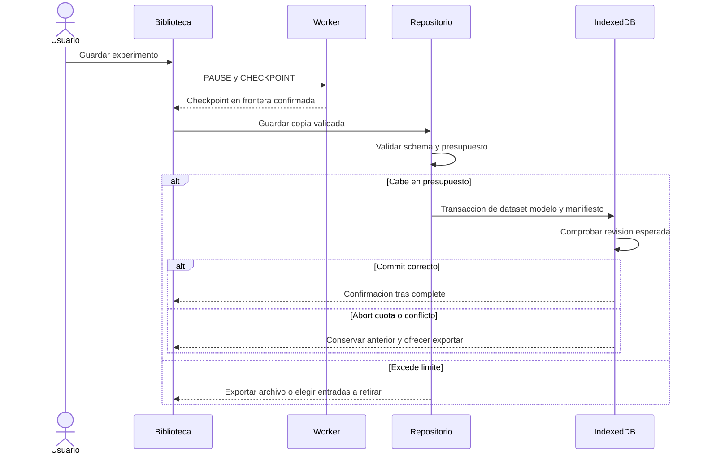

## 10 · Estados de una actividad

UML de estados: hipótesis, experimento, observación y reflexión, con reintentos.

[Fuente Mermaid](diagrams/10-estados-taller.mmd) · [SVG exportado](diagrams/rendered/10-estados-taller.svg)

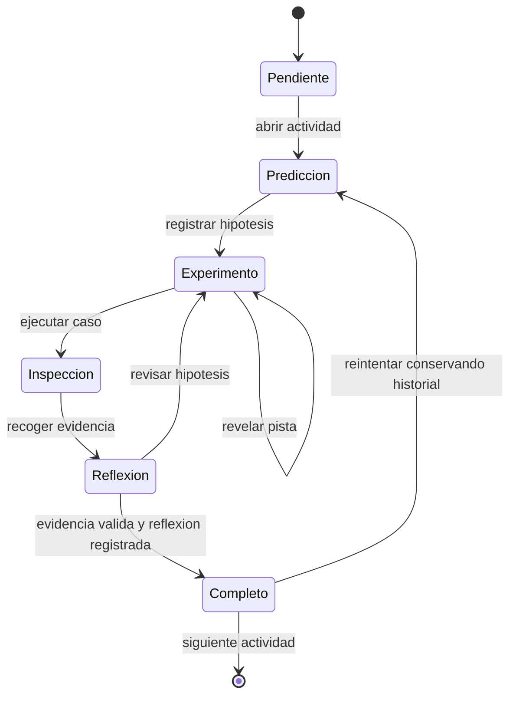

## 11 · Despliegue estático

Vista de despliegue aproximada mediante flowchart. CI y Pages son futuros, no un remoto ya creado.

[Fuente Mermaid](diagrams/11-despliegue.mmd) · [SVG exportado](diagrams/rendered/11-despliegue.svg)

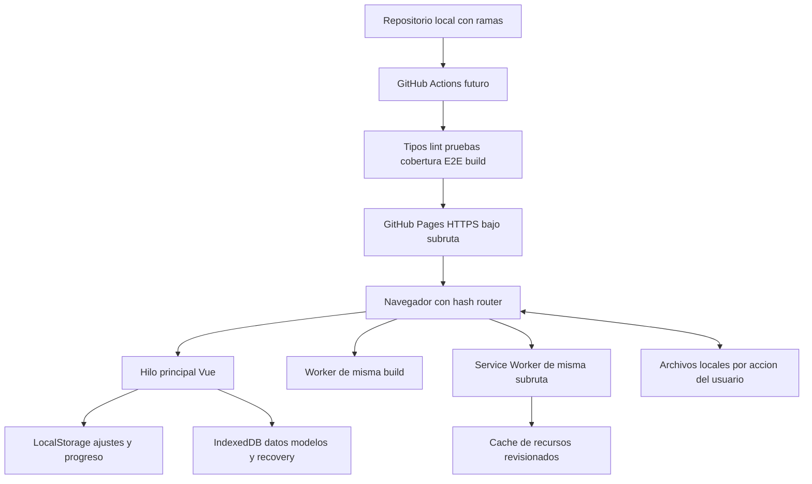

## 12 · Flujo Git de desarrollo

gitGraph ilustrativo del proceso acordado, no una copia del historial real ni trabajo funcional ya realizado.

[Fuente Mermaid](diagrams/12-flujo-git.mmd) · [SVG exportado](diagrams/rendered/12-flujo-git.svg)

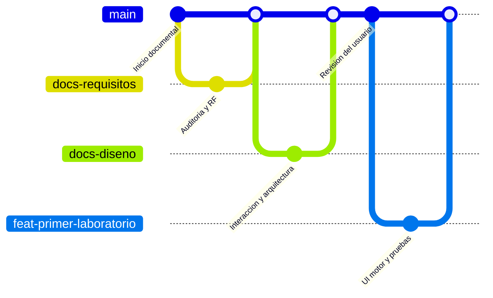

## 13 · Clases de optimizadores

UML de clases: implementaciones de un contrato pequeño y scheduler independiente.

[Fuente Mermaid](diagrams/13-clases-optimizadores.mmd) · [SVG exportado](diagrams/rendered/13-clases-optimizadores.svg)

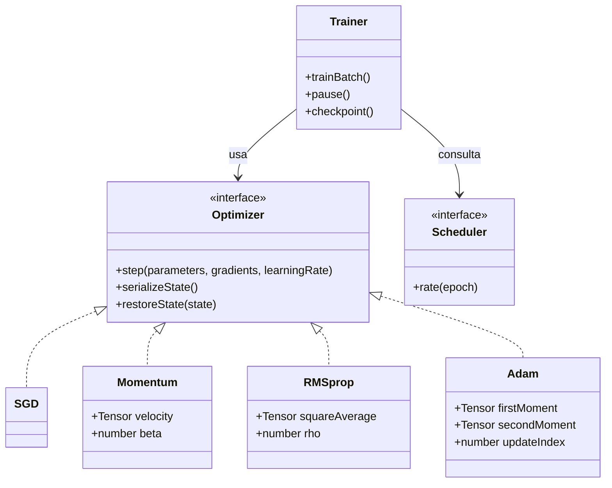

## 14 · Cancelación y revisión

UML de secuencia: descartar cálculo parcial, nueva revisión y watchdog ante fallo.

[Fuente Mermaid](diagrams/14-secuencia-cancelacion.mmd) · [SVG exportado](diagrams/rendered/14-secuencia-cancelacion.svg)

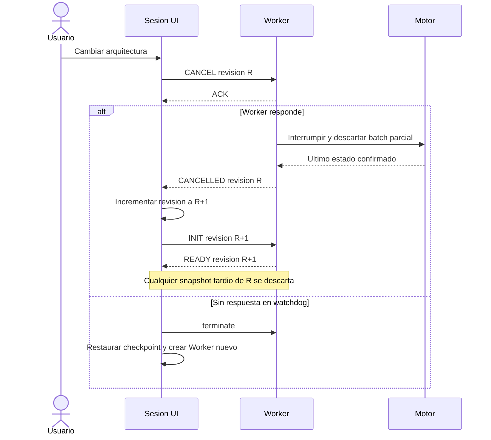

## 15 · Recorrido de aprendizaje

Mapa didáctico en flowchart: dependencias recomendadas, sin bloquear exploración libre.

[Fuente Mermaid](diagrams/15-recorrido.mmd) · [SVG exportado](diagrams/rendered/15-recorrido.svg)

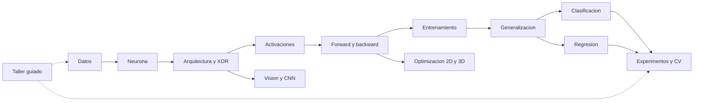

## 16 · Catálogo abierto

UML de clases: conceptos y paquetes versionados; sin máximo global ni enum cerrado de IDs.

[Fuente Mermaid](diagrams/16-clases-catalogo-abierto.mmd) · [SVG exportado](diagrams/rendered/16-clases-catalogo-abierto.svg)

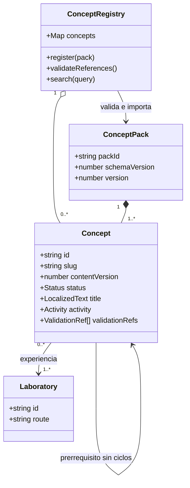

## 17 · Secuencia de validación cruzada

UML de secuencia: reconstruir pipeline/modelo por fold y conservar test fuera de selección.

[Fuente Mermaid](diagrams/17-secuencia-validacion-cruzada.mmd) · [SVG exportado](diagrams/rendered/17-secuencia-validacion-cruzada.svg)

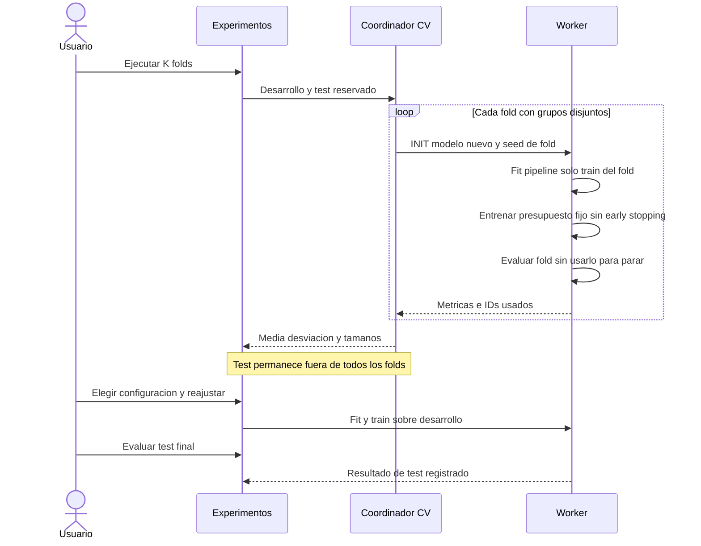

## 18 · Estados offline y actualización

UML de estados: descarga completa comprobada y activación después de guardar/detener sesión.

[Fuente Mermaid](diagrams/18-estados-offline.mmd) · [SVG exportado](diagrams/rendered/18-estados-offline.svg)

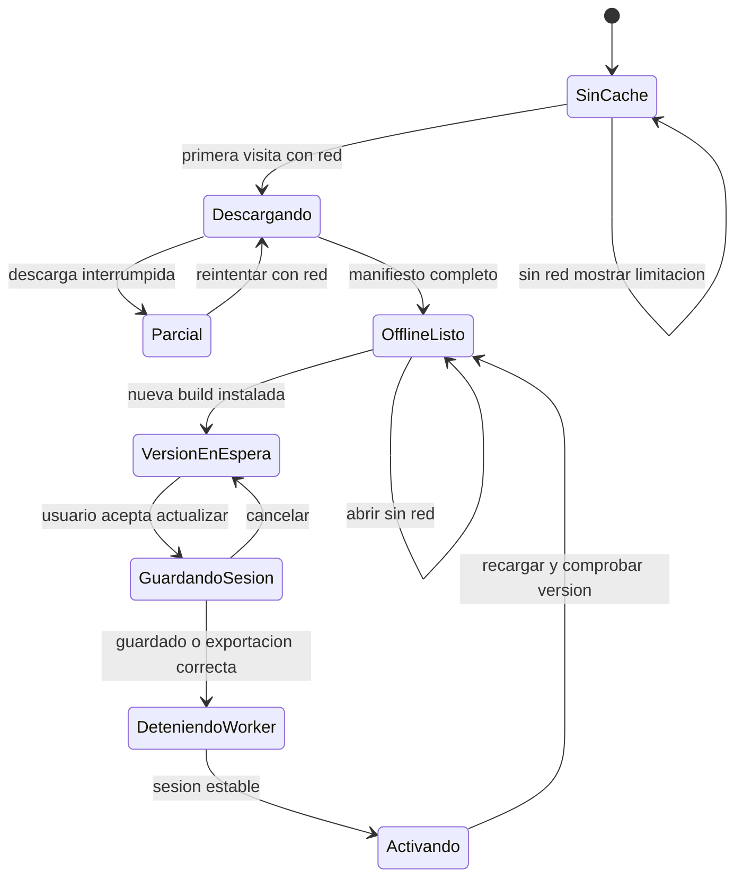

## 19 · Clases del taller

UML de clases: definición declarativa, pasos, reglas y progreso local compatible.

[Fuente Mermaid](diagrams/19-clases-taller.mmd) · [SVG exportado](diagrams/rendered/19-clases-taller.svg)

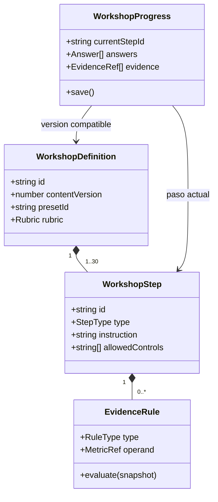

## 20 · Actividad de retropropagación

Actividad en flowchart: acumular gradientes antes de mutar parámetros y confirmar solo valores finitos.

[Fuente Mermaid](diagrams/20-actividad-backprop.mmd) · [SVG exportado](diagrams/rendered/20-actividad-backprop.svg)


## 21 · Secuencia BN cooperativa

UML de secuencia: troceo por capa/fase con estadísticas completas y descarte atómico de candidato.

[Fuente Mermaid](diagrams/21-secuencia-bn-cooperativa.mmd) · [SVG exportado](diagrams/rendered/21-secuencia-bn-cooperativa.svg)

```mermaid
sequenceDiagram
  participant C as Controlador
  participant W as Worker
  participant B as Estado candidato del batch
  W->>B: Guardar RNG y estado confirmado anterior
  loop Por cada capa
    loop Bloques dense de filas y columnas
      W->>B: Calcular bloque y ceder al event loop
    end
    W->>B: Reducir estadisticas del lote completo
    W->>B: Normalizar por bloques usando mismas estadisticas
  end
  W->>B: Backward con reducciones BN completas
  alt Llega PAUSE o CANCEL en un yield
    C->>W: PAUSE o CANCEL
    W->>B: Descartar candidato y restaurar RNG
    W-->>C: Estado estable sin paso parcial
  else Batch finaliza finito
    W->>B: Confirmar parametros optimizador BN y cursor
    W-->>C: Snapshot confirmado
  end
```

## 22 · Estados de predicción previa

UML de estados: guardar hipótesis antes de actuar y contrastar con resultado o indeterminación.

[Fuente Mermaid](diagrams/22-estados-prediccion.mmd) · [SVG exportado](diagrams/rendered/22-estados-prediccion.svg)

```mermaid
stateDiagram-v2
  [*] --> Libre
  Libre --> Baseline: activar POE y elegir accion
  Baseline --> Hipotesis: congelar snapshot
  Hipotesis --> Ejecutando: guardar prediccion antes de aplicar
  Ejecutando --> Observado: resultado finito del presupuesto
  Ejecutando --> Indeterminado: cancelar error o evidencia insuficiente
  Observado --> Reflexion: contrastar regla declarativa
  Indeterminado --> Reflexion: describir limites
  Reflexion --> Libre: guardar evidencia y continuar
  Hipotesis --> Libre: cancelar sin aplicar
```

## 23 · Diagnóstico por evidencia

Flujo de reglas deterministas, con soporte y ventanas, que propone hipótesis sin afirmar causas.

[Fuente Mermaid](diagrams/23-diagnostico.mmd) · [SVG exportado](diagrams/rendered/23-diagnostico.svg)

```mermaid
flowchart LR
  Engine[Motor y backward] --> Summary[Resumen real por capa y split]
  Summary --> Revision{Mismo run y revision}
  Revision -->|No| Drop[Descartar evento antiguo]
  Revision -->|Si| Window[Ventanas y soporte minimo]
  Window --> Rules[Reglas deterministas versionadas]
  Rules --> Evidence[Condicion y valores observados]
  Evidence --> Hypothesis[Hipotesis con limites]
  Hypothesis --> Link[Concepto y experimento sugerido]
  Link --> Student[Alumno decide que contrastar]
```

## 24 · Clases de aprendizaje

UML de clases: POE, reglas, plantilla editorial alineada, guía docente y evidencia.

[Fuente Mermaid](diagrams/24-clases-aprendizaje.mmd) · [SVG exportado](diagrams/rendered/24-clases-aprendizaje.svg)

```mermaid
classDiagram
  class PredictionRecord {
    +string actionSpec
    +string baselineSnapshotId
    +string predictedOutcome
    +string observedSnapshotId
    +string comparisonStatus
    +string explanation
  }
  class DiagnosticRule {
    +string ruleVersion
    +WindowSpec window
    +Thresholds thresholds
    +evaluate(summary)
  }
  class Concept {
    +LocalizedText title
    +NumericExample numericExample
    +Question selfAssessment
    +ControlRef[] relatedControls
    +string targetRelease
  }
  class TeachingPack {
    +Manifest manifest
    +TeacherGuide guide
    +OptionalSolutions solutions
  }
  class EvidencePortfolio {
    +exportMarkdown()
  }
  PredictionRecord --> Concept : contrasta
  DiagnosticRule --> Concept : enlaza
  EvidencePortfolio "1" o-- "0..*" PredictionRecord
  TeachingPack --> Concept : referencias validadas
```

## 25 · Datos persistidos

Entidad-relación de registros IDB. Dataset compartido entre experimentos; no equivale a una base SQL.

[Fuente Mermaid](diagrams/25-datos-persistidos.mmd) · [SVG exportado](diagrams/rendered/25-datos-persistidos.svg)

```mermaid
erDiagram
  DATASET ||--o{ EXPERIMENT : referencia
  EXPERIMENT ||--o{ MODEL : conserva
  EXPERIMENT ||--o{ CHECKPOINT : guarda
  EXPERIMENT ||--o{ LEARNING_EVIDENCE : recoge
  MODEL ||--o{ CHECKPOINT : estado
  EXPERIMENT {
    string id PK
    number revision
    string dataHash FK
  }
  DATASET {
    string dataHash PK
    object columns
  }
  CHECKPOINT {
    string id PK
    string experimentId FK
    number update
    buffer tensors
  }
  LEARNING_EVIDENCE {
    string id PK
    string experimentId FK
    string predictionId
  }
```

## 26 · Entregas y puertas

Roadmap por dependencias: MVP 1.0, alcance original ampliado en v1.1 y propuestas v1.2.

[Fuente Mermaid](diagrams/26-entregas.mmd) · [SVG exportado](diagrams/rendered/26-entregas.svg)

```mermaid
flowchart TB
  D0[Revision documental] --> MVP
  subgraph MVP[MVP 1.0]
    direction LR
    D1[D1 Shell y neurona] --> D2[D2 Datos y pipeline]
    D2 --> D3[D3 Motor y mapas]
    D3 --> D4[D4 Worker y diagnostico]
    D4 --> D5[D5 IDB POE y talleres]
  end
  MVP --> Gate1[Pruebas y revision del MVP]
  Gate1 --> Complete
  subgraph Complete[Alcance completo v1.1]
    direction LR
    D6[D6 Generalizacion] --> D7[D7 Comparacion y CV]
    D7 --> D8[D8 Metricas y etica]
    D8 --> D9[D9 3D vision y retos]
    D9 --> D10[D10 Catalogo y PWA]
  end
  Complete --> Gate2[Pruebas y revision v1.1]
  Gate2 -.-> X[Extensiones v1.2 propuestas]
```

## 27 · Inspección implementada en D3

UML de secuencia de la implementación real: Worker de datos, snapshot, mapa, normas y cancelación.

[Fuente Mermaid](diagrams/27-d3-inspeccion.mmd) · [SVG exportado](diagrams/rendered/27-d3-inspeccion.svg)

```mermaid
sequenceDiagram
  actor Estudiante
  participant Vista as ArchitecturePage
  participant Store as ArchitectureStore
  participant Cliente as DataClient
  participant Worker as data.worker
  participant Motor as Dominio MLP
  Estudiante->>Vista: Elegir capa, neurona y muestra
  Vista->>Store: Invalidar mapa anterior
  Estudiante->>Vista: Calcular mapa
  Vista->>Store: inspect()
  Store->>Cliente: Snapshot clonable e ID
  Cliente->>Worker: inspectNetwork
  Worker->>Motor: backward y forward en rejilla 20 por 20
  Motor-->>Worker: Activaciones, histogramas y normas
  Worker-->>Cliente: Resultado con ID
  alt Respuesta de trabajo vigente
    Cliente-->>Store: Resultado
    Store-->>Vista: Render SVG y tabla equivalentes
  else Cancelado o sustituido
    Cliente->>Worker: terminate()
    Note over Store,Vista: Conservar modelo, descartar respuesta tardia
  end
```

## 28 · Actualización única en D3

UML de estados de la implementación real: inspección sin mutación y aplicación protegida de un gradiente.

[Fuente Mermaid](diagrams/28-d3-actualizacion.mmd) · [SVG exportado](diagrams/rendered/28-d3-actualizacion.svg)

```mermaid
stateDiagram-v2
  [*] --> Snapshot: Ejemplo 2 a 2 a 1
  Snapshot --> Inspeccion: Forward y backward sin mutacion
  Inspeccion --> Inspeccion: Anterior, siguiente, reproducir o chequeo numerico
  Inspeccion --> Preparado: Elegir fase aplicar
  Preparado --> Aplicado: Confirmar paso finito con pesos anteriores
  Aplicado --> Aplicado: Recorrer traza no aplica otro paso
  Aplicado --> Snapshot: Calcular otra pasada con modelo actualizado
  Inspeccion --> Snapshot: Editar entrada, objetivo o peso
  Preparado --> Snapshot: Editar entrada, objetivo o peso
  Aplicado --> Snapshot: Editar entrada, objetivo o peso
  Aplicado --> [*]: Desmontar conserva store y detiene animacion
```

## 29 · Recuperación implementada en D4

UML de secuencia de la implementación: checkpoint cero, confirmación atómica, pausa y recuperación sin reanudación automática.

[Fuente Mermaid](diagrams/29-d4-recovery-sequence.mmd) · [SVG exportado](diagrams/rendered/29-d4-recovery-sequence.svg)

```mermaid
sequenceDiagram
    actor Alumno
    participant Vista as Vue y Pinia
    participant Cliente as TrainingClient
    participant Worker as TrainingRuntime
    participant Motor as Generadores matemáticos
    Alumno->>Vista: Inicializar con train y validación
    Vista->>Cliente: start(input sin test)
    Cliente->>Worker: INIT (identidad y revisión)
    Worker->>Motor: Inicializar y evaluar por fragmentos
    Motor-->>Worker: Estado inicial confirmado
    Worker-->>Cliente: RECOVERY_CHECKPOINT (update 0)
    Cliente->>Cliente: Validar y conservar dos copias RAM
    Cliente->>Worker: RECOVERY_ACK (update 0)
    Worker-->>Cliente: READY
    Cliente-->>Vista: Modelo preparado
    Alumno->>Vista: Entrenar o dar un paso
    Vista->>Cliente: Acción solicitada
    Cliente->>Worker: RUN / STEP_BATCH / STEP_EPOCH
    loop Cada lote
        Worker->>Motor: Candidato por fragmentos de cálculo
        Motor-->>Worker: Modelo y momentos finitos
        Worker->>Worker: Confirmar pesos, momentos y cursor juntos
        opt Época completa o 2 s y sin copia pendiente
            Worker-->>Cliente: RECOVERY_CHECKPOINT
            Cliente->>Worker: RECOVERY_ACK del update recibido
        end
    end
    Alumno->>Vista: Pausar o cancelar
    Vista->>Cliente: Acción solicitada
    Cliente->>Worker: PAUSE o CANCEL
    Worker->>Worker: Descartar candidato incompleto
    Worker-->>Cliente: Estado confirmado y checkpoint
    Cliente-->>Vista: Presentar último estado estable
    opt Worker sin respuesta durante más de 2 s
        Cliente->>Cliente: Terminar Worker y elevar revisión
        Cliente->>Worker: INIT con último checkpoint validado
        Worker-->>Cliente: Checkpoint restaurado
        Cliente->>Worker: RECOVERY_ACK
        Worker-->>Cliente: READY detenido
        Cliente-->>Vista: Estado restaurado con bloqueo frozen conservado
    end
```

## 30 · Estados implementados en D4

UML de estados de entrenamiento y congelación: consultar test nunca habilita más aprendizaje en la misma sesión.

[Fuente Mermaid](diagrams/30-d4-training-state.mmd) · [SVG exportado](diagrams/rendered/30-d4-training-state.svg)

```mermaid
stateDiagram-v2
    direction LR
    state "Inicialización" as init
    state "Detenido (ready, paused,
cancelled o completed)" as stable
    state "Entrenamiento" as running
    state "Congelado" as frozen
    state "Recuperación" as recovering
    state "Restaurado y detenido
ready o frozen" as restored
    [*] --> init
    init --> stable: Checkpoint cero confirmado
    stable --> running: RUN o paso si quedan épocas
    running --> stable: Pausa, cancelación o fin
    stable --> frozen: Congelar antes de test
    running --> recovering: Worker sin respuesta
    frozen --> recovering: Worker sin respuesta
    recovering --> restored: Último checkpoint validado
    frozen --> [*]: Nueva sesión
    restored --> [*]: Esperar decisión del alumno
    note right of frozen: Permite inferencia y test, nunca aprendizaje
    note right of restored: Conserva congelación y consulta de test
```

