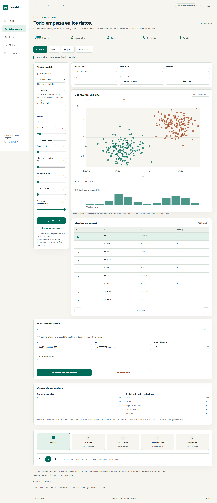

# Entrega D2 · datos reproducibles y preparación sin fuga

Versión 0.4.0. Implementa L01 y US-006–US-011 después de D1. [Abrir laboratorio](https://franmatias.github.io/neural-atlas/#/lab/datos). La especificación general continúa en [laboratorios](05-laboratorios.md), [contratos](11-datos-y-protocolo-worker.md) e [historias](14-historias-y-plan-git.md).

[Tema oscuro](implementation/d2-dark.png) · [Móvil](implementation/d2-mobile.png) · [Pipeline aprendido](implementation/d2-pipeline.png).

## Recorrido docente

1. En **Explorar**, elige una situación o un ejemplo práctico. Los controles son un borrador: solo «Generar y sustituir datos» reemplaza el dataset. La semilla se conserva al elegir un ejemplo. Cambiar un control muestra «Experimento personalizado» si deja de coincidir con un preset.
2. Compara nubes, lunas, círculos, XOR, espirales, flores simuladas, consumo energético y regresión sinusoidal. Las flores no son Iris; el consumo es una fórmula didáctica y no un modelo físico. Hay cuatro escenarios preparados: sin fallos añadidos, desequilibrio 95/5, unidades distintas con atípicos y copias que deben permanecer juntas.
3. Introduce ruido, atípicos, alteración parcial de etiquetas, faltantes o duplicados. La procedencia registra los fallos inducidos; no es un detector automático de anomalías externas. La etiqueta anterior al fallo se conserva en la anotación. Las tasas aleatorias realizadas pueden diferir de las solicitadas.
4. Selecciona la misma muestra en mapa, tabla e inspector. Las flechas recorren IDs; Intro selecciona. Puedes añadir, mover, modificar o eliminar muestras. La tabla pagina todas las filas; el mapa dibuja como máximo 1500 más la seleccionada y comunica omisiones. Sus ejes se pueden cambiar y el histograma sigue la característica horizontal.
5. En **Dividir**, crea conjuntos por IDs. Consulta proporciones realmente logradas, soporte por clase y advertencias. Los grupos nunca se separan. Las muestras sin objetivo quedan fuera de los conjuntos de aprendizaje, disponibles para transformación e inferencia futura.
6. En **Preparar**, selecciona características, imputación, escalado e indicadores de faltantes. Ajusta una vez exclusivamente con train; consulta las estadísticas y vocabularios aprendidos. En Explorar puedes alternar original/preparado y filtrar train/validación/test. La animación muestra el recorrido calculado y distingue fases pendientes; no vuelve a ajustar ni modifica datos.
7. En **Intercambiar**, exporta o importa. La vista previa y validación preparan un candidato; una confirmación independiente sustituye el dataset. Cancelar, cambiar de archivo o recibir un error conserva el anterior.

Cambiar muestras invalida tanto la partición como el pipeline. Volver a dividir invalida el pipeline. Los datasets viven en RAM y se conservan entre rutas; recargar reinicia la sesión. Exporta JSON para conservarlos. LocalStorage sigue reservado a preferencias; la biblioteca IndexedDB pertenece a D5.

## Arquitectura implementada

| Carpeta | Responsabilidad |
|---|---|
| `src/domain/random` | Mulberry32, derivación FNV-1a por propósito y normal Box–Muller |
| `src/domain/data` | Tipos, validación, generación, edición inmutable, perfil, split, estadística, ajuste/transformación y hashes |
| `src/application/data` | Casos de uso, esquema JSON cerrado Zod, análisis CSV con Papa Parse y errores serializables |
| `src/infrastructure/workers` | Worker dedicado, correlación por ID, cancelación y liberación del proceso |
| `src/infrastructure/files` | Límites previos a lectura, decodificación UTF-8 estricta y descarga con Blob |
| `src/stores/datasets.ts` | Coordinación Pinia, revisión, selección e invalidación de derivados |
| `src/features/datasets` | Página y ocho componentes: controles, mapa D3/SVG, tabla, inspector, split, pipeline, intercambio y traza |
| `src/content` y `src/app/i18n/messages/data-es.ts` | Recetas, veinte conceptos nuevos publicados y textos traducibles |

El dominio no depende de Vue, DOM, almacenamiento, reloj ni `Math.random`; lint verifica estas fronteras. Los trabajos de generación, split, preparación e intercambio se ejecutan en un Web Worker de datos. La vista inicial usa un pequeño dataset de 300 muestras. El Worker de entrenamiento y su protocolo avanzado siguen en D4; este proceso no simula entrenamiento.

El cliente crea un Worker por operación, acepta únicamente su respuesta identificada y lo termina al finalizar, cancelar o sustituir el trabajo. Los objetos transferidos son datos clonables, sin proxies de Vue. El parser, el esquema y los hashes quedan en el chunk independiente del Worker. El SHA-256 procede de `@noble/hashes`; la codificación UTF-8 y serialización canónica tienen pruebas contra un oráculo de Node.

## Invariantes de los cálculos

- **Reproducibilidad:** semilla entera uint32, versión 1 y flujos separados de generación y fallos. Los vectores de referencia están en [rng-v1.json](fixtures/rng-v1.json). Añadir faltantes no cambia la secuencia de etiquetas alteradas. El número final incluye duplicados.
- **Partición:** aleatoria, estratificada, por grupos, estratificada por grupos o temporal. Ratios suman uno y se solicita al menos un 10 % por conjunto. La asignación estratificada usa restos mayores; los empates favorecen train, validación y test. Un grupo activa una estrategia por grupos automáticamente. La asignación agrupada minimiza una función de desvío con barridos de intercambio acotados; muestra resultados reales sin prometer ratios exactos.
- **Tiempo:** marcas UTC ISO válidas; grupos con intervalos solapados y tiempos iguales forman bloques indivisibles. Los cortes respetan el orden. No se aplica barajado temporal. Un reparto inviable conserva el resultado y muestra soporte insuficiente para entrenar; no inventa conjuntos.
- **Soporte:** el informe marca como insuficiente para entrenar una clasificación con menos de dos ejemplos por clase en train o menos de uno en cada conjunto restante; menos de cinco en validación/test produce advertencia de inestabilidad. Preparar características sigue siendo posible para inspeccionar estadísticas si train no está vacío; la puerta del futuro entrenamiento deberá consumir ese mismo resultado de validación.
- **Preparación:** seleccionar → imputar → codificar → escalar. Media, mediana o moda numérica y moda categórica, aprendidas solo de train. El vocabulario reserva siempre una columna para desconocidos. Las columnas enteramente vacías en train se bloquean. Las constantes producen cero al escalar; el estado usa denominador interno uno. Z-score utiliza desviación poblacional. Min-Max no recorta validación/test: un valor externo puede superar uno.
- **Integridad:** el hash canónico incluye orden y contenido de muestras, esquema y objetivo; ID/revisión del contenedor no alteran su identidad matemática. Un split importado se valida contra datos, IDs, estrategia y reproducción determinista. Toda edición incrementa revisión y obliga a recalcular derivados.

Ejemplo para explicar fuga: si train contiene 0 y 10, Min-Max aprende mínimo 0 y máximo 10; una muestra de validación con valor 100 se transforma en 10. Incluirla en el ajuste para conseguir un resultado entre 0 y 1 revelaría información de validación. El test unitario comprueba este comportamiento y categorías desconocidas sin volver a ajustar.

## Intercambio y límites

| Recurso | Límite o contrato |
|---|---|
| Generación | 20–10 000 muestras finales; ruido 0–1; atípicos/duplicados 0–20 %, etiquetas/faltantes 0–30 %, minoría 5–50 % |
| Dataset | Hasta 10 000 filas, 63 características más objetivo; clasificación 2–10 clases |
| CSV | 16 MiB UTF-8, hasta 64 columnas incluyendo metadatos; separador coma, punto y coma o tabulación elegido explícitamente |
| JSON | 32 MiB UTF-8, profundidad máxima 20, texto de celda máximo 4096 caracteres |
| Pipeline | Máximo 32 características resultantes; desbordamientos numéricos se bloquean |
| Presentación | 1500 puntos más selección; tabla de 20 filas por página; cálculos sobre todas las muestras |

El CSV conserva cadenas, campos entrecomillados, saltos de línea internos y números mediante Papa Parse. El usuario asigna roles, tipo de objetivo y decimal punto/coma; no hay conversión automática indiscriminada ni pérdida del objetivo cero. Los errores identifican registro y columna. Excluir filas inválidas requiere una acción explícita; no se aplica silenciosamente. La descarga protege cadenas que podrían interpretarse como fórmulas de hoja de cálculo, informa del número y deja intactos los números negativos. Esa protección altera la representación CSV; JSON conserva el texto original. CSV no es un checkpoint completo del experimento.

JSON usa `format: neural-atlas.dataset`, `schemaVersion: 1`, columnas con arrays paralelos, IDs, objetivos, clases, orígenes, grupos, marcas temporales, anotaciones, receta y split opcional. Exporta hash y procedencia de versión; `recipeExact` deja de ser verdadero después de editar. El esquema rechaza claves extra, tipos inválidos y claves peligrosas. Los archivos son datos, sin expresiones ejecutables. No incluye todavía pesos de modelos ni estado completo de pipeline: su intercambio pertenece a D5.

## Evidencia de calidad

- `npm run check`: tipos, lint, 135 pruebas en nueve archivos, umbrales V8, producción, presupuesto y documentación correctos. Cobertura: 99,21 % líneas, 98,50 % sentencias, 94,42 % ramas y 97,75 % funciones. El dominio de datos tiene 100 % de líneas.
- Tests unitarios: ocho recetas, semillas/oráculos, independencia de defectos, 10 000 muestras, propiedades de partición para quince semillas, grupos/tiempo, soporte, train-only, desconocidos, límites, UTF-8, hashes y archivos adversos.
- Integración: componentes, Pinia, datos realmente clonados antes del manejador, edición/invalidez, importación candidata, lectura tardía cancelada, fallos del Worker, limpieza y ciclo de animación. Solo el mínimo bootstrap del Worker se excluye de instrumentación; cliente y manejador están cubiertos y el Worker real se prueba en navegador.
- Playwright incluye catorce recorridos por motor: los diez de D1 y cuatro de datos. Los 28 recorridos de Chromium y WebKit pasan localmente. Los nuevos cubren Worker real/grupos/pipeline, CSV inválido con exclusión y confirmación, descarga/importación JSON con el mismo hash y teclado, axe en cuatro pestañas y ambos temas, y cinco anchos de 360 a 1440 px sin desbordamiento global. No sustituyen una auditoría manual completa WCAG ni validación pedagógica en aula.
- Transferencia inicial comprimida: JS 53,63 KiB y CSS 10,02 KiB, dentro del presupuesto. D3 y el laboratorio se cargan por ruta; el proceso de datos tiene su propio recurso. No se afirma todavía el cumplimiento de los presupuestos del entrenamiento o del 3D.

La [cadena de CI y Pages](24-despliegue-pages.md) exige los tres motores en Linux antes de publicar y verifica después la dirección pública. La incidencia local de arranque de Firefox en Windows permanece documentada en [D1](23-implementacion-d1.md); no se omite Firefox en CI.

## Pendiente después de D2

D3 incorporará perceptrón/MLP, arquitectura, activaciones y recorrido de gradientes. D4 añadirá entrenamiento. Biblioteca, modelos, talleres, comparación avanzada, Three.js y offline conservan sus fases. El glosario tiene 35 conceptos desarrollados y enlazados a los dos laboratorios disponibles; el catálogo abierto de 152 conceptos continúa siendo el alcance de diseño.
