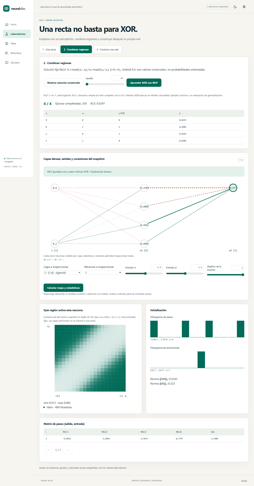

# Entrega D3 · de una recta al gradiente

Versión 0.5.0. Añade L03, L04 y L05: cinco laboratorios disponibles en total. El motor calcula los números mostrados; las animaciones inspeccionan snapshots y no sustituyen al aprendizaje.

[Perceptrón y frontera](implementation/d3-perceptron.png) · [Activaciones](implementation/d3-activations.png) · [Propagación en oscuro](implementation/d3-propagation.png) · [Móvil](implementation/d3-mobile.png).

## Historias y aceptación implementadas

| Historia | Resultado observable | Evidencia |
|---|---|---|
| US-014 | Rosenblatt aprende AND; XOR muestra presupuesto, testigo 3/4 y contradicción algebraica. MLP aprende los cuatro vértices | Unidades y E2E de arquitectura |
| US-015 | Constructor 0–6 ocultas, 1–64 neuronas, 1–32 entradas, tarea compatible y contador de parámetros | Validadores, topología máxima, matrices y UI |
| US-016 | Cero/Xavier/He reproducibles; histogramas de pesos/activaciones y normas reales por capa | Unidades de inicialización, inspector y panel avanzado |
| US-017 | Seis funciones escalares, derivadas, α ajustable, zoom, cadena y softmax vectorial/Jacobiano | Diferencias finitas, controles y E2E |
| US-018 | Forward, backward, nueve gradientes y una aplicación protegida | Gradiente por parámetro, pruebas de inmutabilidad y intento repetido/recorrido |
| US-019 | Lotes sembrados por época, IDs completos, cola y contador separado | Propiedades del muestreador, integración y UI |
| US-049 | Mapa de neurona seleccionada calculado con forward del snapshot y alternativa tabular | Oráculo punto a punto, Worker real y E2E |

## L03 · arquitectura y XOR

[Abrir arquitectura](https://franmatias.github.io/neural-atlas/#/lab/arquitectura).

El recorrido comienza con una recta: elige AND o XOR, semilla, tasa 0,001–1 y presupuesto 1–1000 épocas. Rosenblatt usa `e=y−step(w·x+b)`, `w←w+ηex`, `b←b+ηe`, pesos iniciales cero y orden sembrado por época. Para cuando una época completa no comete errores o termina el presupuesto. Conserva el mejor estado entre el inicial y los finales de época, con primer empate. La frontera y su deslizador usan los pesos realmente guardados; el informe distingue errores durante el recorrido de aciertos del snapshot final. Agotar presupuesto no prueba no separabilidad de un dataset arbitrario. Para los cuatro vértices XOR sí se aporta la contradicción algebraica.

La segunda parada separa dos resultados: una construcción fija `ReLU(x₁−x₂)+ReLU(x₂−x₁)` y un MLP aprendido `2→4→1`, tanh/sigmoid, BCE y descenso simple de lote completo con η=0,5, hasta 6000 épocas. La construcción tiene salida lineal y no se presenta como probabilidad. El MLP detiene el ejemplo cuando logra 4/4 y BCE menor de 0,03, o agota presupuesto. Se prueban semillas 7, 42 y 123. La etiqueta sobre el diagrama identifica si el modelo es inicializado, construido o aprendido. Resolver cuatro puntos no demuestra generalización.

El constructor admite cero capas ocultas y las dimensiones máximas de diseño. La salida se deriva de tarea: binaria 1/sigmoid/BCE, multiclase K/softmax/CE, regresión 1/lineal/MSE. El escalón no se ofrece como activación de backprop. Un borrador inválido no reemplaza el modelo. La topología máxima `32→64→64→64→64→64→64→10` suma 23 562 parámetros densos; BN no está implementada en D3. El diagrama agrupa capas grandes en doce nodos visibles, mientras que selector y tabla permiten examinar todos los parámetros.

Los mapas se solicitan explícitamente: selecciona capa, neurona, muestra y objetivo; pulsa **Calcular mapa y estadísticas**. Se evalúan 400 puntos con el mismo modelo, incluidos caminos de capas profundas. Con más de dos entradas las restantes se fijan a la muestra; con una entrada se advierte que el segundo eje no existe. La tabla contiene los mismos 400 valores. Cambiar selección o muestra invalida el resultado. El inspector muestra histogramas de pesos y activaciones de la muestra, y normas de dW/db. No confunde un histograma de una sola muestra con una distribución del dataset completo.

## L04 · activaciones y gradientes

[Abrir activaciones](https://franmatias.github.io/neural-atlas/#/lab/activaciones).

Compara lineal, escalón, sigmoid estable, tanh, ReLU y Leaky ReLU con α 0,001–0,3. Curvas de función y derivada distinguidas por línea continua/discontinua y leyenda; z entre −10 y 10 y cuatro escalas de eje. ReLU adopta derivada cero en el quiebre; Leaky usa α. Escalón muestra derivada no disponible para backprop. Una derivada muy pequeña produce explicación de saturación/inactividad.

La cadena recorre de una a veinte activaciones con `aₖ=f(aₖ₋₁)` y producto de derivadas. Ofrece índice manual, reproducción, pausa, velocidad compartida y logaritmo absoluto. Cero exacto, logaritmo −∞ y derivada no disponible se distinguen. Esta cadena aislada omite pesos y sumas de caminos; no se presenta como norma de una red ni pretende que sigmoid aislada explique explosión.

Softmax tiene entre dos y diez logits, restando el máximo antes de exponenciar; muestra vector, suma y Jacobiano completo. Los tests comprueban estabilidad con logits ±1000, invariancia ante traslación y derivadas cruzadas. La precisión finita puede representar probabilidades extremas como cero: el entrenamiento usa pérdidas desde logits y no deriva una probabilidad recortada.

El panel avanzado compara cero/Xavier/He con igual semilla, red `2→8→8→1`, muestra `[0,8;0,2]` y target 1; permite tanh/ReLU y elegir capa. Los pesos tienen las distribuciones especificadas, los sesgos empiezan en cero. Las normas proceden de backward real sin aplicar ningún paso. El inspector de L03 permite además consultar el modelo construido por el estudiante.

## L05 · del cálculo a la actualización

[Abrir propagación](https://franmatias.github.io/neural-atlas/#/lab/propagacion).

Preset `2→2→1`: primera matriz `[[0,5;−0,3],[−0,2;0,4]]`, sesgos `[0,1;−0,1]`, segunda matriz `[[0,7;−0,5]]`, sesgo `0,2`, ocultas tanh y salida sigmoid. Entrada `[0,8;0,2]`, target 1, tasa 0,1. La primera suma oculta reproduce z=0,44 de L02. Dimensiones y fórmulas se mantienen junto a las sustituciones numéricas.

Ocho fases distinguen entrada, sumas, activaciones, pérdida, gradiente de salida, cadena, acumulación y aplicación. El selector de arista muestra su peso, producto, delta y derivada. El nivel de explicación compartido cambia entre intuición, regla con valores y fórmulas formales. El recorrido de señal tiene sentido de avance y el gradiente sentido inverso; se pausa y respeta movimiento reducido y ocultación de pestaña.

**Solo Aplicar una actualización cambia parámetros**, y únicamente desde la última fase. Se confirma un nuevo modelo finito en buffers separados. La traza sigue mostrando el snapshot anterior para explicar ese cambio; volver atrás o reproducir no aplica un segundo paso. **Calcular otra pasada** toma el modelo actualizado y vuelve a habilitar una aplicación. Editar entrada, objetivo o peso crea otra traza. Reiniciar recupera el ejemplo.

El comprobador numérico usa copias, ε=10⁻⁵ y diferencias centradas para todos los pesos y sesgos. Señala cruces de quiebres ReLU/Leaky/MAE, en lugar de presentarlos como errores analíticos. Se limita a 256 parámetros para mantener el control acotado. El ejemplo visible tiene nueve. Las pruebas verifican redes binarias, multiclase y de regresión y gradientes de todas sus capas.

El panel de lotes usa veinte IDs reales del ejemplo de muestreo, tamaño 1–20 y semilla/índice de época. Muestra barajado, cola y `ceil(N/B)` actualizaciones futuras. No entrena el dataset ni cuenta un fotograma como actualización. No hay BN en este panel.

## Responsabilidades y contratos

| Módulo | Responsabilidad real |
|---|---|
| `domain/network/model.ts` | Especificación, dimensiones, validación, inicialización, Float64Array fila [out,in], forward, softmax y normas escaladas |
| `domain/network/backprop.ts` | BCE/CE desde logits, MSE/MAE, backward, promedio de batch una sola vez, paso inmutable y chequeo numérico |
| `domain/network/learning.ts` | Rosenblatt, ejemplo XOR acotado, snapshots por época y orden de lotes |
| `domain/network/inspection.ts` | Cadena, histogramas, mapas y resúmenes del snapshot |
| `application/data/jobs.ts` | Casos identificados `inspectNetwork`, `perceptron` y `solveXor` en el Worker existente |
| `stores/architecture.ts` | Modelo activo, procedencia, selección, invalidación y respuestas vigentes |
| `stores/propagation.ts` | Snapshot educativo, gradientes y protección de aplicación única |
| `features/network` | Tres páginas, diagramas, frontera, mapas, curvas D3, histogramas, softmax, lotes y reproductor |

RNG e integridad de D2 se reutilizan; no se introduce otra librería matemática ni se depende de un backend. La inicialización usa stream `initialization`; lotes y perceptrón derivan sus propios propósitos por época. La comparación exacta entre motores JS conserva los límites de `Math.exp/tanh/log` del [contrato matemático](10-motor-matematico.md).

Las operaciones largas de L03 se ejecutan en Web Worker cancelable mediante terminación; una respuesta anterior no reemplaza el estado nuevo. El modelo inicial y una pasada pequeña de L05 se calculan localmente para inspección inmediata. No se adelanta el coordinador cooperativo de entrenamiento/checkpoints de D4. Los datasets preparados en D2 todavía no se usan para entrenar en L03: el aprendizaje visible está acotado al ejemplo canónico.

La arquitectura y traza sobreviven entre rutas mediante Pinia; la página de comparación de activaciones abre con sus valores iniciales al volver. Los controles visuales se limpian al desmontar. Todos los modelos están en RAM; el intercambio de pesos y persistencia de biblioteca sigue en D5. LocalStorage mantiene solo preferencias.

## Pruebas y diseño verificable

184 pruebas unitarias/integración en once archivos. El núcleo matemático tiene alrededor del 99,7 % de cobertura de líneas y el conjunto 98,74 %, con umbrales originales respetados. Incluye forma máxima, salidas compatibles, inicialización/semillas, logits extremos, Jacobiano, diferencias finitas, una sola media por batch, inmutabilidad, rechazos de valores no finitos, XOR y conservación de IDs.

Dieciocho recorridos Playwright por motor, 36 aprobados localmente con Chromium y WebKit; CI exige además Firefox en Linux. Los cuatro nuevos recorridos cubren los tres laboratorios, Worker real, mapas profundos, constructor, softmax, los nueve gradientes y protección de actualización; axe en claro/oscuro, tres anchuras y movimiento reducido. La [incidencia local de Firefox](23-implementacion-d1.md) sigue documentada; no se omite en CI. Estas comprobaciones no sustituyen una auditoría manual completa WCAG ni el piloto docente.

Transferencia inicial medida en el build: 57,63 KiB JS y 11,10 KiB CSS comprimidos; el motor/renderer se separa por rutas y los trabajos tienen chunk de Worker. Son medidas de transferencia, no una certificación del rendimiento de entrenamiento futuro.

Se añaden dos diagramas UML de implementación a los 26 originales: [secuencia de inspección](diagrams/27-d3-inspeccion.mmd) y [estados de actualización](diagrams/28-d3-actualizacion.mmd), con SVG/PNG revisados. [Catálogo completo](15-diagramas.md). Las capturas se regeneran con `node scripts/capture-d3.mjs` sobre producción local; los diagramas nuevos con `node scripts/visual-review.mjs --only=27,28`.

El glosario publica 34 conceptos nuevos: 69 desarrollados de los 152 previstos. El catálogo mantiene IDs estables y su lista abierta; el nuevo contenido enlaza a la experiencia correspondiente, sin declarar implementadas las fases restantes.

## Continuidad

D4 incorporará el entrenamiento general conectado con datasets/pipeline, optimizadores y métricas. D5 conserva biblioteca, intercambio de modelos y talleres. BN/dropout, CV, Three.js y offline siguen sus fases. El [despliegue continuo](24-despliegue-pages.md) solo publica `main` después de superar todas las puertas y comprueba la aplicación pública por HTTPS.
