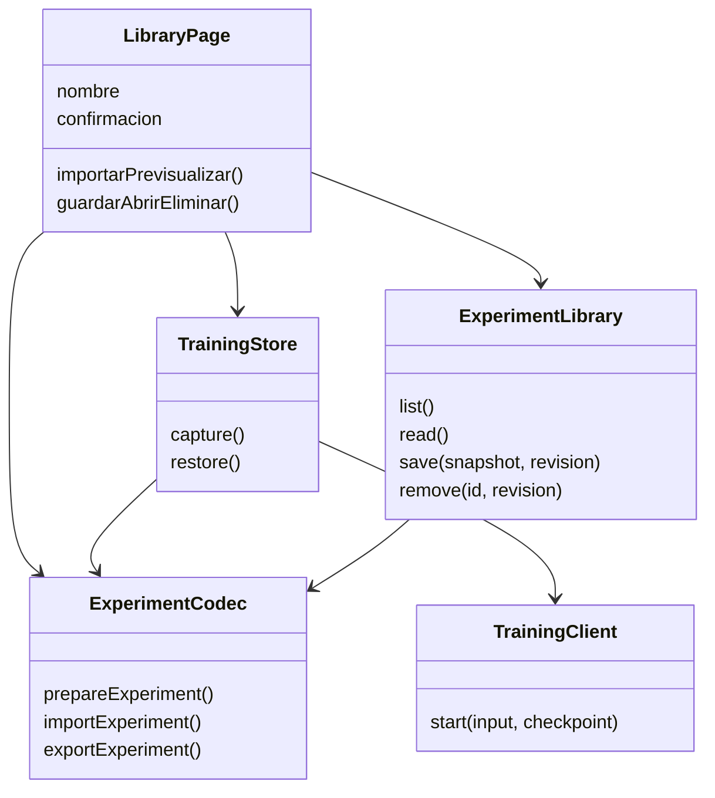
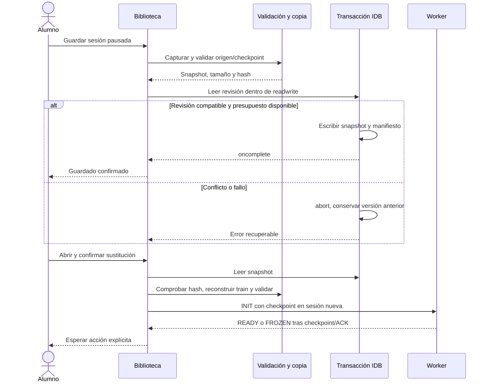

# D5 · Biblioteca de experimentos, primer incremento

Versión **0.6.1**. Este incremento habilita `/biblioteca`: guardar, recuperar, actualizar, eliminar e intercambiar **experimentos completos**. Avanza US-033 y la parte de experimentos de US-034. D5 sigue abierto: los modelos de inferencia independientes, recuperación automática en disco, POE, T01–T05, progreso y portfolio tendrán incrementos propios. No se declara todavía la puerta MVP ni las suites P-I04/P-I07/P-E11a completas.

## Uso

1. En Entrenamiento, carga o prepara datos e inicializa un modelo.
2. Ejecuta uno o varios lotes; pausa antes de guardar.
3. Abre **Guardar o recuperar experimento**, escribe un nombre y pulsa **Guardar como nuevo**.
4. Tras recargar, abre Biblioteca, elige una entrada y confirma la sustitución de la sesión. El entrenamiento no arranca automáticamente.
5. Continúa con el siguiente lote o evalúa el modelo. Un modelo congelado continúa congelado.
6. **Exportar sesión JSON** descarga una copia sin necesitar acceso a IndexedDB. También puedes exportar una entrada guardada sin abrirla.
7. Al importar, el archivo se valida y se muestra un resumen. Solo **Abrir archivo y sustituir sesión** reemplaza el laboratorio; no guarda implícitamente una nueva entrada.

Guardar es **manual**: se conserva la última actualización confirmada al guardar, no los cambios posteriores. La recuperación automática del Worker de D4 sigue utilizando dos copias en RAM; todavía no recupera una sesión no guardada después de cerrar la página. La interfaz lo indica expresamente. La actualización o eliminación de una entrada y la apertura que reemplaza la sesión exigen una confirmación en la propia interfaz.

## Contenido e integridad

El archivo usa `format: neural-atlas.experiment`, `schemaVersion: 1` y `engineVersion: 1`. Límite **64 MiB UTF-8**, comprobado antes de analizar JSON; selección de archivo también comprueba `File.size` antes de leerlo. Se rechazan claves desconocidas en el sobre/configuración/checkpoint, versiones desconocidas, profundidad excesiva y claves de prototipo. Los números de los tensores deben ser finitos; nunca se ejecuta contenido importado.

`shared/validation.ts` configura Zod con `jitless: true` **antes** de construir esquemas, tanto en la página como en el Worker de datos. Evita incluso la sonda de generación dinámica de código: aunque la biblioteca atrape su excepción, el navegador registra una infracción CSP. La regresión de navegación escucha `securitypolicyviolation` y exige cero infracciones; no se amplía `script-src` ni se permite `unsafe-eval`. Los archivos incluyen también versión de aplicación y fecha UTC de captura, independientes de la versión del motor.

Incluye un único dataset **columnar** con split y hash, opciones y hash del pipeline, configuración, pesos/biases Float64, momentos del optimizador, paso, orden/cursor de lote, historial, baseline, umbral/clase positiva y marca de consulta previa de test. No se duplica la matriz transformada: se reconstruye con el pipeline ajustado exclusivamente sobre el train original. Se comprueba el hash del pipeline reconstruido y después el checkpoint contra el origen reconstruido. Una topología importada no se corrige silenciosamente para encajar con los datos.

La marca `testConsulted` puede ser verdadera con un modelo entrenable: significa que test se consultó en una sesión anterior del mismo origen. No convierte esa sesión en una evaluación ciega. `frozen` pertenece al checkpoint y bloquea su entrenamiento al restaurarlo.

Abrir un archivo antiguo conserva además cualquier consulta previa conocida en la sesión actual para el mismo hash de datos/split. La marca del archivo es informativa, no un registro externo inmutable: todavía no hay historial permanente global de consultas independiente de los experimentos guardados.

SHA-256 del contenido canónico detecta alteración accidental tanto del archivo como del registro local. **No es firma ni prueba de autoría**: quien edite el contenido puede volver a calcular el hash. Las validaciones matemáticas y de procedencia se ejecutan incluso si el hash coincide. Los tensores se convierten explícitamente a arrays JSON; al importar vuelven a Float64Array, sin redondear a Float32. La siguiente actualización se contrasta exactamente con el entrenamiento continuo para clasificación binaria, multiclase y regresión.

## Persistencia y transacciones

Se conserva la decisión ADR-004: **IndexedDB** para experimentos; **LocalStorage** para preferencias. No se almacenan modelos en LocalStorage ni se usa un servidor.

La primera versión real de `neural-atlas`, versión de base 1, contiene dos almacenes:

| Almacén | Responsabilidad |
|---|---|
| `experiments` | Snapshot autocontenido, dataset columnar y checkpoint con tensores nativos, más hash de integridad |
| `libraryIndex` | Manifiesto ligero: ID, revisión, nombre, fecha, bytes, tarea y contadores; índice `updatedAt` |

Es una implementación incremental del diseño de persistencia: todavía no crea los almacenes especializados de datasets compartidos, modelos separados, recuperación, paquetes ni evidencias. No hay deduplicación ni relaciones que puedan quedar huérfanas. La ampliación futura requerirá una migración explícita de versión; no se inventa una migración desde la biblioteca inexistente de D4 ni se borra una base corrupta.

Antes de abrir una transacción de escritura se valida, calcula el tamaño/hash y copia el snapshot. Dentro de **una sola transacción readwrite** sobre ambos almacenes se comprueba la revisión esperada y el límite de entradas, y se escribe snapshot + manifiesto. Solo `transaction.oncomplete` anuncia el éxito. Un aborto, incluso después de encolar el snapshot pero antes de actualizar su manifiesto, conserva ambos registros anteriores. No hay tareas asíncronas ajenas a IDB dentro de esa transacción.

Máximo **5 experimentos × 40 MiB = 200 MiB**, sin descuento por datos compartidos. El cargo es el mayor entre JSON UTF-8 y metadata UTF-8 + bytes de tensores nativos (un cero ocupa menos en JSON que en Float64). Es un presupuesto lógico conservador, no una medición exacta del espacio físico del navegador. Quedan reservados los otros 56 MiB del diseño para incrementos posteriores. El navegador puede imponer una cuota inferior. Nunca se elimina una entrada automáticamente.

Dos pestañas pueden leer la misma revisión; la primera escritura gana y la segunda debe refrescar y decidir de nuevo. El control se hace dentro de la transacción, no depende de BroadcastChannel. No se promete actualización espontánea de la lista: hay **Actualizar biblioteca** y refresco después de conflictos. Cada conexión se cierra al finalizar; `versionchange` solicita cierre y una apertura bloqueada muestra un mensaje recuperable.

Un fallo de cuota conserva la versión anterior; acceso denegado deja la sesión en RAM con exportación disponible. Un registro cuyo snapshot no valida no se abre ni elimina. La biblioteca pertenece al navegador y al origen: borrar datos del sitio la borra y otras aplicaciones Pages del mismo origen no constituyen un aislamiento de seguridad. Exporta copias y revisa los datasets antes de compartirlos; el archivo contiene todas las filas, también test.

## Responsabilidades y diseño ejecutado

`application/training/experiment.ts` define contrato/validación y reconstrucción reproducible, sin UI ni IDB. `infrastructure/storage/experiment-library.ts` controla transacciones, revisión y cuota. `infrastructure/files/experiments.ts` limita la lectura, decodifica UTF-8 y descarga/revoca Blob URLs. `stores/training.ts` orquesta una sesión nueva con el cliente Worker; la vista gestiona controles y confirmaciones. Las rutas se cargan bajo demanda.

## Verificación y límites

Evidencia local, 23/10/2026: **236 pruebas unitarias/integración correctas**, cobertura **97,32% de líneas y 94,01% de ramas**, tipos/lint/build/presupuestos/documentación correctos. **62 recorridos Playwright correctos** (31 en Chromium y 31 en WebKit), incluida la regresión CSP corregida; CI exige los mismos 31 en cada uno de sus tres motores, **93 recorridos**. Se mantienen los umbrales existentes, sin excluir código nuevo. Firefox se ejecuta en el entorno Linux de CI; permanece la incidencia del binario local Windows documentada en D1/D4. Los dos diagramas Mermaid de este documento se han analizado con Mermaid 11.17.2.

Carga inicial comprimida: **58,99 KiB JS / 11,81 KiB CSS**. Capturas de la implementación revisadas: [biblioteca escritorio](implementation/d5-library.png) y [biblioteca móvil oscura](implementation/d5-library-mobile.png). Reproducción local con `node scripts/capture-d5-library.mjs` sobre el preview; las fechas y mediciones de los experimentos son reales, no una promesa de resultado del aprendizaje.

`tests/unit/experiments.test.ts` comprueba la siguiente actualización exacta en tres tareas, copias independientes, versiones, corrupción, no finitos, contadores, split, topología y pipeline. `tests/unit/experiment-library.test.ts` inyecta fallos del puerto IDB y verifica presupuesto, conflictos, cierres y registros corruptos. El puerto controlado **no sustituye la semántica nativa** ni se presenta como un emulador completo.

`tests/integration/library.test.ts` recorre guardado, actualización, confirmaciones, apertura, importación/exportación, limpieza de Blob URLs y degradación. `tests/integration/training.test.ts` restaura realmente el motor con transporte controlado, sin ejecutar automáticamente, y comprueba la congelación.

`tests/e2e/library.spec.ts` prueba **IndexedDB y Worker nativos**: recarga/reanudación, intercambio de archivos, conflicto entre pestañas, acceso denegado, congelación y consulta de test persistentes, dos temas/móvil/axe con nombres de 120 caracteres y aborto real con cuota inyectada al escribir el índice **después** de encolar el checkpoint. CI ejecuta esos seis recorridos con Chromium, Firefox y WebKit. La documentación y el smoke público forman parte de las mismas puertas de CI.

No se ha certificado Safari real, presión física de disco ni recuperación ante apagado del sistema operativo. Los fallos de cuota se inyectan de manera controlada y se comprueba la atomicidad nativa. Las otras fases del diseño siguen pendientes.

Ramas de implementación: `feat/d5-experiment-library` (contrato, almacenamiento y reanudación) y `feat/d5-library-interface` (pantalla, archivos, pruebas nativas, documentación y smoke). Se fusionan explícitamente en main. La especificación global se conserva como objetivo; este documento distingue lo implementado de lo pendiente.
