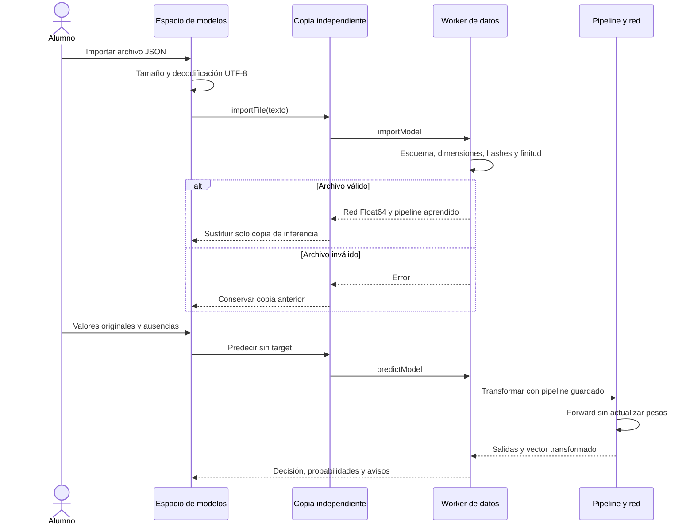

# D5 · Modelos de inferencia independientes

Versión **0.6.2**. Segundo incremento de D5 y continuación de US-034/RF-050–051: archivo de modelo que reproduce la predicción **sin transportar las filas del dataset**. Complementa la [biblioteca de experimentos](30-biblioteca-d5.md), disponible desde 0.6.1. D5 sigue abierto para recuperación automática en disco, talleres POE, progreso y evidencias.

## Recorrido didáctico

1. Entrena o inicializa un modelo, pausa y abre Biblioteca.
2. Pulsa **Modelos para predecir sin dataset** y **Copiar modelo de la sesión**.
3. Revisa tarea, objetivo, arquitectura, clases y, en clasificación binaria, clase positiva y umbral.
4. Introduce una muestra en sus unidades originales y pulsa **Predecir con este modelo**. No se pide su etiqueta.
5. Despliega **Vector transformado enviado a la red** para relacionar los valores crudos con escalado, one-hot e indicadores de ausencia.
6. Exporta el modelo. Otra pestaña o navegador puede importarlo sin tener tu sesión de entrenamiento ni sus filas.

La copia de inferencia es independiente del entrenamiento: predecir no actualiza pesos, consultar este espacio no sustituye sus datos y cerrar la copia no elimina los experimentos guardados. La copia se conserva en RAM entre rutas. Tras recargar hay que importar el archivo; todavía no se ofrece una colección IDB adicional de modelos independientes.

Un modelo de inferencia no contiene los momentos del optimizador, el orden/cursor de lotes ni el historial y no permite reanudar entrenamiento. Para ello se usa `neural-atlas.experiment`. La interfaz presenta esa diferencia en el punto de uso.

## Contrato del archivo

`format: neural-atlas.model`, `schemaVersion: 1`, `engineVersion: 1`, versión de aplicación y fecha UTC. Límite **8 MiB UTF-8** comprobado antes de analizar JSON; también se comprueba `File.size` antes de leerlo. Se admiten exclusivamente UTF-8 válido y esquemas estrictos, con límites de estructura, profundidad, cadenas y tensores. No hay evaluación de código, HTML importado ni descargas de dependencias externas.

| Bloque | Información y validación |
|---|---|
| `network` | Topología y capas densas, pesos/biases Float64 serializados como arrays numéricos; dimensiones, activaciones y finitud comprobadas |
| `pipeline` | Imputaciones y estadísticas numéricas, vocabularios ordenados, opción de escalado, columnas desconocidas e indicadores de ausencia; declaración de ajuste con train |
| `features` | Solo las características utilizadas, con ID, nombre, tipo y unidad opcional |
| `targetName`, `task`, `classOrder` | Etiqueta del objetivo y orden exacto de salidas; clases únicas y no vacías, consistentes con la tarea |
| `positiveClassId`, `threshold` | Regla binaria exportada; `null` para multiclase y regresión |
| `hashes` | Huellas de datos/split de origen, pipeline y red; las dos últimas se comprueban contra el contenido |
| `training` | Época, actualizaciones, congelación y consulta de test declaradas, sin métricas ni ejemplos individuales |
| `integrity` | SHA-256 canónico del sobre; detección de alteración accidental, no firma ni prueba de autoría |

No se incluyen filas, IDs de muestras, targets individuales, anotaciones de defectos, particiones ni recetas generadoras. Sí se incluyen estadísticas, nombres y categorías aprendidas: un archivo de modelo **no es una garantía de anonimización**. Revisa esos campos antes de compartirlo. Sin las filas originales no se puede volver a demostrar que las estadísticas se ajustaron solo con train; la interfaz distingue comprobación estructural/integridad de esa procedencia declarada.

El importador reconstruye Float64Array y valida la misma topología que el motor. Comprueba correspondencia y orden de características, unicidad de vocabularios, categoría de imputación conocida, estadísticas finitas, desviación no negativa y coherencia de columnas constantes. Reconstruye los IDs y etiquetas de las salidas del pipeline y exige que coincidan con la dimensión de entrada de la red. No descarta columnas ni corrige el archivo silenciosamente.

## Predicción y explicación

- **Binaria:** `p(0) = 1 − p(1)`; la clase positiva exportada se elige si su probabilidad es **mayor o igual** al umbral. Un empate sigue esa misma regla.
- **Multiclase:** argmax de softmax, con primer índice en caso de empate. Se conserva el orden de clases original.
- **Regresión:** salida lineal escalar en unidades del objetivo; no se convierte en probabilidades.
- **Ausencias:** `null` aplica el valor de imputación aprendido. Si el pipeline contiene indicadores, se añade su señal de ausencia.
- **Categoría desconocida:** activa la columna específica `unknown` y muestra aviso; no se amplía ni reordena el vocabulario.
- **Extrapolación:** un valor numérico fuera del rango de train muestra aviso. Las columnas constantes mantienen el tratamiento del pipeline original.

La copia conserva umbral y clase positiva sin ofrecer controles que aparenten reentrenarla. Las salidas probabilísticas no implican calibración ni garantizan acierto. Editar una muestra retira el resultado anterior hasta predecir de nuevo, evitando mostrar una respuesta de otra entrada.

## Responsabilidades y ejecución

`network-schema.ts` comparte contrato y conversión de tensores entre modelos y experimentos, evitando dos definiciones de topología. `inference-model.ts` define validación, archivo y predicción pura. `infrastructure/files/models.ts` limita/decodifica archivos y administra Blob URLs. `stores/inference.ts` mantiene la copia aislada y coordina el cliente Worker. `ModelsPage.vue` presenta la explicación, campos y resultados.

Importación JSON, exportación JSON y predicción viajan por trabajos `importModel`, `exportModel` y `predictModel` del **Worker de datos**, sin etiquetas ficticias ni dependencia de un entrenamiento activo. La creación de una copia desde una sesión valida previamente el experimento con el controlador; la preparación no vuelve a ajustarse al predecir. No hay fallback de inferencia a la página si falta Worker.

El cliente termina el Worker al finalizar cada trabajo. Cambiar de ruta cancela el trabajo pendiente pero conserva la copia ya abierta. Una lectura de archivo que termina después de abandonar la pantalla no puede abrir un modelo tardío. Identidades/cancelación del cliente y secuencia del store descartan respuestas antiguas. Un archivo inválido conserva el modelo anterior. Las cadenas importadas se muestran con interpolación Vue, nunca con `v-html`.

## Verificación

Evidencia local del 23/10/2026: **250 pruebas unitarias/integración correctas**, **97,42% de líneas y 94,20% de ramas** con los umbrales existentes. Tipos, lint, build, presupuesto y documentación correctos. **70 recorridos Playwright correctos**: 35 en Chromium y 35 en WebKit. CI exige esos mismos 35 en cada motor, incluido Firefox Linux: **105 recorridos**. No se han reducido umbrales ni añadido exclusiones de cobertura. El binario Firefox local Windows mantiene la incidencia ya documentada; no sustituye al control Linux de CI.

Carga inicial gzip: **59,04 KiB JS / 11,81 KiB CSS**. Capturas revisadas de [escritorio](implementation/d5-models.png) y [móvil oscuro](implementation/d5-models-mobile.png), reproducibles con `node scripts/capture-d5-models.mjs` sobre preview. El diagrama de este documento se ha analizado con Mermaid 11.17.2.

La batería unitaria compara **exactamente** la salida con la red entrenada para tres tareas tras exportar/importar; comprueba ausencia de dataset/optimizador, independencia de tensores, preservación de clases y regla binaria, todos los escalados, columnas constantes, categorías desconocidas, imputación e indicadores. Valida versiones, corrupción, claves extra/prototipos, contratos incompletos, no finitos y tamaño antes de analizar.

Integración prueba transporte real del manejador mediante un puerto controlado, copia sin modificar el laboratorio, archivo inválido, falta de Worker, cancelación, lectura tardía tras navegar, descarga y revocación de URL. Los recorridos Playwright usan **Workers nativos**: una pestaña sin sesión reproduce las mismas salidas del modelo exportado, multiclase/regresión sobreviven a recarga/importación, y móvil/temas pasan axe. La ruta `/modelos` se añade a la comprobación de CSP.

No se afirma reanudación con un archivo de modelo, colección persistente adicional, calibración, procedencia demostrada sin datos, Safari real ni evaluación docente humana. Taller y portfolio mantienen sus siguientes incrementos de D5.

Ramas: `feat/d5-inference-models` para contrato, motor y transporte; `feat/d5-inference-interface` para experiencia, pruebas nativas, documentación y comprobación pública. Se fusionan explícitamente en main. El smoke desplegado crea una copia, exporta el archivo, recarga (perdiendo la sesión en RAM), lo importa y exige las mismas salidas.
