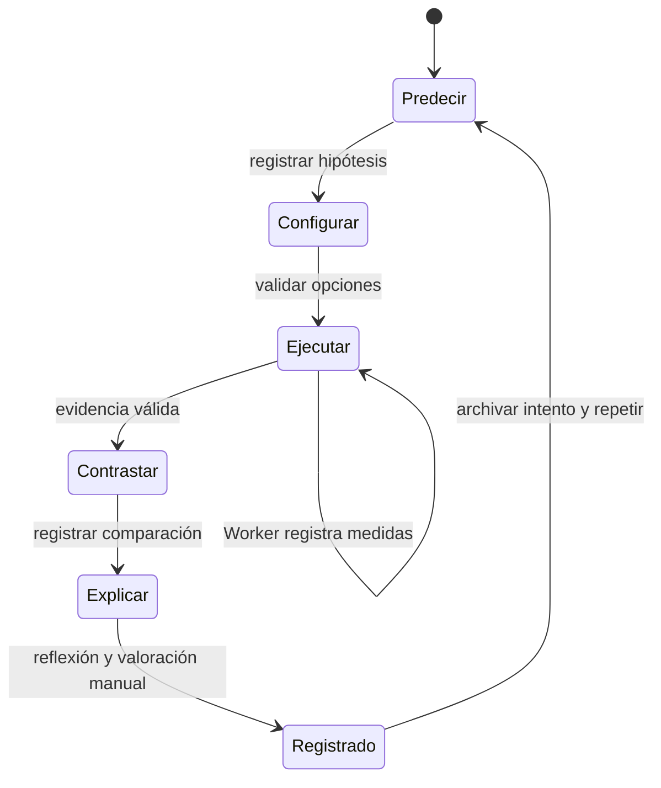
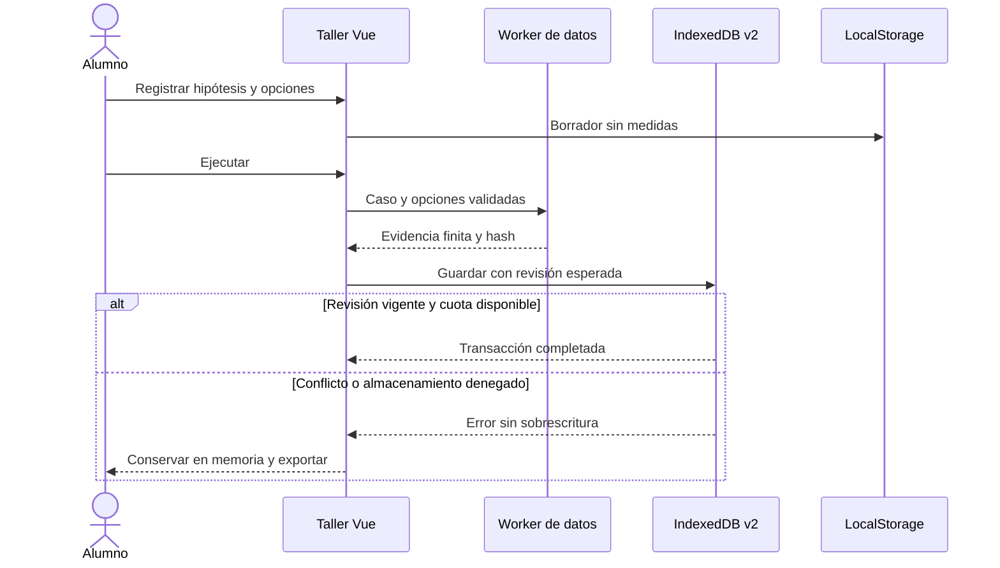
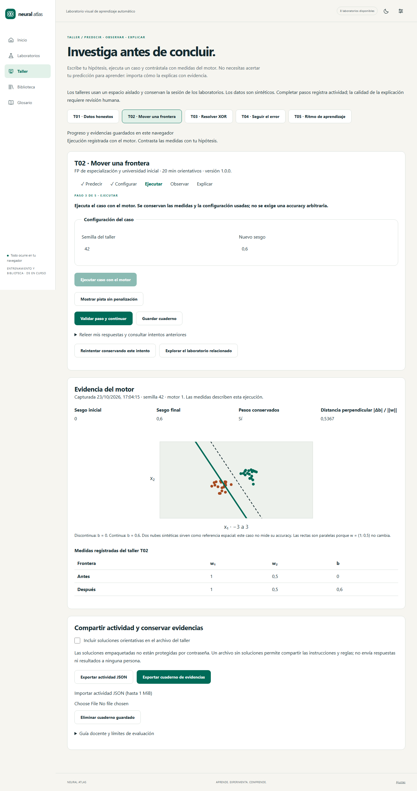
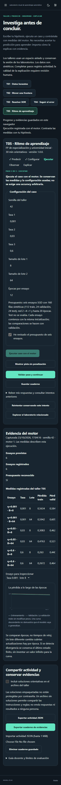

# D5 · Talleres de predicción, observación y explicación

Versión 0.6.3. Cinco recorridos disponibles en `/taller`, orientados a FP de especialización y universidad. Cada actividad separa hipótesis, configuración, ejecución, contraste y explicación. Completar el recorrido registra trabajo y una autoevaluación; no certifica comprensión ni corrige automáticamente la calidad del texto.

## Uso

1. Escoge T01–T05 y escribe una predicción antes de ejecutar.
2. Configura el caso. T05 requiere aceptar explícitamente el presupuesto de seis ensayos.
3. Ejecuta el motor en un Web Worker y examina las medidas y tablas reales.
4. Contrasta tu predicción con esas medidas. Solicita pistas si las necesitas.
5. Explica el resultado, registra una autoevaluación orientativa y exporta el cuaderno.

Las pistas y soluciones consultadas quedan registradas, sin penalización. Las soluciones son orientaciones abiertas, sin control de acceso. La rúbrica de cuatro niveles requiere valoración humana. El mínimo de caracteres comprueba presencia de una respuesta, no su corrección. No se solicita identidad ni se envían respuestas a un docente o servidor.

## Casos y convenciones matemáticas

| Caso | Experimento | Evidencia y límites |
| --- | --- | --- |
| T01 · Datos honestos | 160 muestras sintéticas con ruido, ausentes y atípicos; una característica cambia de unidad ×1000. División estratificada 70/15/15, imputación media e indicadores de ausencia; escalado estándar o Min-Max. | Cuenta filas, comprueba particiones disjuntas, hash de IDs de train usado para ajustar y ausencia de valores no finitos tras transformar. No estima rendimiento predictivo. La conversión de unidades es fija, no un estadístico aprendido. |
| T02 · Mover una frontera | Conserva pesos (1, 0,5), cambia el sesgo desde cero y dibuja ambas rectas `x₁ + 0,5x₂ + b = 0`. | Distancia perpendicular `|b| / √1,25`, pesos y sesgos. Las muestras son contexto visual, no una evaluación de exactitud. |
| T03 · Resolver XOR | Entrena un perceptrón y compara con una recta explícita y una construcción ReLU 2→2→1 que calcula `|x₁−x₂|`. | Salidas de los cuatro puntos XOR. La recta explícita acierta 3/4 y la construcción 4/4. La construcción ReLU es deliberada: no se presenta como una red aprendida. |
| T04 · Seguir el error | Red pequeña fija, entrada (0,8; 0,2), objetivo 1; backpropagation y una actualización con tasa configurable. | Nueve gradientes analíticos frente a diferencias centrales; error relativo ≤10⁻⁵ fuera de puntos angulosos. Pérdida antes/después y confirmación de cambio de peso. No es una ejecución de múltiples épocas. |
| T05 · Ritmo de aprendizaje | 160 medias lunas, mismo split, pipeline, semilla e inicialización; MLP 2→4→1, tanh y SGD. Tres tasas distintas × dos tamaños de lote distintos, 5–20 épocas. | Seis curvas de train/validación, pérdidas y número de actualizaciones. No consulta test para elegir configuración. Una divergencia numérica detectada se registra conservando el último estado finito; no se inventan puntos infinitos. No todas las configuraciones tienen que divergir. |

La semilla permite repetir datos e inicialización dentro de la misma versión del motor; UUID y fecha identifican una ejecución, por lo que los archivos no son idénticos byte a byte. Los casos están aislados de los datos y del entrenamiento activo del laboratorio. Hay enlaces para continuar explorando en el laboratorio correspondiente.

## Contratos y responsabilidades

- `content/workshops.ts`: instrucciones, pistas, soluciones, guía docente y rúbrica.
- `application/workshops/contracts.ts`: contratos Zod y nueve reglas declarativas cerradas; nunca evalúa código importado.
- `application/workshops/experiments.ts`: adaptadores al motor matemático puro, ejecutados por el Worker de datos.
- `application/workshops/progress.ts`: validación de fases, respuestas, referencias y coherencia entre opciones y evidencia.
- `stores/workshops.ts`: coordinación de interfaz, cancelación, borradores, revisiones y persistencia.
- `infrastructure/storage/workshop-library.ts`: transacciones y presupuesto de cuadernos.
- `features/workshops/`: página, controles y presentación accesible de tablas, frontera SVG y curvas.

El formato `neural-atlas.workshop` versión 1 admite importación JSON UTF-8 de hasta **1 MiB**, cinco fases en orden y IDs únicos. Es un primer contrato deliberadamente limitado a esos cinco pasos y a T01–T05. Se pueden añadir versiones y actividades basadas en esos motores; otros motores o secuencias más largas requieren ampliar el contrato y sus pruebas. Las reglas son `equals`, `range`, `finite`, `changed`, `compareRuns`, `splitDisjoint`, `predictOutcome`, `compareObservation` y `manualReflection`. Las fases obligatorias no pueden omitirse mediante un archivo importado.

El hash de definición incluye su contenido salvo las soluciones: compartir una copia sin soluciones mantiene compatible el progreso. Cambiar instrucciones u opciones de la definición genera otro hash. Exportar actividad omite soluciones por defecto; incluirlas requiere marcar una casilla. `neural-atlas.learning-evidence` exporta definición, progreso, mediciones, intentos y hash de integridad. Es un cuaderno JSON para consulta, no un modelo entrenable ni un formato de importación de progreso. El hash detecta alteraciones accidentales; no es firma ni prueba de autoría.

## Persistencia y recuperación

IndexedDB `neural-atlas` migra **v1→v2** sin recrear los almacenes existentes. Añade `learningEvidence` junto a `experiments` y `libraryIndex`; conserva experimentos y tensores. Definición, progreso, intentos y evidencia de cada actividad se guardan juntos en una transacción. Las revisiones optimistas impiden que una pestaña sobrescriba silenciosamente otra. El presupuesto de cuadernos es **8 MiB**, separado del de experimentos. No hay expulsión automática.

LocalStorage `neural-atlas:v1:progress` guarda un resumen de hasta 448 KiB medidos en UTF-16: respuestas, fase, pistas y referencias de evidencias. No duplica matrices, modelos ni medidas matemáticas. Los borradores se escriben tras una pausa al teclear y al abandonar la página. Si IndexedDB está denegado, las respuestas pueden recuperarse, pero el experimento debe ejecutarse otra vez para reconstruir la evidencia y avanzar. La memoria conserva el trabajo entre rutas durante esa sesión; no sobrevive a una recarga.

Cada actividad permite conservar hasta diez intentos anteriores; al alcanzar el límite se solicita exportar y gestionar el registro, sin descartar intentos automáticamente. Borrar el registro requiere confirmación explícita, comprueba su revisión y elimina también su resumen local cuando es posible. La interfaz informa por separado de un fallo al borrar el resumen. Ante cuota, conflicto o indisponibilidad conserva la copia en memoria y ofrece exportación. Un registro inválido provoca diagnóstico y modo memoria, sin borrar la base; todavía no existe reparación selectiva por registro.

## Interfaz y verificación

Catálogo responsive, pasos visibles, foco al cambiar de fase, controles etiquetados, tablas alternativas a los gráficos, temas claro/oscuro y animación de aparición regulada por ajustes y movimiento reducido. Las curvas reutilizan el componente de pérdida del laboratorio. La observación y explicación permanecen visibles en el cuaderno.

Evidencia de la entrega: **267 pruebas unitarias/integración**, cobertura **96,92% de líneas y 93,29% de ramas**, **44 recorridos por navegador** (88 locales Chromium/WebKit; 132 en CI Chromium/Firefox/WebKit). Se comprueban los cinco recorridos completos, reintentos, archivos, reglas, errores, revisión entre pestañas, cuota, IndexedDB denegado, migración nativa v1→v2 con tensores, recarga, móvil y accesibilidad automática. Firefox local sigue afectado por la instalación de Windows documentada en D1; CI usa Linux. El despliegue añade un recorrido T02 y recuperación al smoke público.

Capturas reproducibles con `scripts/capture-d5-workshops.mjs`:

## Pendiente

D5 permanece abierto: falta recuperación automática de entrenamiento en disco. T06–T12, regularización avanzada, visualizaciones 3D y las siguientes entregas conservan sus fases. Este incremento no constituye el paquete docente completo RF-076, una revisión científica humana ni un pilotaje con alumnado. La licencia y las condiciones editoriales del contenido deben cerrarse antes de presentar un paquete docente distribuible; no se introduce una licencia nueva implícita.
