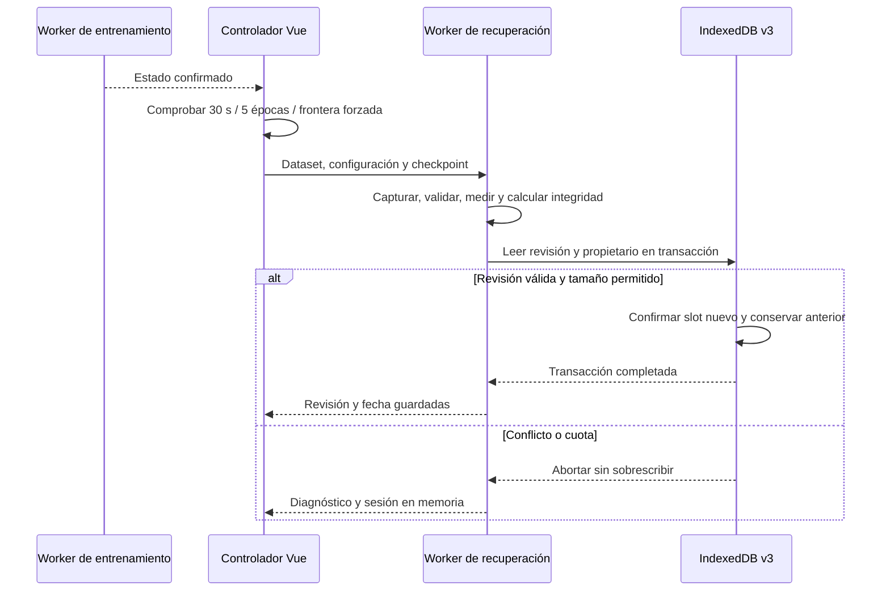
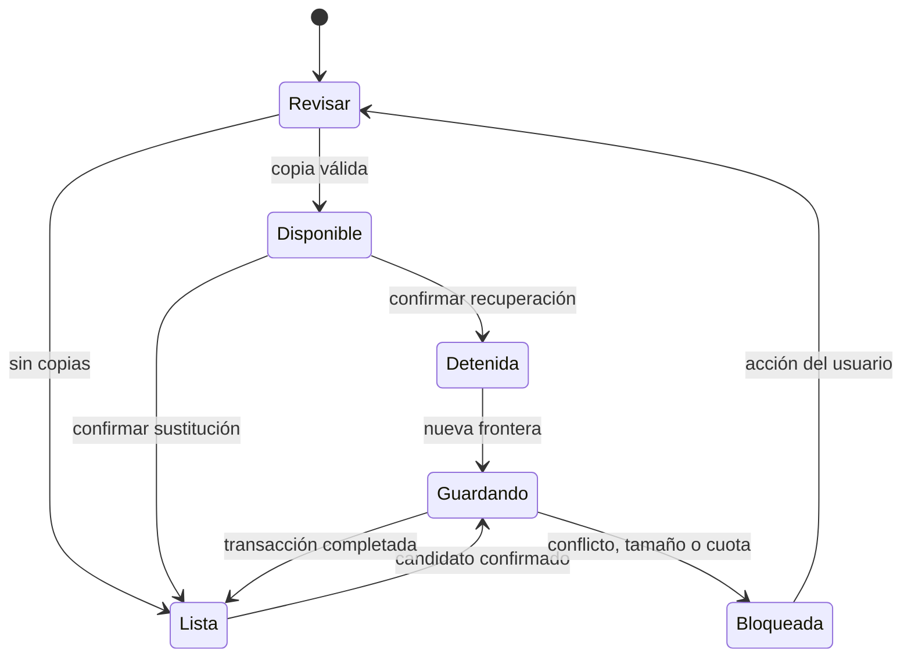
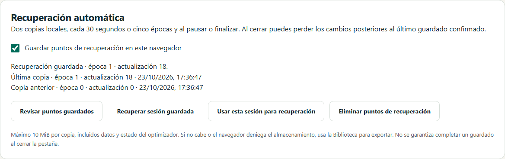

# D5 · Recuperación automática en disco

Versión 0.6.4. El laboratorio de entrenamiento dispone de un panel de recuperación que conserva puntos completos en IndexedDB, además de los dos checkpoints RAM del controlador. No sustituye el guardado manual de Biblioteca.

## Comportamiento

Al inicializar una sesión se prepara una copia. Durante el entrenamiento se solicita un guardado en una frontera confirmada cada **30 segundos o cinco épocas**, lo que suceda antes. Pausar, cancelar, completar o congelar fuerza otro candidato. Cambiar el umbral, la clase positiva o la marca de consulta de test también solicita una copia coherente. No se guardan estados intermedios de un lote.

La interfaz indica cuándo una transacción ha terminado, su época, actualización y fecha. Al recargar, muestra la copia disponible, pero no reemplaza los datos activos ni inicia el entrenamiento. «Recuperar sesión guardada» exige confirmación, valida el archivo interno, restaura datos, split, pipeline, configuración, pesos, momentos del optimizador, orden y cursor; después permite continuar en el siguiente lote. Una copia anterior puede haber perdido las actualizaciones posteriores al último guardado confirmado. No se garantiza completar una escritura al cerrar la pestaña.

El interruptor desactiva nuevas solicitudes durante la sesión de navegador actual; no borra copias existentes. «Eliminar puntos de recuperación» requiere confirmación y revisión vigente. Si se sigue entrenando con el guardado activado podrán crearse puntos nuevos. Biblioteca conserva sus experimentos e intercambio de archivos independientemente de esta función.

## Arquitectura y presupuestos

`trainingRecovery` se añade mediante migración **IndexedDB v3**. No recrea `experiments`, `libraryIndex` ni `learningEvidence`. Un único registro global `active` contiene dos slots completos y una revisión. Cada slot ocupa como máximo **10 MiB**, incluyendo los datos necesarios para reconstruir la sesión y el estado del optimizador. Los metadatos incluyen margen para el encabezado. No hay una pareja de slots por sesión histórica: el máximo global es 20 MiB. No se desalojan experimentos guardados para hacer sitio.

La captura, validación matemática, estimación de bytes, hashes y escritura se ejecutan en un **Worker dedicado de recuperación**, separado del entrenamiento. El hilo principal coordina las solicitudes y copia el mensaje; esa copia tiene un coste dependiente del tamaño, pero no serializa, ajusta el pipeline ni calcula hashes. El controlador serializa las escrituras y conserva como pendiente solo el candidato más reciente. No crea una cola ilimitada.

| Responsabilidad | Archivo |
| --- | --- |
| Adaptar estados confirmados del entrenamiento | `src/stores/training.ts` |
| Cadencia y dispatcher comprobable | `src/application/training/recovery.ts` |
| Cola, disponibilidad y acciones de usuario | `src/stores/recovery.ts` |
| Transporte y ciclo de vida del Worker | `src/infrastructure/workers/recovery-client.ts` |
| Entrada del Worker | `src/infrastructure/workers/recovery.worker.ts` |
| Dos slots, presupuesto, integridad y transacción | `src/infrastructure/storage/training-recovery.ts` |
| Migraciones aditivas | `src/infrastructure/storage/database.ts` |
| Controles, confirmación y foco | `src/features/training/RecoveryPanel.vue` |

## Conflictos y errores

Cada página tiene un propietario aleatorio. Una pestaña nueva que encuentra una recuperación ajena no la sobrescribe automáticamente. Puede recuperarla o elegir explícitamente «Usar esta sesión para recuperación». Ambas acciones usan la revisión leída; si otra pestaña escribe entre la lectura y la transacción, la sustitución falla y exige revisar otra vez. La apropiación no elimina Biblioteca.

Una cuota insuficiente, el límite de 10 MiB, IndexedDB denegado, un bloqueo de migración o un error de Worker detienen nuevos intentos automáticos hasta revisar la situación. La sesión activa permanece en RAM. La interfaz propone Biblioteca para exportarla. Una respuesta perdida o un timeout no se consideran confirmación de guardado, aunque el navegador haya podido completar la transacción; revisar los puntos vuelve a leer la revisión real.

Cada slot conserva un hash de la representación explícita de tensores. Se valida el dataset, pipeline y checkpoint antes de restaurar. Si el slot reciente no pasa la validación, se intenta el anterior. El encabezado mantiene, para las dos identidades de sesión retenidas, marcas monotónicas de congelación y consulta de test con su integridad. Así recuperar un estado anterior de la misma sesión no vuelve a habilitar entrenamiento tras consultar test. Una cabecera inválida o dos slots inválidos generan diagnóstico y conservan la base sin borrarla. Los hashes detectan corrupción accidental, no prueban autoría ni protegen frente a alguien que reescriba datos y hashes.

## Verificación y alcance

Pruebas de cadencia, serialización de candidatos, errores de transporte y timeout, revisión optimista, rollback por cuota, dos slots nativos, corrupción y fallback, conservación de congelación/test, desactivación y eliminación. Los navegadores comparan el checkpoint completo del siguiente lote de Adam tras recuperar con el obtenido sin recargar: pesos, momentos, orden, cursor e historial deben coincidir.

El incremento incorpora cuatro recorridos nativos por navegador y actualiza la prueba de migración de v1 a v3. La batería completa consta de **275 pruebas unitarias/integración** y **48 recorridos por motor**: 96 locales en Chromium/WebKit y 144 en CI Chromium/Firefox/WebKit. Se mantienen los controles de tipos, lint, cobertura, presupuesto, documentación, accesibilidad y rendimiento existentes. La instalación local de Firefox en Windows mantiene la incidencia documentada; CI lo verifica en Linux.

Captura reproducible: `scripts/capture-d5-recovery.mjs`.

La recuperación en disco de este incremento cubre el motor CPU actual. No implementa estados futuros de dropout, batch normalization o early stopping (D6). Tampoco implica cerrar por sí sola la puerta MVP: el paquete docente completo, su revisión humana y la aceptación global conservan sus condiciones.
