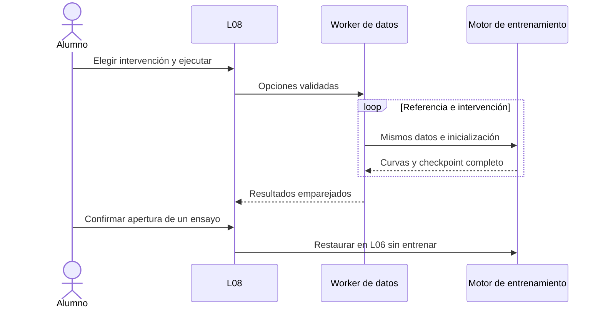
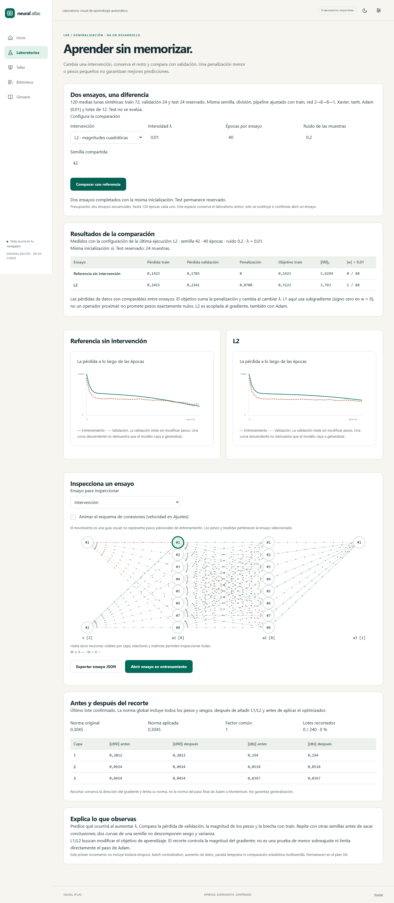
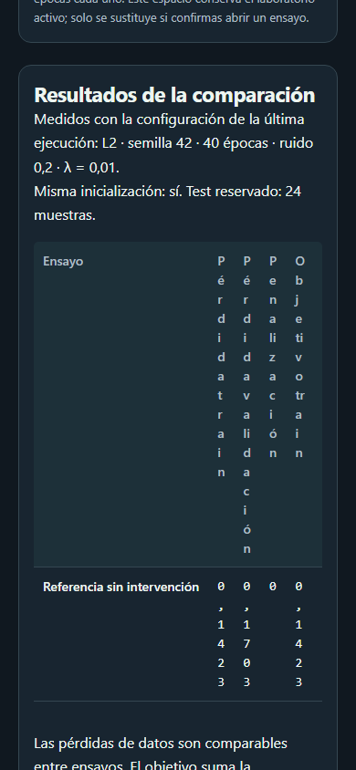

# D6 · Primer incremento de generalización

Versión 0.7.0. L08 `/lab/generalizacion` incorpora comparación emparejada de **L1, L2 y recorte por norma global**. Las mismas opciones están disponibles en L06, con guardado, reanudación y exportación. D6 permanece en desarrollo: este incremento no implementa dropout, batch normalization, aumento de datos ni parada temprana.

## Experiencia didáctica

Escoge una intervención, predice qué cambiará y ejecuta la comparación. Los dos ensayos usan 120 medias lunas sintéticas: 72 muestras de train, 24 de validación y 24 reservadas para test. Comparten semilla, división estratificada, imputación y escalado ajustados solo con train, red 2→8→8→1, Xavier, tanh, Adam con tasa 0,01, lote 12 y horizonte de épocas. Solo cambia L1, L2 o el umbral de recorte. Con λ = 0 los ensayos de penalización son idénticos.

El presupuesto es de dos ensayos secuenciales en un Worker, de 5–120 épocas cada uno. Se puede cancelar; los últimos resultados completos se conservan. La configuración mostrada con el resultado corresponde a su ejecución, aunque se hayan editado los controles para otra prueba. Test no se evalúa ni se usa para elegir la intervención. Los hashes de inicialización permiten comprobar que ambos ensayos parten del mismo modelo.

La tabla separa pérdida de datos en train, pérdida de datos en validación, penalización y objetivo de train. Incluye norma de los pesos y número de pesos con magnitud menor que 0,01. Ese umbral descriptivo no significa que el modelo sea disperso ni que tenga pesos exactamente nulos. Dos curvas muestran los registros reales de ambos ensayos. El esquema de conexiones usa los pesos reales del ensayo seleccionado; su animación es una guía visual, no más pasos de entrenamiento. Se regula con Ajustes y respeta movimiento reducido. El área horizontal del esquema se puede recorrer con teclado.

Puedes exportar cada ensayo como experimento completo o confirmar su apertura en L06. La comparación no modifica por sí misma el laboratorio activo. Los ensayos se abren detenidos en su horizonte completado: para entrenar durante otro horizonte, crea una sesión nueva. Desde L06 pueden evaluarse y convertirse en modelos independientes. La comparación vive en RAM; exporta los ensayos para conservarlos tras una recarga.

## Convenciones matemáticas

Con pérdida de datos media del lote `Ldatos`, el objetivo es:

`J = Ldatos + λ₁ Σ|w| + ½ λ₂ Σw²`.

La suma incluye matrices de pesos, **sin sesgos**. Se añade `λ₁ sign(w) + λ₂w` al gradiente medio de pesos una sola vez; no se divide otra vez por el tamaño del lote ni por el número de muestras. En `w = 0` se elige subgradiente cero para L1. El algoritmo es descenso por subgradiente, no un operador proximal: L1 no garantiza ceros exactos.

La penalización es acoplada: sus derivadas pasan por SGD, Momentum, RMSprop o Adam. Con Adam no es AdamW ni weight decay desacoplado. Las curvas de train y validación conservan exclusivamente la pérdida de datos. El objetivo penalizado se registra por separado; no debe compararse como si fuera la misma función cuando cambia λ.

Después de sumar la penalización, se calcula la norma global del gradiente completo, incluyendo pesos y sesgos de todas las capas. Con umbral `c > 0`, si `‖g‖₂ > c`, se aplica a todos los componentes `s = c / (‖g‖₂ + 10⁻¹²)`; en otro caso `s = 1`. El umbral cero desactiva el recorte; activo admite 0,1–100. L1 y L2 admiten 0–0,1, con cero como desactivación.

El recorte conserva la dirección y limita la norma del gradiente antes del optimizador. No limita necesariamente la norma del paso de Adam o Momentum, ni demuestra una reducción del sobreajuste. Se registran norma original y aplicada, factor común, normas ‖dW‖ y ‖db‖ por capa y contador acumulado de lotes recortados. Las normas originales ya incluyen la contribución de la penalización.

## Diseño y contratos

| Responsabilidad | Archivo |
| --- | --- |
| Penalización, gradiente y recorte cooperativo | `src/domain/training/regularization.ts` |
| Agregación por lote, confirmación y checkpoint | `src/domain/training/session.ts` |
| Experimentos emparejados y presupuesto cerrado | `src/application/training/generalization.ts` |
| Contrato del experimento y compatibilidad | `src/application/training/experiment.ts` |
| Ejecución cancelable y resultados en RAM | `src/stores/generalization.ts` |
| Página L08 | `src/features/generalization/GeneralizationPage.vue` |
| Controles reutilizados en L06 | `src/features/training/RegularizationControls.vue` |
| Tabla de normas antes/después | `src/features/training/GradientControlPanel.vue` |

El motor conserva la ruta anterior cuando `config.regularization` está ausente. Los experimentos anteriores siguen usando `schemaVersion: 1`, `engineVersion: 1` y su hash original. Los que incluyen la nueva configuración —también con coeficientes cero explícitos— usan **schemaVersion 2 y engineVersion 2**. Su hash de configuración identifica ese motor; no se acepta un encabezado de versión incompatible con el contenido. La versión 0.7 puede leer v1 y v2. Las aplicaciones anteriores no pueden abrir los nuevos experimentos v2.

El checkpoint interno mantiene su estructura versionada básica, con telemetría opcional vinculada a la nueva configuración. Se copian sus arrays, se validan finitud, tamaños, normas y contadores y se conservan los momentos del optimizador. Cada época añade `regularizationPenalty` y `trainObjective`, verificando la suma y la penalización del modelo cuando se está en una frontera de época. Los archivos de modelo de inferencia mantienen su contrato: para predecir se usan los pesos aprendidos y el pipeline, sin aplicar una penalización durante inferencia.

No cambia la versión de IndexedDB: los almacenes existentes admiten las dos versiones del experimento. Biblioteca y recuperación automática conservan la nueva configuración y telemetría dentro de la misma transacción ya implementada. El nuevo laboratorio no constituye un comparador arbitrario A/B de L12: ofrece únicamente dos ensayos con una intervención cerrada y presupuesto acotado.

## Verificación y límites

Pruebas con diferencias centrales de los nueve parámetros de una red pequeña verifican el objetivo con L1/L2, incluidos los sesgos sin penalización. Se comprueba la independencia de la penalización respecto al tamaño del lote, equivalencia numérica al desactivar controles, no mutación de buffers y recorte con un factor común. Los casos de reanudación cubren clasificación binaria, multiclase y regresión con los cuatro optimizadores, comparando exactamente el siguiente checkpoint tras exportar/importar. También se comprueba la predicción con un modelo independiente.

La batería incorpora pruebas de interacción, cancelación, resultados anteriores, apertura explícita, archivos y movimiento reducido. Cinco recorridos adicionales por navegador verifican L1, L2, recorte, recuperación en disco con regularización y accesibilidad en ambos temas/móvil. Total: **295 pruebas unitarias/integración y 53 recorridos por motor** (106 locales Chromium/WebKit y 159 en CI Chromium/Firefox/WebKit). Se mantienen umbrales y controles de calidad existentes; Firefox local conserva la incidencia de Windows documentada en D1.

Capturas reproducibles con `scripts/capture-d6-generalization.mjs`:

Quedan parciales US-025 y US-026; este incremento no cierra D6 ni afirma haber realizado una descomposición estadística de sesgo/varianza. Dropout, BN, early stopping con restauración del mejor estado, augmentation válido por receta, pruebas ampliadas de sus checkpoints y comparación multisemilla mantienen sus historias y criterios de aceptación.
