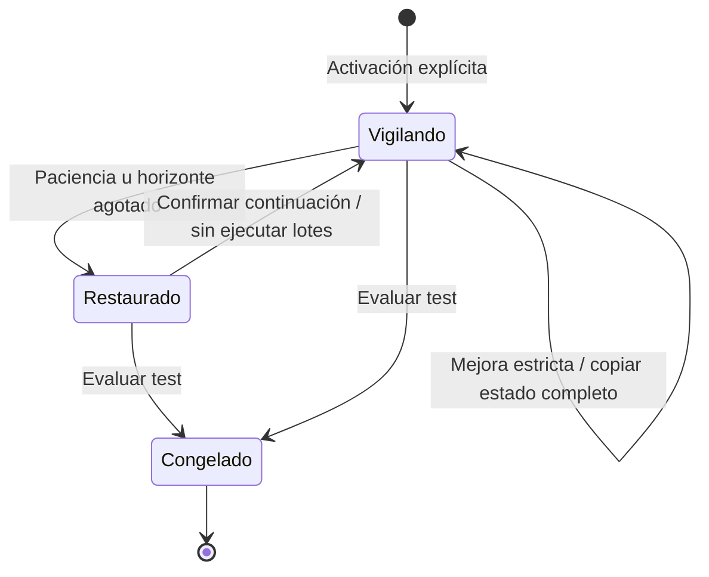
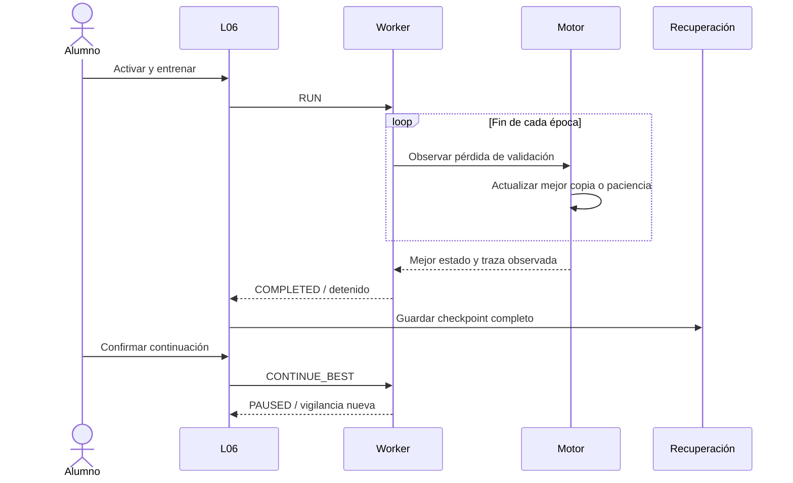
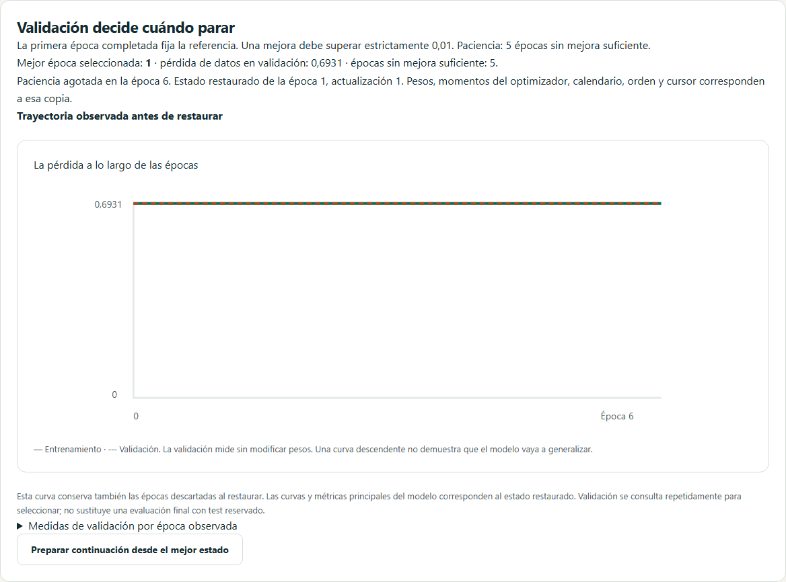
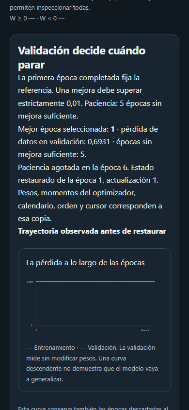

# D6 · Parada temprana y restauración completa

Incremento 0.7.1, 25 de octubre de 2026. L06 incorpora parada temprana opcional; L08 permite compararla con una referencia que utiliza los mismos datos, inicialización y presupuesto máximo. Amplía US-025/US-026 sin cerrar D6.

## Contrato didáctico y matemático

La selección consulta únicamente la **pérdida de datos de validación**, sin penalización L1/L2 y sin consultar test. La primera época completada establece la referencia: la época cero no es candidata. Una mejora se acepta si `mejorPérdida − pérdidaActual > minDelta`, estrictamente. La paciencia cuenta épocas consecutivas sin mejora suficiente, no lotes. Admite paciencia entre 5 y 100 y mejora mínima entre 0 y 0,01.

Al agotarse la paciencia o el horizonte de épocas se restaura el mejor checkpoint completo: pesos, sesgos, momentos y paso del optimizador, orden de muestras, cursor, contadores, historia y telemetría. El calendario deriva de esos contadores restaurados. Si ambas condiciones coinciden, el motivo es paciencia. Los contadores pueden retroceder deliberadamente; esto no se contabiliza como pérdida accidental de actualizaciones.

La pantalla distingue **época observada de detención** y **época seleccionada**. La curva principal representa el estado seleccionado; un panel separado conserva todas las épocas observadas, incluidas las descartadas. La tabla permite inspeccionar valores exactos. Elegir repetidamente con validación no garantiza generalización: test permanece reservado para la evaluación final que congela el modelo.

Continuar requiere confirmación y conserva el horizonte original. Se inicia una vigilancia nueva después de la época seleccionada; su primera época completada vuelve a establecer la referencia. No se ejecuta entrenamiento automáticamente. Se conserva un informe de la vigilancia anterior, sin acumular una cadena ilimitada. Un estado congelado no admite continuación.

## Responsabilidades y formatos

| Archivo | Responsabilidad |
| --- | --- |
| `src/domain/training/early-stopping.ts` | Selección, copia profunda, continuación y validación de trazas |
| `src/domain/training/session.ts` | Fronteras de época y restauración atómica |
| `src/application/training/checkpoint-codec.ts` | Conversión de vectores y esquema estricto no recursivo |
| `src/application/training/runtime.ts` | Estado detenido y comando de continuación en Worker |
| `src/features/training/EarlyStoppingPanel.vue` | Trayectoria completa y confirmación accesible |
| `src/infrastructure/storage/experiment-library.ts` | Contabilización de la copia adicional en cuotas |

La configuración opcional ausente conserva el motor/formato anterior: v1 sin regularización y v2 con regularización. Activar parada temprana usa **schemaVersion 3 y engineVersion 3**, también cuando se combina con L1/L2 o recorte. El mejor checkpoint no contiene otro monitor ni duplica el dataset. Se validan la secuencia de observaciones, selección, paciencia, motivo y coherencia del estado restaurado. Las aplicaciones antiguas no pueden importar v3.

Biblioteca y recuperación automática conservan ambos estados y el bloqueo de test. El presupuesto numérico incluye buffers adicionales y observaciones; la cuota de almacenamiento cuenta los vectores de ambos checkpoints. No cambia la versión de IndexedDB. Los modelos de inferencia conservan su formato independiente v1 y solo incluyen el modelo seleccionado y su preparación aprendida.

## Evidencia y límites

Las pruebas numéricas cubren clasificación binaria, multiclase y regresión con SGD, Momentum, RMSprop y Adam. Tras exportar/importar, el siguiente lote coincide exactamente con la trayectoria independiente del mejor estado. También se prueban umbral estricto, horizonte, copias independientes, archivos iniciales, corrupción, cuotas, congelación y recuperación.

Total de esta entrega: **314 pruebas unitarias/integración**, cobertura de líneas **96,61 %** y ramas **93,26 %**; **57 recorridos por navegador**, 114 locales Chromium/WebKit y 171 exigidos en CI con Firefox. Los cuatro nuevos recorridos comprueban restauración real, disco, optimizador, confirmación, congelación, comparación L08 y accesibilidad automática en móvil/ambos temas. Los umbrales existentes se mantienen. La accesibilidad automática no sustituye una auditoría manual completa ni una validación docente con alumnos.

Capturas reproducibles: `scripts/capture-d6-early-stopping.mjs`.

Siguen pendientes dropout, normalización por lotes, aumento válido por receta y comparación multisemilla. La restauración no amplía el horizonte ni convierte L08 en el comparador arbitrario L12. El primer incremento D6 conserva su evidencia histórica en [generalización](34-generalizacion-d6.md).
