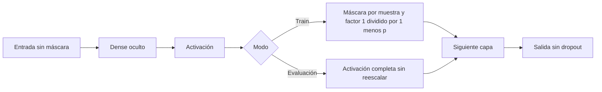
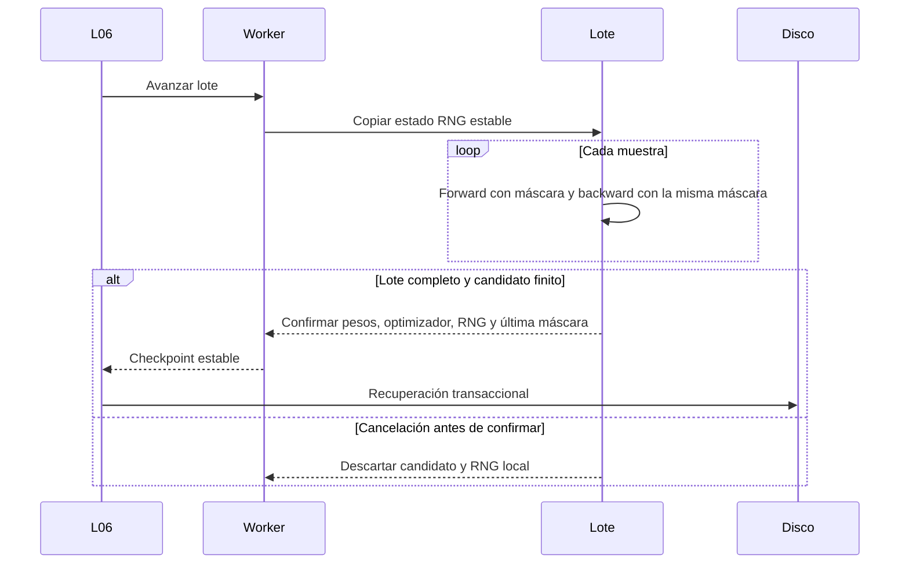
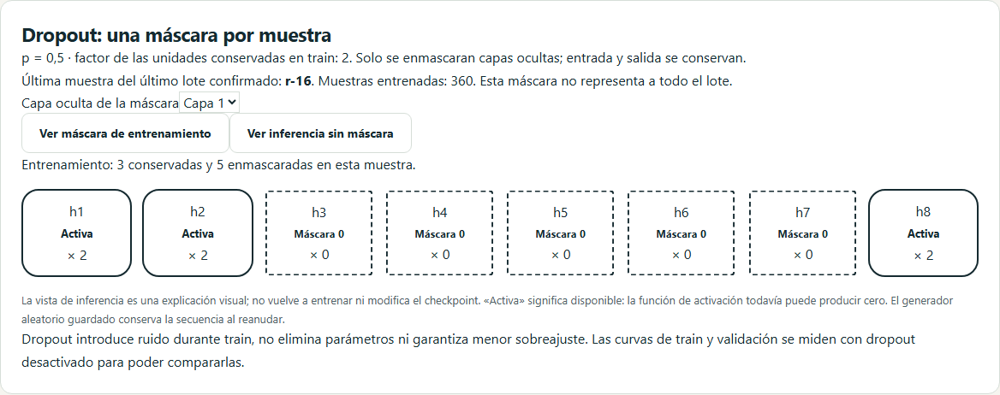
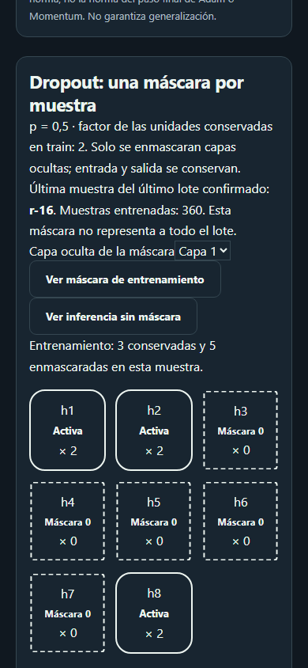

# D6 · Dropout invertido y secuencia reproducible

Incremento 0.7.2, 25 de octubre de 2026. Amplía el entrenamiento L06 y la comparación emparejada L08; avanza US-026 y US-035 sin cerrarlas mientras falta BN. D6 permanece abierto para BN, aumento de datos y comparación multisemilla.

## Reglas observables

Dropout es opcional y está desactivado inicialmente. El alumno escoge una probabilidad `p ∈ [0, 0,8]`, compartida por todas las capas ocultas; requiere al menos una. Cada muestra utiliza una máscara independiente por capa: `m ~ Bernoulli(1−p)` y `a′ = a·m/(1−p)`. No se aplica a entradas ni salidas. Backprop utiliza **la misma máscara y el mismo factor**, además de la derivada de la activación. Los pesos no se eliminan. p=0 conserva exactamente la trayectoria numérica anterior, aunque el experimento identifica explícitamente el nuevo contrato.

La esperanza de cada activación enmascarada coincide con su valor previo, con los pesos fijados. Eso no implica igualdad de predicciones o pérdidas entre una red no lineal completa y el promedio de sus subredes. Dropout introduce ruido en train; no garantiza menor sobreajuste ni mejora para cualquier problema.

Validación, test, predicción y las curvas de pérdida de train utilizan **evaluación sin máscara y sin reescalado**. Las curvas no representan el objetivo estocástico de cada lote. L1/L2 y recorte conservan su orden: promedio de gradientes de muestras con dropout, penalización de pesos, recorte global y optimizador. La parada temprana observa la pérdida determinista de validación.

## Estado, cancelación y reanudación

Se utiliza el stream Mulberry32-v1 con propósito `dropout`, separado de inicialización y orden de lotes. Consume un uniforme por neurona oculta y muestra, también cuando p=0. El checkpoint conserva estado uint32, caché normal nula, número de muestras entrenadas, ID de la última muestra y sus máscaras binarias por capa. La máscara mostrada pertenece a **la última muestra del último lote confirmado**, no al lote entero.

El generador del lote es una copia local. Si se cancela un lote incompleto, su consumo aleatorio no alcanza el checkpoint estable. La confirmación del lote actualiza juntos modelo, optimizador y RNG. Al pasar de época se conserva el stream; no se reinicia. El mejor checkpoint de parada temprana incorpora la misma copia completa, por lo que restaurar y continuar reproduce también la próxima máscara.

La validación comprueba que `muestras = época·Ntrain + cursor`, el ID esperado y la forma/binarios de las máscaras. Verifica el estado Mulberry mediante aritmética módulo 2³² y regenera únicamente la última máscara para comprobarla: no recorre todas las muestras anteriores. La lectura no consume el RNG del entrenamiento.

## Diseño y contratos

| Archivo | Responsabilidad |
| --- | --- |
| `src/domain/random/seeded.ts` | Restauración validada del PRNG, incluida caché normal para otros usos |
| `src/domain/training/dropout.ts` | Configuración, máscaras, copias y coherencia del estado |
| `src/domain/training/kernel.ts` | Forward y backward cooperativos con contexto opcional de entrenamiento |
| `src/domain/training/session.ts` | Confirmación atómica por lote; evaluación sin dropout |
| `src/domain/training/early-stopping.ts` | Copia profunda del RNG y máscaras del mejor estado |
| `src/application/training/checkpoint-codec.ts` | Serialización estricta del nuevo estado |
| `src/features/training/DropoutPanel.vue` | Máscara real, elección de capa y comparación visual train/inferencia |

Configurar dropout utiliza **schemaVersion 4 / engineVersion 4**, incluso con p=0 o combinado con regularización/parada temprana. Se leen formatos 1–4; las versiones antiguas no abren v4. Ausencia de dropout mantiene v1/v2/v3 y sus hashes. El checkpoint base sigue siendo versión interna 1 con campos opcionales validados. Los archivos de inferencia mantienen v1: contienen los pesos seleccionados y el pipeline, sin máscaras, RNG ni configuración de dropout. IndexedDB conserva su versión; las cuotas incluyen el nuevo metadato y el presupuesto numérico declara buffers adicionales.

El panel ofrece selección de capa, unidades identificadas por texto y forma, factor aplicado y vista de inferencia. La vista es una explicación, no una nueva ejecución ni un cambio del checkpoint. Las transiciones respetan velocidad y movimiento reducido de Ajustes. L08 utiliza mismos datos, split, preparación, inicialización y presupuesto en ambas ramas; solo la intervención consume el stream dropout. Test permanece reservado.

## Evidencia y límites

**336 pruebas unitarias/integración**, cobertura de líneas **96,55 %** y ramas **93,21 %**, sin reducir umbrales. Se comprueban todos los pesos y sesgos de una red de dos capas ocultas mediante diferencias centrales con máscaras fijas; la derivada se evalúa condicionada a esas máscaras. Clasificación binaria, multiclase y regresión se reanudan exactamente con los cuatro optimizadores. Incluye tasa cero, cancelación sin consumo, corrupción, restauración del mejor RNG y exportación de modelos independientes.

**60 recorridos por navegador**: 120 locales Chromium/WebKit y 180 en CI Chromium/Firefox/WebKit. Los tres nuevos recorridos cubren Worker nativo, recuperación en disco, importación y siguiente lote idénticos, predicción independiente, comparación v4, móvil, temas y accesibilidad automática. Los controles automáticos no sustituyen una auditoría manual completa ni un pilotaje docente.

Capturas reales reproducibles con `scripts/capture-d6-dropout.mjs`:

No incluye probabilidades distintas por capa, dropout en entradas, MC dropout, BN ni distribuciones de resultados multisemilla. Esas extensiones conservan sus historias. El [incremento anterior](35-parada-temprana-d6.md) documenta la política de selección y continuación del mejor estado.
