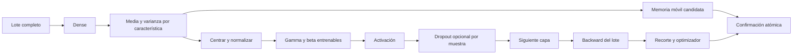
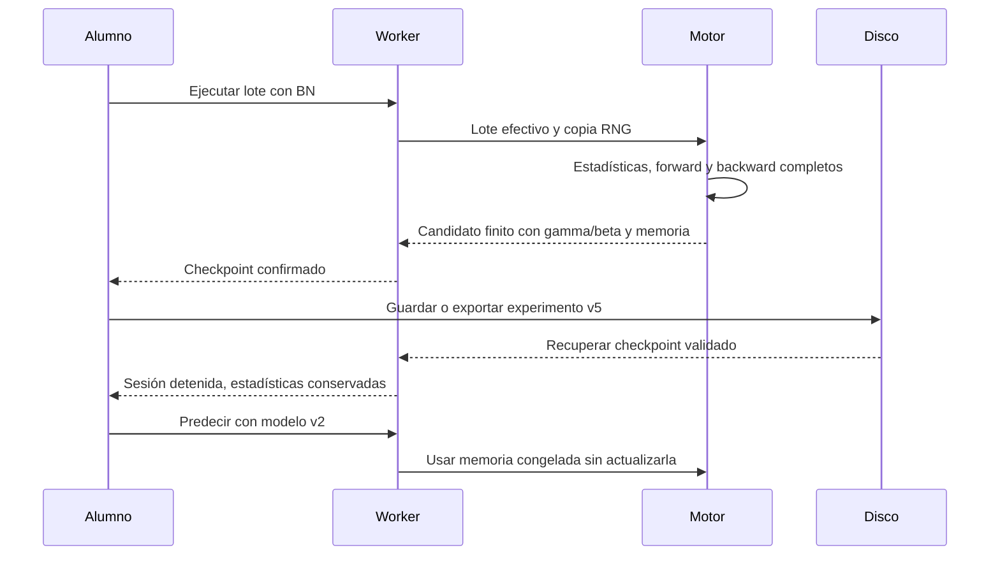
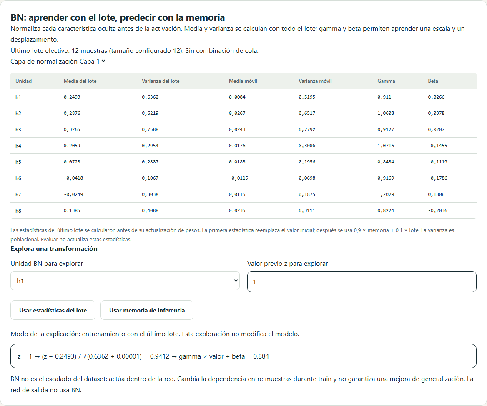
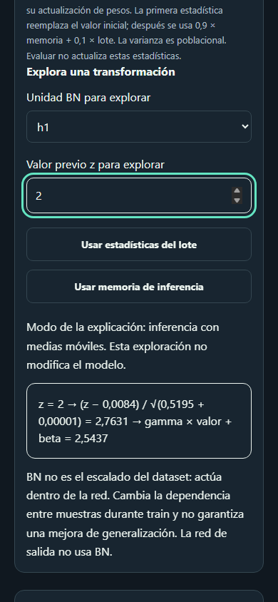

# D6 · Normalización por lotes con estado completo

Incremento 0.7.3, 25 de octubre de 2026. BN está disponible en entrenamiento L06 y comparación L08, combinable con dropout, L1/L2, recorte y parada temprana. Avanza US-026 y US-035; su aceptación global y D6 siguen abiertos mientras quedan aumento de datos y comparación multisemilla.

## Contrato matemático

En cada capa oculta se ejecuta Dense → BN → activación → dropout opcional. La salida conserva sigmoid, softmax o lineal sin BN. Para cada característica del lote:

```text
μ = mean(z)
v = mean((z − μ)²)                   varianza poblacional
x̂ = (z − μ) / sqrt(v + 1e-5)
u = gamma · x̂ + beta
```

Gamma comienza en 1 y beta en 0; ambos son parámetros entrenables y añaden dos valores por unidad oculta. Media y varianza móviles no son parámetros entrenables. Los sesgos densos previos a BN se conservan aunque sean redundantes con el centrado; su gradiente teórico puede ser cero, con residuos numéricos de redondeo.

El backward calcula `dbeta = Σ du`, `dgamma = Σ(du·x̂)` y `dz = gamma/sqrt(v+ε)/B · (B·du − Σdu − x̂·Σ(du·x̂))`. La pérdida ya está promediada una vez entre las muestras; el factor B de esta derivada pertenece al Jacobiano de BN, no introduce un segundo promedio de la pérdida. El gradiente se calcula con los pesos anteriores antes de actualizar cualquier parámetro.

La media móvil utiliza memoria 0,9: `running ← 0,9·running + 0,1·estadística`. La primera estadística reemplaza el inicial, mediante `initialized`; antes del primer lote, evaluación usa media 0 y varianza 1. Se conserva varianza poblacional también en la memoria. Es una convención propia explícita: no se promete igualdad numérica con frameworks que utilicen otras convenciones.



## Lotes, aleatoriedad y evaluación

BN exige alguna capa oculta y tamaño configurado ≥2. Si la cola tendría una sola muestra, se combina con el lote anterior: N=280 y B=31 produce ocho lotes de 31 y uno de 32, nueve actualizaciones en total. No se omiten ni duplican muestras. Se permiten B+1 efectivos en esa frontera, incluso 513 para B=512. Los contadores, IDs, presupuesto y validadores usan esta misma regla.

El kernel trabaja con el lote completo y cede el control durante el cálculo de filas, estadísticas y gradientes. No simula BN promediando gradientes independientes. Dropout conserva un uniforme por neurona oculta y muestra, en orden muestra→capa→unidad. Sus máscaras se generan con una copia local del RNG. Cancelar antes de confirmar descarta candidato, estadísticas y consumo aleatorio.

La confirmación guarda juntos pesos, gamma/beta, momentos de los cuatro optimizadores, memoria móvil, RNG y estadísticas del último lote. Estas últimas se calcularon antes de actualizar los pesos y se muestran como tales. La parada temprana conserva todos esos campos en su mejor checkpoint. Restaurar no reinicia las medias móviles.

Evaluación de train, validación, test y predicción utiliza memoria móvil congelada y dropout desactivado. No recalcula estadísticas con la consulta ni mezcla test con train. Las curvas representan este modo de evaluación, no la pérdida estocástica del lote. BN no equivale al escalado de entrada ni garantiza mejor generalización.

## Diseño, archivos y persistencia

| Archivo | Responsabilidad |
| --- | --- |
| `src/domain/network/normalization.ts` | Inicialización, copia, validación y transformación para inferencia |
| `src/domain/training/normalized-batch.ts` | Forward/backward del lote, gamma/beta y estadísticas candidatas |
| `src/domain/training/batches.ts` | Cola combinada y número real de actualizaciones |
| `src/domain/training/optimizer.ts` | Momentos también para gamma y beta |
| `src/domain/training/regularization.ts` | Penalización solo de W; recorte global incluye gamma/beta |
| `src/application/training/network-schema.ts` | Conversión explícita de todos los tensores |
| `src/features/training/BatchNormalizationPanel.vue` | Tabla real y exploración numérica train/inferencia |

Activar `spec.batchNormalization` usa **experimento schemaVersion 5 / engineVersion 5**, también combinado con las otras intervenciones. Se leen experimentos 1–5. El modelo denso base mantiene versión interna 1 con campos opcionales; el formato externo distingue los requisitos de su consumidor. El hash incluye la arquitectura BN y todas las estadísticas. Ausencia de BN conserva rutas y formatos anteriores.

Los modelos independientes con BN utilizan **neural-atlas.model v2 / engineVersion 2** y retienen gamma/beta y medias/varianzas móviles. No incluyen filas, optimizador, máscaras ni la traza del último lote. Modelos sin BN mantienen v1. Las versiones antiguas no abren experimentos v5 ni modelos v2. Se rechaza un encabezado que no corresponda al contenido.

IndexedDB no cambia de versión. Biblioteca, recuperación automática y parada temprana conservan los nuevos tensores; las cuotas cuentan sus bytes nativos y el presupuesto incluye buffers proporcionales al lote completo. La norma global de recorte incluye todos los parámetros entrenables; la interfaz distingue la contribución conjunta de gamma/beta. L1/L2 siguen penalizando solamente matrices densas.



## Verificación y límites

**367 pruebas unitarias/integración**, cobertura de líneas **96,54 %** y ramas **93,20 %**, con gradientes centrados para todos los pesos, sesgos, gamma y beta en clasificación binaria, multiclase y regresión y cuatro activaciones. Los oráculos usan máscaras fijas para comprobar también la composición con dropout. Reanudación exacta con SGD, Momentum, RMSprop y Adam, transición de época, cola combinada, cancelación, corrupción, mejor estado y congelación de test.

**63 recorridos por navegador**: 126 locales Chromium/WebKit y 189 en CI con Firefox. Los tres nuevos recorridos verifican Workers nativos, recuperación completa en disco, importación y siguiente lote idéntico, modelo v2 tras recarga, tabla y transformación en móvil/ambos temas, evaluación congelada y comparación BN con test reservado. Los umbrales existentes se mantienen. La comprobación automática no sustituye una auditoría manual completa ni una evaluación docente con alumnos.

La comparación L08 conserva los mismos pesos y sesgos densos iniciales. BN añade gamma=1, beta=0 y sus estadísticas propias; no se afirma igualdad de las predicciones iniciales entre ambas redes. Las conexiones del diagrama representan la parte densa; el panel BN muestra sus parámetros adicionales.

Capturas reales reproducibles con `scripts/capture-d6-normalization.mjs`:





Esta entrega aplica BN a todas las capas ocultas con ε y memoria fijos. No incorpora layer/group normalization, estadísticas por dispositivo ni equivalencia de entrenamiento con otro framework. Aumento de datos válido por receta y comparación multisemilla permanecen pendientes.
