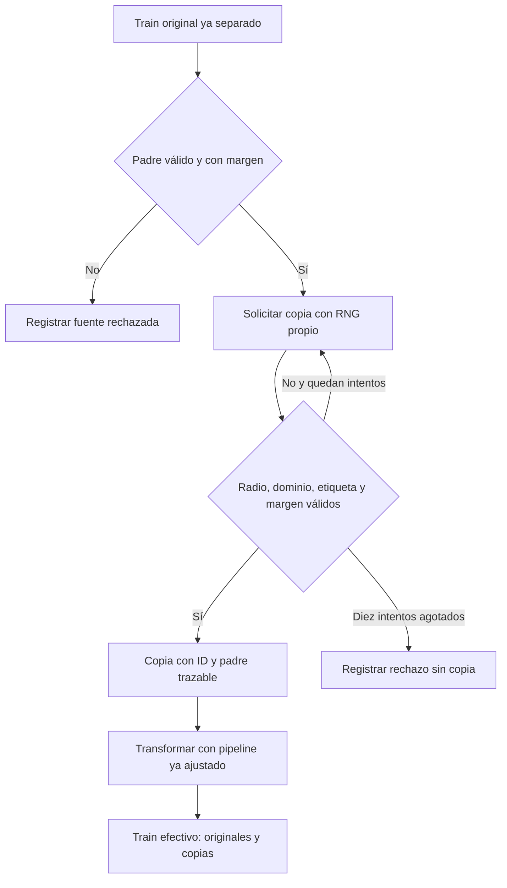
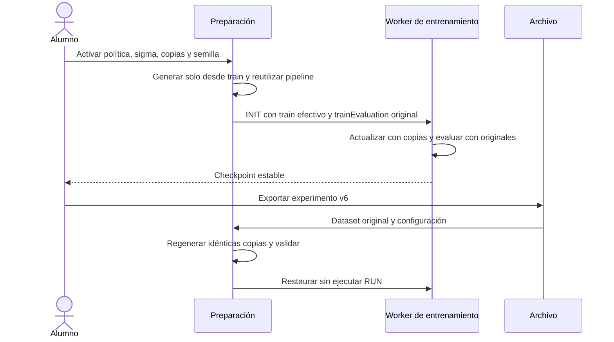
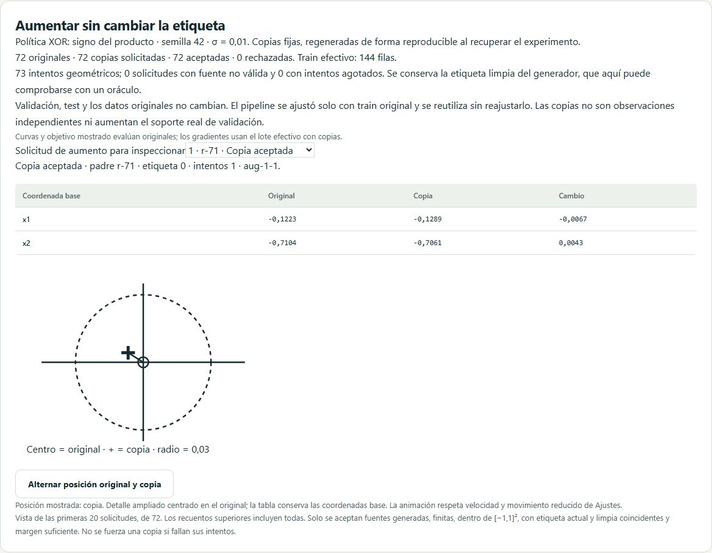
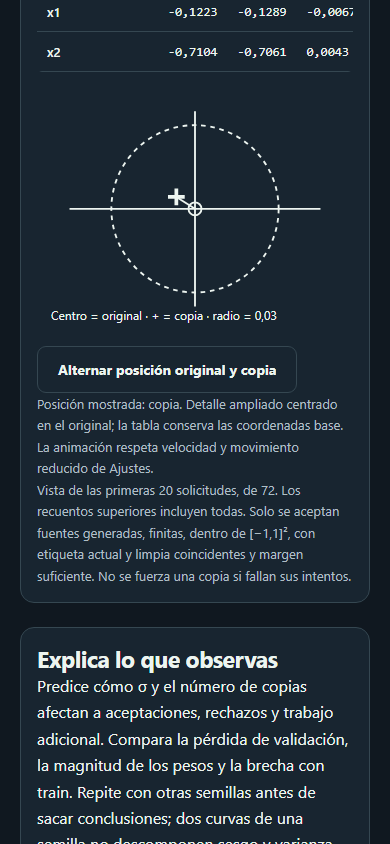

# D6 · Aumento conservador de datos con trazabilidad

Incremento 0.7.4, 25 de octubre de 2026. Aumento en L06 y comparación L08 para las recetas sintéticas de círculos y XOR. Las copias son **fijas por experimento**, generadas antes del pipeline ya ajustado y usadas solo en entrenamiento. No cambian cada época ni se escriben como filas del dataset original. D6 sigue abierto para comparación multisemilla y aceptación global.

## Política geométrica y límites

| Política | Oráculo de etiqueta limpia | Margen |
| --- | --- | --- |
| Círculos | Clase 1 si `norm(x)<0,5`; clase 0 en otro caso | `abs(norm(x)−0,5)` |
| XOR | Clase 1 si `x1·x2<0`; clase 0 en otro caso | `min(abs(x1),abs(x2))` |

La fuente debe tener receta compatible, dos características numéricas x1/x2 y clasificación binaria con orden 0,1. Cada padre debe ser generado, finito, estar dentro de [−1,1]², conservar su etiqueta limpia anotada y coincidir con el oráculo, con margen ≥0,03. Se excluyen fuentes con etiqueta alterada, outliers o faltantes; las filas importadas o manuales tampoco producen copias. Un JSON exportado desde la aplicación puede conservar su receta y sus filas generadas. Estos metadatos no constituyen una certificación de procedencia externa.

Por cada original de train se solicitan entre una y tres copias. Se dibujan dos desplazamientos gaussianos independientes con `σ ∈ [0, 0,01]`, stream Mulberry32-v1 `augmentation` y semilla explícita. El candidato se acepta solo si:

1. El radio del desplazamiento es ≤0,03.
2. Permanece dentro de [−1,1]².
3. Conserva la etiqueta del oráculo y margen ≥0,03.

Cada solicitud tiene como máximo diez intentos. Un fallo no fuerza ni recorta una copia: se registra como rechazo. Los padres rechazados permanecen como originales en train; el criterio puede dar más peso a las fuentes que sí admiten copias. σ=0 genera duplicados exactos; no añade variación ni observaciones independientes. No hay rotaciones, reflexiones, mezcla de clases ni aumento automático de lunas, flores, regresión o datos sin política conocida. El ruido de etiquetas no se presenta como augmentation.

## Partición, curvas y presupuesto

El split se realiza antes de generar copias. Los IDs de train original son los únicos candidatos; validación y test no se transforman. El pipeline conserva estadísticas y vocabularios ajustados solo con train original, sin reajuste con las copias. El dataset, su hash y su partición originales permanecen iguales.

`TrainingInput.train` contiene originales seguidos de copias aceptadas, con IDs `aug-indicePadre-numeroCopia`. `trainEvaluation` conserva una copia independiente de los originales. Pérdidas/curvas de train, evaluación de entrenamiento, matriz de confusión y baseline se calculan sobre originales. `trainObjective` muestra esa pérdida evaluada más penalización, no el objetivo del lote aumentado que produce el gradiente. Las copias sí contribuyen al gradiente, a los lotes, a BN y a sus medias móviles. No aumentan el soporte real de las métricas.

El presupuesto y los contadores usan filas efectivas, incluida la cola combinada de BN. Un lote completo se refiere a ese total efectivo. Se bloquea la solicitud si el máximo posible de originales+copias más validación supera 10.000 filas, antes de generar candidatos, aunque algunos pudieran rechazarse. Reducir copias o tamaño del dataset resuelve ese límite.

L08 compara referencia e intervención con misma receta, datos originales, split, pipeline, pesos iniciales, tamaño de lote y máximo de épocas. **Añadir copias puede aumentar el número de actualizaciones y el coste**: no se afirma que el presupuesto de actualizaciones esté igualado. La tabla muestra filas efectivas y actualizaciones. Las pérdidas de train/validación se comparan con los mismos originales. Para este ensayo se selecciona círculos o XOR; otras intervenciones conservan medias lunas.

## Estado, recuperación y responsabilidades

| Archivo | Responsabilidad |
| --- | --- |
| `src/domain/data/augmentation.ts` | Políticas, oráculos, rechazo, generación y trazabilidad pura |
| `src/application/training/source.ts` | Selección exclusiva de train y transformación con el pipeline existente |
| `src/domain/training/session.ts` | Contrato de originales/copias; curvas y baseline originales |
| `src/stores/training.ts` | Evaluación de train original y restauración sin arrancar |
| `src/features/training/AugmentationPanel.vue` | Recuentos, inspección de solicitudes y detalle 2D ampliado |
| `src/application/training/generalization.ts` | Ensayos emparejados con trabajo adicional declarado |

Las copias no requieren un RNG en movimiento dentro del checkpoint: se regeneran determinísticamente desde dataset, IDs ordenados de train, política, semilla, σ y número de copias. La preparación se ejecuta antes de INIT; en L08 y recuperación en disco se realiza dentro de sus Workers existentes. El motor de entrenamiento continúa en su Web Worker. Se limita la vista a las primeras veinte solicitudes, con recuentos sobre todas.

Activar aumento usa **experimento schemaVersion 6 / engineVersion 6**, también con BN, dropout y parada temprana. Se leen versiones 1–6; sin aumento se conserva el contrato anterior. No cambia el checkpoint base ni la versión de IndexedDB. El experimento contiene dataset original y configuración: las filas efectivas se reconstruyen y validan antes de restaurar orden, cursor y momentos. Cambiar la política o parámetros cambia el hash de configuración. No se exportan las copias dentro del CSV/JSON del dataset original.

Los modelos independientes siguen siendo v1 sin BN o v2 con BN. Contienen modelo y preparación aprendida; la inferencia no genera copias ni aplica jitter. Restaurar el mejor checkpoint conserva optimizador, BN y RNG de dropout, y reconstruye exactamente las mismas copias fijas. Un estado congelado sigue sin admitir entrenamiento.

## Evidencia y límites

**385 pruebas unitarias/integración**. Se verifican radio, margen y etiqueta, inmutabilidad de originales, semilla reproducible, σ=0, rechazo de fuentes inválidas, diez intentos máximos y límites. Las dos recetas se reanudan exactamente con los cuatro optimizadores y con BN/dropout/parada temprana. Se comprueban originales de evaluación, pipeline sin reajuste, modelos independientes y formatos incompatibles.

**66 recorridos por navegador**: 132 locales Chromium/WebKit y 198 en CI con Firefox. Los nuevos recorridos cubren recuperación/importación exactas, métricas sobre las 280 filas originales del ejemplo, accesibilidad automática del gráfico en móvil y ambos temas, y comparación XOR con exportación v6. Se mantienen los umbrales; la verificación automática no sustituye una auditoría manual ni un pilotaje docente.

Capturas reales reproducibles con `scripts/capture-d6-augmentation.mjs`:

Quedan fuera el aumento en línea que cambia por época, nuevas políticas para otras recetas o datos reales, exportación de un dataset materializado de copias y comparación multisemilla. Esta entrega no promete una mejora de generalización por el mero hecho de aumentar filas.
