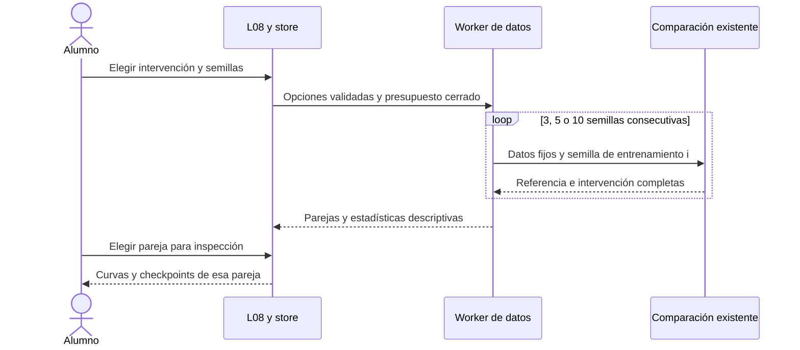
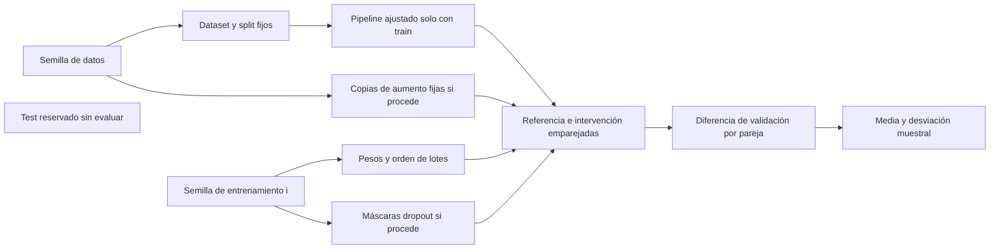
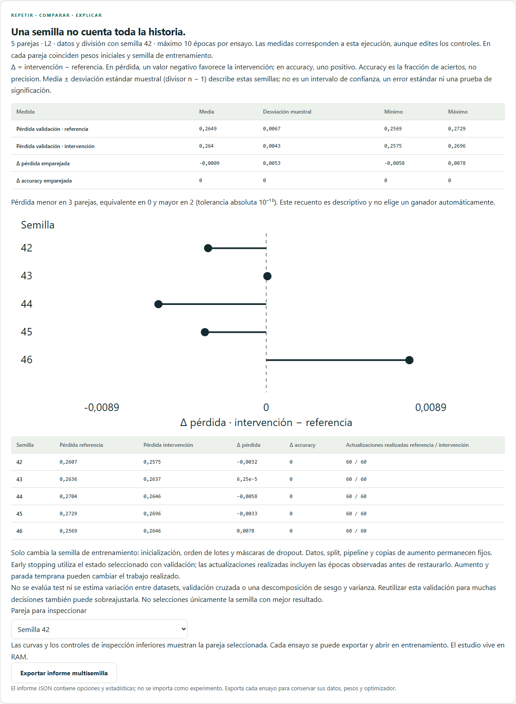
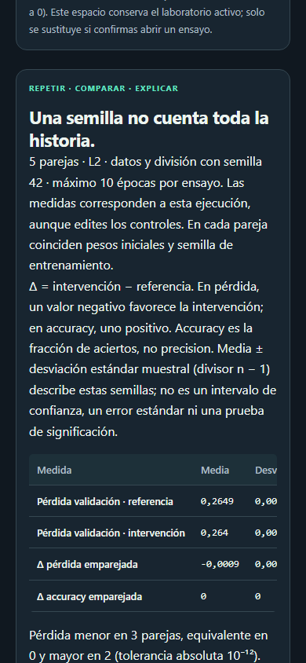

# D6 · Comparación emparejada entre semillas

Incremento 0.7.5, 25 de octubre de 2026. L08 permite repetir una intervención con **3, 5 o 10 semillas de entrenamiento**, inspeccionar cada pareja y exportar un informe descriptivo. No se usa test. Este incremento cubre la repetición estadística pendiente de L08; no cierra por sí solo toda la aceptación D6 ni constituye el comparador arbitrario L12 de D7.

## Experiencia y requisitos

1. Escoge L1, L2, recorte, parada temprana, dropout, BN o aumento, ruido y horizonte de 5–120 épocas.
2. «Semilla compartida» conserva la generación de los 120 datos, división estratificada 72/24/24 y pipeline ajustado solo con train. Con aumento, también fija las copias y su RNG.
3. Elige 3/5/10 repeticiones y primera semilla de entrenamiento. Las semillas son enteros uint32 consecutivos: después de 4294967295 vuelve a 0. No se filtran ni ordenan por resultado.
4. Ejecuta en un Web Worker: 6/10/20 ensayos secuenciales. Se puede cancelar inmediatamente terminando el Worker. Solo se publican estudios completos; un fallo, cancelación o abandono de ruta conserva el último resultado completo.
5. Compara pérdidas de validación, diferencias emparejadas y dispersión. Selecciona una pareja para ver sus curvas y estado real en los componentes de inspección existentes.
6. Exporta el informe de análisis o cada experimento. Abrir un ensayo en L06 exige la confirmación habitual de sustitución del laboratorio. Cambiar pareja invalida una confirmación pendiente.

Dentro de cada pareja coinciden pesos y sesgos densos iniciales, datos, split, pipeline, tamaño de lote y horizonte máximo. Entre parejas cambia la **semilla de entrenamiento**, que gobierna inicialización, orden de lotes y máscaras de dropout. No se presenta como una variación exclusiva de pesos. BN añade parámetros afines propios como en 0.7.3; aumento conserva sus copias como en 0.7.4. Parada temprana puede detenerse antes y aumento añade actualizaciones: el presupuesto de trabajo no está igualado.

Los resultados contienen una copia validada de las opciones de su ejecución. Editar controles no cambia el informe ni las curvas existentes. Una comparación simple completada sustituye el estudio multisemilla visible; no lo sustituye si falla o se cancela. La selección por defecto es la primera pareja, intervención; no se busca automáticamente la semilla con menor pérdida.

## Cálculo y límites estadísticos

Para cada semilla i se extrae del checkpoint seleccionado la pérdida de validación de referencia A y de intervención B. Se calcula `ΔLᵢ = Lᵢ(B) − Lᵢ(A)`; negativo favorece B. Para accuracy (fracción de aciertos) `ΔAccᵢ = Accᵢ(B) − Accᵢ(A)`; positivo favorece B. Accuracy no es precision.

El resumen incluye media, mínimo, máximo y **desviación estándar muestral** de pérdidas A/B y diferencias emparejadas. Con n semillas:

`media = Σ xᵢ / n`; `s = √[Σ (xᵢ − media)² / (n − 1)]`.

Se agregan diferencias por pareja; la desviación de Δ no se calcula restando desviaciones marginales. No se agrega el objetivo penalizado como si fuera la misma pérdida al cambiar λ. Un recuento descriptivo usa tolerancia absoluta 10⁻¹² para diferencias equivalentes. No hay p-valores, intervalos de confianza, error estándar ni elección automática de ganador. Los datos con dos clases y solo 24 filas de validación hacen que accuracy sea discreta.

Con parada temprana, las métricas corresponden al mejor estado restaurado por validación y no a la última época observada. Las actualizaciones **realizadas** del informe se toman de la última observación antes de restaurar, evitando subestimar el trabajo. El archivo individual conserva ambos estados como antes.

Este estudio describe variación del procedimiento de entrenamiento **condicionada a un único dataset, split y configuración**. Las semillas de un PRNG no son una prueba de independencia estadística. No estima variación entre datasets, validación cruzada, incertidumbre poblacional ni una descomposición formal de sesgo/varianza. Consultar repetidamente esta validación para ajustar intervenciones puede sobreajustarla. Test sigue reservado y no se usa para rankear semillas.

## Diseño, compatibilidad y presupuesto

| Responsabilidad | Archivo |
| --- | --- |
| Pareja con semilla de datos y entrenamiento separadas | `src/application/training/generalization.ts` |
| Validación, enumeración, estadística y formato de informe | `src/application/training/multiseed.ts` |
| Mensaje tipado `multiseed` y despacho de errores | `src/application/data/jobs.ts` |
| Cancelación, conservación y selección explícita | `src/stores/generalization.ts` |
| Resumen, gráfico D3/SVG y tabla equivalente | `src/features/generalization/MultiseedPanel.vue` |
| Controles y reutilización de la inspección | `src/features/generalization/GeneralizationPage.vue` |

Se reutiliza el motor y sus versiones actuales: experimentos v1–v6 y modelos de inferencia v1/v2. No se modifican hashes de configuraciones previas ni contratos de checkpoint. Cada experimento registra en `config.seed` su semilla de entrenamiento y conserva dataset/split originales. La llamada de una sola pareja sin segundo argumento mantiene el comportamiento anterior.

El archivo `neural-atlas.multiseed-report`, schemaVersion 1, contiene versión de aplicación, ámbito `training-seed-fixed-data`, opciones, medidas por semilla, resumen y `testConsulted: false`. Es un informe JSON de análisis, **no se importa como experimento**. Para conservar pesos y momentos se exporta cada ensayo con el botón existente. El estudio permanece en RAM: no cambia IndexedDB ni LocalStorage y no altera la sesión activa de entrenamiento.

El presupuesto máximo son 20 entrenamientos de una red 2→8→8→1 sobre 120 datos, 120 épocas cada uno, con los límites de la comparación existente. No admite redes/datasets arbitrarios ni búsqueda exhaustiva. Se retienen todos los ensayos para inspección; no hay progreso parcial ni promesa de tiempo fijo. El hilo principal queda disponible y cancelar termina el Worker. Los gráficos incluyen texto y tabla, controles con nombre, scroll horizontal accesible con teclado, temas claro/oscuro y vista móvil; no añaden movimiento automático.

## Verificación

- Unidad: estadística conocida y entradas no finitas, límites, vuelta uint32, datos/split/pipeline fijos, pesos emparejados, diferencias reales, repetibilidad y equivalencia exacta con λ cero.
- Las siete intervenciones recorren el motor real; se verifican exportación/importación y preparación de experimentos sin usar test. Aumento conserva copias entre semillas; early stopping declara actualizaciones observadas y métricas seleccionadas.
- Integración: cliente Worker con despachador real, selección/exportación, confirmación invalidada, cancelación, salida de ruta, límites, error de descarga y conservación de resultados.
- Playwright: Worker nativo, informe y archivo individual coherentes, apertura de semilla correcta, cancelación, λ cero, móvil, ambos temas y accesibilidad automática.
- CI conserva los umbrales de cobertura y ejecuta todos los recorridos en Chromium, Firefox y WebKit. El smoke público comprueba un informe multisemilla además de los contratos previos.

Verificación local: **398 pruebas unitarias/integración**, cobertura de líneas **96,40%** y ramas **92,95%**, tipos/lint, build, CSP/presupuesto y documentación correctos. La batería local recorrió 136 casos Chromium/WebKit: 135 pasaron en la ejecución completa; uno de CSV falló antes de cargar la aplicación con `net::ERR_NO_BUFFER_SPACE` de Windows y pasó en repetición aislada sin cambios. Los cuatro casos multisemilla pasaron en ambos motores. El recorrido completo de smoke, adaptado temporalmente a localhost, también pasó; el script publicado conserva sus comprobaciones HTTPS y de dominio. CI ejecuta **204 recorridos** en los tres motores. Firefox local conserva la incidencia de Windows documentada en D1.

Capturas reproducibles con `scripts/capture-d6-multiseed.mjs`:

No se afirma validación docente en aula. Quedan las curvas por tamaño de dataset y capacidad de RF-042 y la aceptación global D6; después siguen el comparador general, CV y módulos de D7, además de los siguientes talleres del plan.
