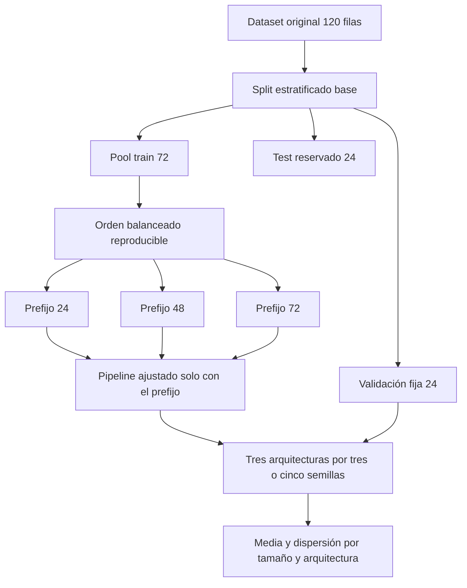
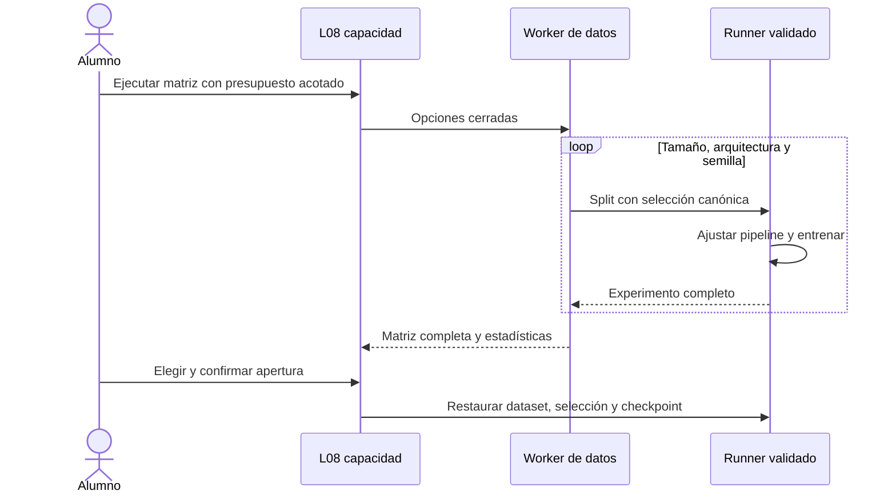
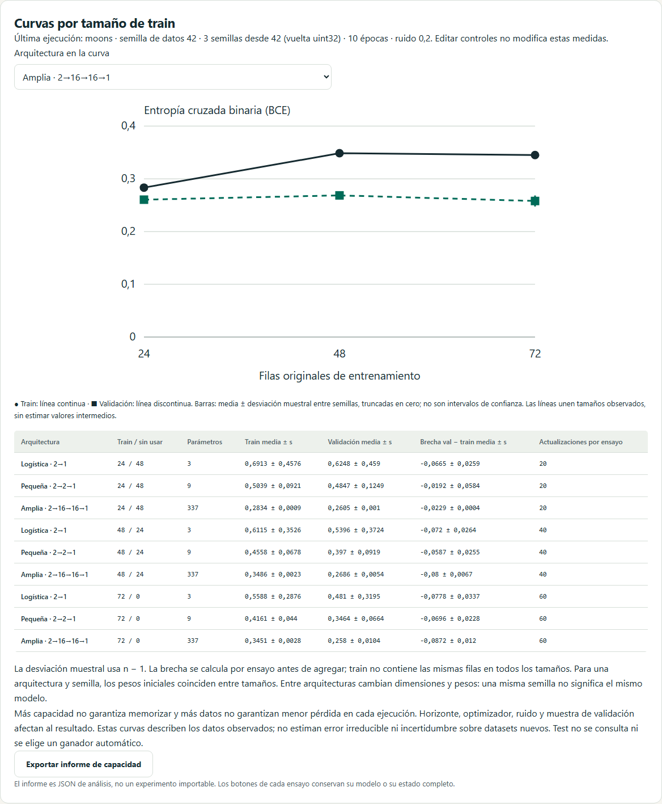
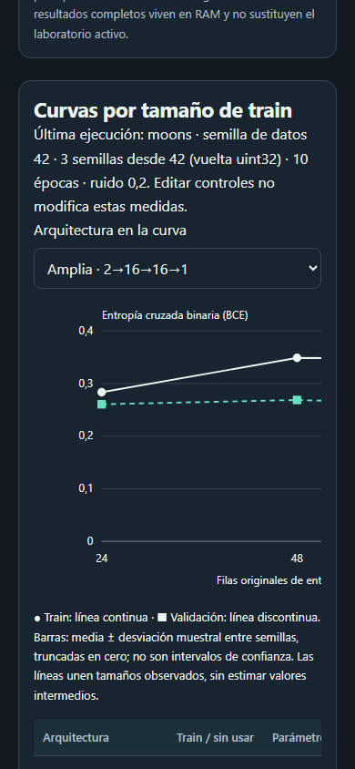

# D6 · Capacidad y curvas por tamaño de datos

Incremento 0.7.6, 26 de octubre de 2026. La vista L08 `/lab/generalizacion/capacidad`, enlazada desde regularización, compara **24/48/72 filas de train**, **tres arquitecturas** y **3/5 semillas** con validación fija. Completa el bloque de capacidad y tamaños de RF-042, después del aumento y la repetición multisemilla. No equivale a un análisis causal de sesgo/varianza ni al comparador libre L12.

## Requisitos y diseño experimental

| Elemento | Convención verificable |
| --- | --- |
| Datos | 120 puntos sintéticos de lunas, círculos o XOR; ruido 0–0,4 |
| Partición base | Estratificada, 72 train, 24 validación, 24 test; semilla de datos fija |
| Tamaños | Prefijos anidados y balanceados de 24, 48 y 72 IDs del pool train |
| Preprocesamiento | Imputación media y escalado estándar ajustados solo con cada prefijo |
| Arquitecturas | Logística 2→1 (3 parámetros), MLP 2→2→1 (9), MLP 2→16→16→1 (337) |
| Red | Tanh en ocultas, salida sigmoide y Xavier; sin BN/dropout/early stopping/aumento en este estudio |
| Entrenamiento | Adam tasa 0,01, lote 12, horizonte 5–120 épocas común |
| Pérdida | Entropía cruzada binaria estable desde logits; no MSE |
| Repetición | 3 semillas por defecto, opción 5; consecutivas uint32, vuelta a 0 tras 4294967295 |
| Presupuesto | 27 o 45 ensayos secuenciales en Web Worker; cancelación por terminación |

La red logística tiene logit lineal y frontera de decisión recta con umbral 0,5. Su salida sigmoide no es una regresión numérica lineal. La clave `config.loss: 'mse'` conserva el contrato existente de pérdidas **de regresión**: el motor binario utiliza siempre BCE; la interfaz y el informe muestran la pérdida efectiva.

Para cada clase se barajan los IDs de train con la semilla de selección y streams `subset-0`/`subset-1`. Se intercalan en el orden declarado de clases y se toman prefijos. Cada tamaño contiene la mitad de cada clase. Los prefijos de una ejecución están anidados y no incorporan validación/test. Las 48 o 24 filas restantes del pool train quedan sin usar, visibles en la tabla y en L01 tras abrir el ensayo.

La selección solo admite clasificación binaria con pool balanceado, estrategia estratificada y ausencia de grupos; exige tamaño par ≥4, no superior al pool. Los casos incompatibles fallan explícitamente. Esta política acotada no pretende resolver subconjuntos estratificados multiclase, temporales o por grupos. No se cambian etiquetas ni se eliminan filas del dataset original.

El pipeline se vuelve a ajustar por tamaño, sin consultar filas omitidas, validación o test. Con la misma arquitectura y semilla, los pesos iniciales coinciden entre tamaños; el pipeline cambia, por lo que no se afirma identidad de la función completa sobre coordenadas originales. Entre arquitecturas cambian dimensiones, parámetros y pesos. La misma semilla no produce modelos idénticos de distinta forma.

El presupuesto iguala épocas, **no actualizaciones ni cómputo**: cada época tiene 2/4/6 actualizaciones según tamaño, y las redes más grandes requieren más operaciones por actualización. Se declaran ambos ejes. Test permanece reservado y ningún resultado lo puntúa. Cambiar controles conserva las opciones realmente ejecutadas junto al último resultado.

## Cálculo y experiencia visual

Cada ensayo conserva su historial por época, modelo, momentos del optimizador, IDs de train, pipeline y checkpoint completo. Se agrupa por tamaño y arquitectura para calcular media y desviación muestral (divisor n−1) de train, validación y brecha `val−train`. La brecha se calcula **por ensayo antes de agregar**: su desviación no es la resta de desviaciones marginales.

El gráfico D3/SVG compara train y validación para la arquitectura seleccionada. Usa puntos y segmentos entre tamaños observados, sin interpolación predictiva. Barras verticales: media ± desviación muestral, truncadas en cero. Son dispersión descriptiva entre semillas, no intervalos de confianza ni error estándar. Línea continua/círculos y discontinua/cuadrados permiten distinguir series sin depender del color. Tabla textual equivalente, scroll por teclado y temas claro/oscuro; los ejes permanecen visibles en escritorio y se desplazan horizontalmente en móvil.

La inspección permite elegir cualquiera de los 27/45 ensayos, ver sus curvas por **época** y sus conexiones reales, con animación regulada por Ajustes y movimiento reducido. No se confunde la curva por tamaño con la curva por épocas ni la animación con actualizaciones adicionales.

Se puede exportar el informe de análisis, el experimento completo o el modelo de inferencia sin filas. Abrir un ensayo en L06 exige confirmación de sustitución del laboratorio; cambiar selección invalida una confirmación pendiente. Se abre detenido en su horizonte completado, como las comparaciones anteriores. Cancelación, fallo o salida de ruta conservan el último estudio completo. El estudio vive en RAM, sin sobreescribir automáticamente la sesión activa.

## Contratos y separación de responsabilidades

| Responsabilidad | Archivo |
| --- | --- |
| Selección canónica, balance, límites e integridad | `src/domain/data/split.ts` y `types.ts` |
| Dataset con selección y validación de versión | `src/application/data/json-schema.ts` y `json-files.ts` |
| Ejecución aislada reutilizada por L08 | `src/application/training/study-run.ts` |
| Matriz de ensayos, agregación e informe | `src/application/training/capacity.ts` |
| Worker tipado, validación y errores | `src/application/data/jobs.ts` |
| Estado, cancelación y exportación | `src/stores/capacity.ts` |
| Vista, confirmación y navegación | `src/features/generalization/CapacityPage.vue` |
| Escalas y representación de dispersión | `src/features/generalization/CapacityChart.vue` |

`DataSplit.selection`, cuando existe, contiene `{kind:'balanced-prefix-v1', count, seed}`. `validateSplit` reconstruye la división base y el prefijo; no acepta IDs arbitrarios ni un hash recalculado sin correspondencia con el algoritmo. El hash de selección forma parte de `splitHash`. Los ratios siguen describiendo la división base, no los tamaños efectivos posteriores.

Los datasets ordinarios continúan en **schemaVersion 1**, con el mismo hash. Solo los que llevan selección usan **dataset schemaVersion 2**; la correspondencia versión/selección es obligatoria en ambos sentidos. Los lectores antiguos rechazan v2. El dataset completo conserva 120 filas originales; la selección está en el split. Esto permite que los experimentos normales sigan validando el pipeline y reanudando exactamente, sin debilitar la validación de particiones.

No cambia el motor matemático ni sus hashes/versiones previos: experimentos v1–v6 y modelos v1/v2. Un experimento de este estudio usa motor/experimento v2 por su regularización cero explícita y **dataset anidado v2**, dos contratos distintos. Los lectores anteriores al soporte de dataset v2 no pueden abrirlo. El modelo de inferencia independiente conserva su formato y el pipeline del prefijo.

`neural-atlas.capacity-report`, schemaVersion 1, incluye versión de aplicación, métrica `binary-cross-entropy`, opciones ejecutadas, resúmenes y medidas por ensayo con hashes de configuración/pipeline/inicialización. No es importable como experimento; los botones individuales generan los archivos existentes con integridad y límites de tamaño.

## Pruebas y aceptación D6

- Unidad: prefijos anidados, balance, val/test fijos, límites, grupos y pools incompatibles, manipulación de IDs/metadatos, correspondencia dataset v1/v2 y escalado sin filas omitidas.
- Ejecuciones reales con tres recetas: 27 ensayos por estudio, conteos 3/9/337, actualizaciones 2/4/6 por época, semillas, repetibilidad, medias y brechas calculadas desde checkpoints reales.
- Roundtrip de cada ensayo y modelo; selección combinada con BN/dropout/early/aumento reanuda exactamente el siguiente checkpoint con los cuatro optimizadores.
- Integración: Worker con despachador real, configuración ejecutada, selección, confirmación, cancelación, fallo de apertura/exportación y vista de train omitido.
- Playwright: Worker nativo, descarga de informe/experimento/modelo, recuperación automática en disco con selección, evaluación de 24 originales, navegación, cancelación, temas, móvil y accesibilidad.

Estos casos completan el bloque técnico de capacidad de US-028. El informe de D6 debe leerse junto con [regularización](34-generalizacion-d6.md), [parada temprana](35-parada-temprana-d6.md), [dropout](36-dropout-d6.md), [BN](37-normalizacion-lotes-d6.md), [aumento](38-aumento-datos-d6.md) y [multisemilla](39-comparacion-multisemilla-d6.md). Las historias técnicas US-025/026/027/028/035 tienen implementaciones y pruebas; una aceptación docente en aula no se inventa ni se considera sustituida por estas comprobaciones.

Verificación local: **414 pruebas unitarias/integración**, líneas **96,33%**, ramas **93,15%**, tipos, lint, compilación, CSP/presupuesto y documentación correctos. Los casos que entrenan matrices completas bajo cobertura disponen de timeout específico de 30 s; esto no cambia las pruebas de latencia/pausa de la aplicación. La batería Chromium/WebKit recorrió 142 casos: 141 pasaron en la ejecución completa y uno de datos falló con `net::ERR_NO_BUFFER_SPACE` de Windows; pasó aisladamente sin cambiar la aplicación. Se limita a dos el número de navegadores paralelos locales, igual que en CI, para reducir presión sobre recursos. CI exige 213 recorridos en los tres motores.

Capturas reproducibles con `scripts/capture-d6-capacity.mjs`:

Continúan D7 (comparador libre, validación cruzada, pipelines avanzados, deriva y segmentos), D8–D10 y los talleres posteriores según su plan. Las extensiones X1/X2 siguen siendo propuestas separadas del alcance original.
