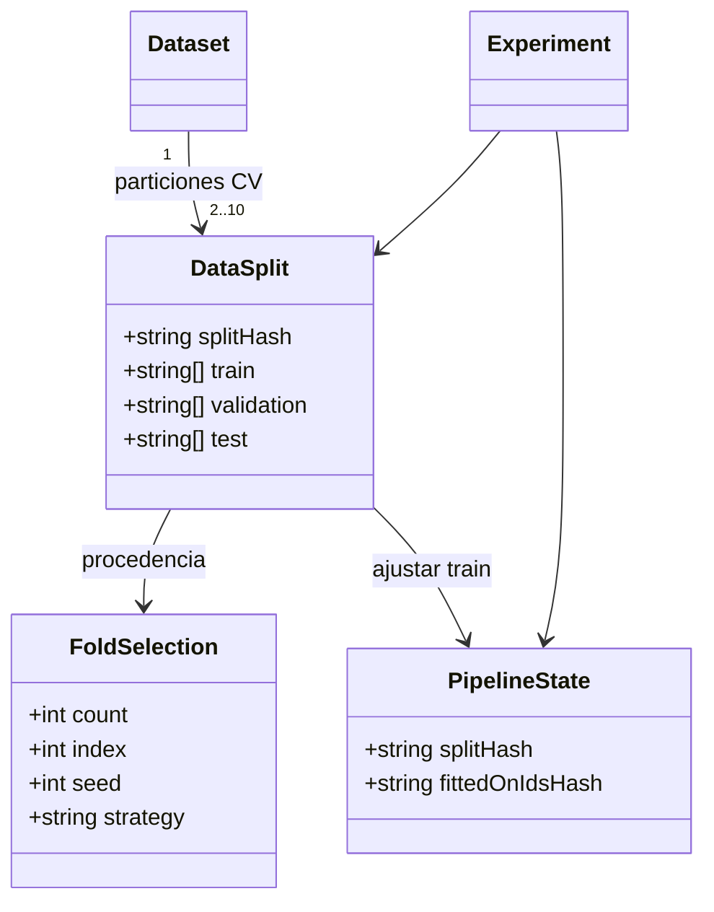
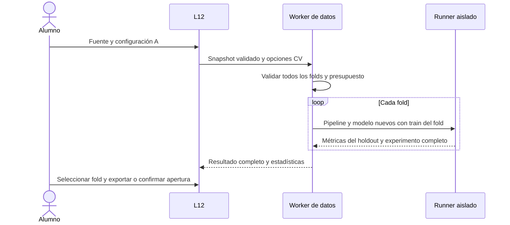
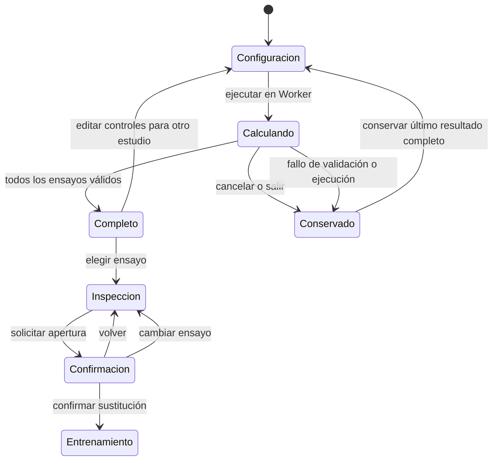
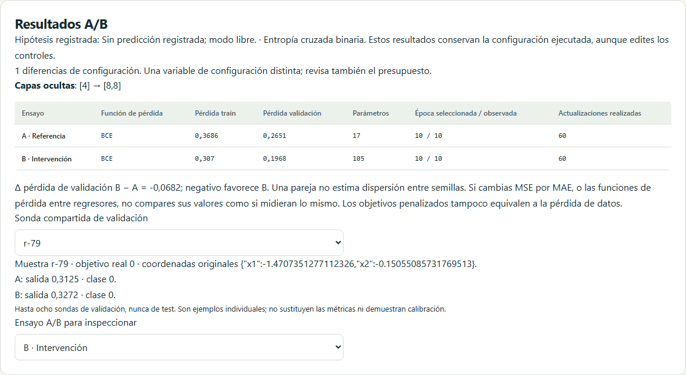
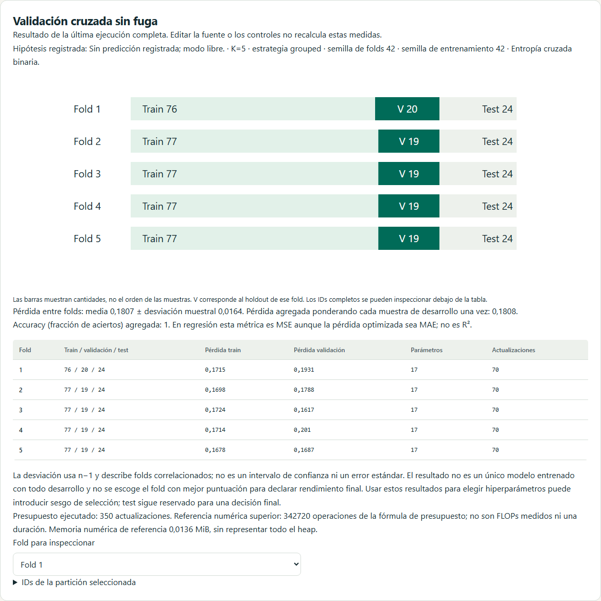
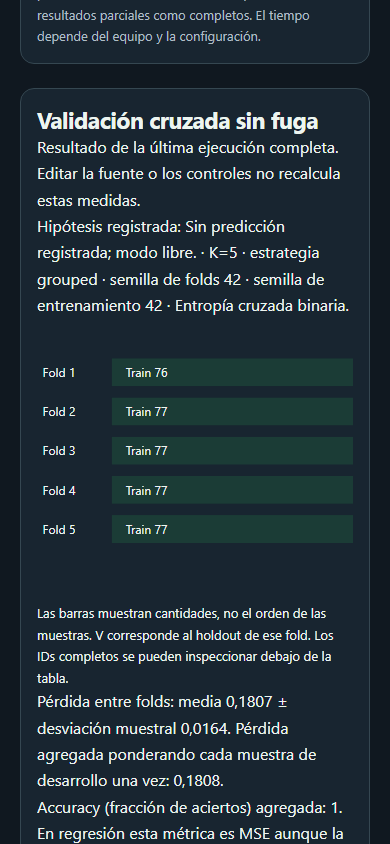

# D7 · Experimentos A/B y validación cruzada

Incremento 0.8.0, 26 de octubre de 2026. L12 `/lab/experimentos` pasa a estar disponible: comparación A/B sobre datos compartidos, hipótesis y reflexión, sondas de validación y CV de K=2–10 con modelos/pipelines nuevos. Son diez laboratorios disponibles. D7 sigue abierto para transformaciones robustas/derivadas, deriva, timeline de segmentos y ampliación del comparador de proyección; no se marca terminado todo el proyecto.

## Requisitos y experiencia

Los estudios parten de una copia de un ejemplo sintético (lunas, flores, seno o copias agrupadas) o del dataset, split, configuración de entrenamiento y pipeline del espacio de trabajo. Preparar una fuente y ejecutar un estudio no sustituye la sesión activa. Para datos propios se reutiliza la importación CSV/JSON de L01. Se copia también el antecedente de consulta de test, sin borrarlo para aparentar un test no observado.

El estudiante puede registrar una predicción antes de ejecutar y una reflexión posterior. No se exige texto para explorar en modo libre, no se califica comprensión automáticamente y el informe distingue la hipótesis capturada con la ejecución de la reflexión editable. Datos, configuraciones y textos permanecen en el navegador; no se envían a un servidor de entrenamiento. Los estudios completos viven en RAM y se conservan ante cancelación, fallo o salida de ruta. El laboratorio solo se sustituye tras confirmar la apertura de un ensayo individual.

El trabajo se ejecuta secuencialmente en un Worker dedicado. Antes de entrenar se validan todas las configuraciones/folds. No se publican resultados parciales como si fueran una comparación/CV completa. Cancelar termina el Worker e invalida respuestas tardías. Los controles quedan bloqueados durante el cálculo, con cancelación disponible. Seleccionar otro ensayo o iniciar otra ejecución invalida una confirmación de apertura pendiente.

## Comparación A/B

- Dataset y split comunes, pipelines ajustados solo con el train de ese split. Se pueden escoger características, imputación y escalado estándar/Min-Max/ninguno por rama.
- Épocas y tamaño de lote sincronizados en esta primera interfaz. Semilla sincronizada por defecto, con opción de separar semillas. Hasta seis capas ocultas de 1–64 unidades, sin ocultas si el campo queda vacío; activación, optimizador y tasa por rama.
- Los ajustes avanzados de una configuración copiada se conservan. Se pueden desactivar explícitamente BN/dropout/early stopping/aumento/regularización para ese estudio. Modificar capas conservando controles incompatibles produce un error de validación; no se oculta una corrección automática.
- Se declaran las diferencias de configuración, parámetros, pérdida de datos, épocas seleccionadas/observadas y actualizaciones realmente efectuadas. La dimensión de entrada derivada de las características no se cuenta como una segunda decisión independiente; las configuraciones completas siguen en los archivos.
- Igualar semilla no iguala pesos entre arquitecturas distintas ni iguala la función completa al cambiar el pipeline. Igualar épocas tampoco iguala operaciones, y con early stopping/aumento puede no igualar actualizaciones. Esta entrega no incluye todavía presupuestos por tiempo o actualizaciones fijas.

Los modelos binarios usan BCE, los multiclase entropía cruzada categórica y los regresores MSE/MAE. El selector de pérdida de regresión no cambia la función de clasificación. Evaluación binaria con umbral 0,5. `Δ = B−A`: negativo en pérdida favorece B si ambas pérdidas son comparables. Cuando dos regresores usan MSE y MAE diferentes, los deltas de pérdida son `null` y la interfaz explica que no se deben restar; se conserva la métrica común MSE de evaluación y las predicciones reales. El objetivo penalizado no se confunde con la pérdida de datos.

Hasta ocho sondas compartidas se toman exclusivamente de validación. Cada modelo recibe los valores originales a través de su propio pipeline; se muestran salida, clase o regresión y advertencias de rango/categoría. Las sondas no son una métrica agregada ni una prueba de calibración. No hay selección automática de ganador ni una conclusión causal por cambiar varias opciones. Una sola pareja no estima variabilidad entre semillas.

## Validación cruzada sin fuga

El desarrollo reúne el train y la validación de la **división base**, dejando su test intacto. No se admite como base un fold, una selección de tamaño ni una partición temporal. Para cada fold se reconstruyen partición, pipeline y modelo desde cero. La parada temprana está desactivada explícitamente: el holdout del fold no elige la época de su propio modelo. El resto de ajustes válidos de A se conserva, con el mismo horizonte/semilla de entrenamiento en cada fold.

El enfoque reserva un test final y aprende las transformaciones dentro del train de cada fold, siguiendo el principio descrito en la [guía oficial de validación cruzada de scikit-learn](https://scikit-learn.org/stable/modules/cross_validation.html). El motor aquí es TypeScript propio y sus algoritmos/convenciones no pretenden replicar todos los detalles numéricos de esa biblioteca.

| Variante | Algoritmo y límite |
| --- | --- |
| Aleatoria | Barajado reproducible del desarrollo y distribución cíclica equilibrada |
| Estratificada | Barajado por clase, distribución cíclica con offset acumulado; tamaños globales y por clase difieren como máximo en uno |
| Por grupos | Grupos completos, orden aleatorio reproducible con prioridad por tamaño y asignación al fold menos cargado; empates por índice |

Con grupos presentes se exige la variante por grupos; nunca se dividen entidades para satisfacer tamaños. La estrategia agrupada no promete estratificación perfecta. Si hay menos grupos que folds o falta soporte por clase, se rechaza el estudio. La variante estratificada no admite regresión. El soporte del motor exige al menos dos muestras de cada clase en train y una en validación/test; algunos casos desbalanceados o agrupados necesitan menos folds u otro diseño.

Cada ID de desarrollo aparece en validación exactamente una vez y en train en los otros K−1 folds. Ningún ID del test final pasa a esos conjuntos. La estratificación utiliza etiquetas para asignar particiones; «test reservado» significa que no se entrena, ajusta pipeline ni calcula una métrica de test durante el estudio, no que se desconozcan sus IDs de partición.

Se muestran pérdidas por fold, media y desviación **muestral** (n−1), además de la media ponderada por tamaño del holdout: cada muestra de desarrollo aporta una vez. Accuracy se agrega como fracción de aciertos; en regresión `validationScore` es MSE, incluso si la pérdida optimizada es MAE. No es R² ni RMSE. Los folds comparten muestras de entrenamiento y están correlacionados: la desviación no es un error estándar ni un intervalo de confianza. La CV no produce automáticamente un único modelo entrenado con todo desarrollo y no debe presentarse el mejor fold como rendimiento final.

## Límites de ejecución y archivos

Presupuesto cerrado: 2 ensayos A/B o 2–10 en CV; dataset ≤1.000 filas, horizonte ≤120 épocas, ≤5.000 parámetros por modelo y referencia superior conjunta de trabajo numérico ≤2·10⁸ según `trainingBudget`. CV añade referencia de memoria numérica ≤32 MiB. Son fórmulas de referencia, no FLOPs medidos, heap total ni una garantía de tiempo. Los límites del motor de entradas, soporte, lotes y transformaciones se siguen validando. No se habilitan búsquedas exhaustivas ni ejecuciones recibidas como JavaScript.

`DataSplit.fold` registra `{kind:'k-fold-v1', count, index, seed, strategy}`. `splitDataset` conserva la división base y reconstruye el fold de forma determinista; `validateSplit` exige igualdad del resultado completo. No se aceptan IDs arbitrarios con un hash recalculado. Los grupos y el test quedan vinculados al algoritmo y a la procedencia de la base.

- **Dataset v1:** división ordinaria, sin selección/fold.
- **Dataset v2:** selección de tamaño balanceada de D6.
- **Dataset v3:** fold reconstruible de D7.

La correspondencia entre versión y metadatos es obligatoria. Los lectores anteriores a v3 lo rechazan. Los contratos del motor/experimento v1–v6 y de inferencia v1/v2 se mantienen: la nueva versión del dataset es un contrato anidado distinto. Se puede guardar/exportar/importar/reanudar el ensayo de un fold con el pipeline de su train. L01 declara el fold y sus cantidades cuando se abre; crear otra partición sustituye explícitamente el fold.

Los formatos `neural-atlas.comparison-report` y `neural-atlas.cross-validation-report`, schemaVersion 1, incluyen opciones ejecutadas, procedencia, métricas, presupuestos, hipótesis y reflexión. El informe CV conserva IDs y hashes por fold, sin incrustar el dataset completo. Son informes de análisis; los botones de inspección exportan aparte el experimento completo o el modelo de inferencia importables. La apertura es detenida, no ejecuta test, y conserva el antecedente `testPreviouslyConsulted` en los archivos individuales.

Las opciones superiores describen la configuración solicitada. El informe CV incluye además la **configuración efectiva de cada fold**: tarea, clases y dimensión de entrada adaptadas al dataset/pipeline. Esto es necesario porque vocabularios categóricos de distintos train pueden producir dimensiones diferentes. Los ejemplos y copias del espacio de trabajo también actualizan la tarea y las clases del formulario para corresponder a sus datos.

Esta precisión de metadatos se publica en la revisión **0.8.1**, sin cambiar el cálculo del entrenamiento ni los contratos de experimento/modelo. El smoke público comprueba también que la versión servida coincide con la versión del commit desplegado.

## Arquitectura y estados

| Responsabilidad | Archivo |
| --- | --- |
| Asignación de folds y validación de parámetros | `src/domain/data/folds.ts` |
| Split canónico, hashes y reconstrucción | `src/domain/data/split.ts` |
| Archivos dataset v1/v2/v3 | `src/application/data/json-schema.ts` y `json-files.ts` |
| Orquestación CV y presupuesto previo | `src/application/training/cross-validation.ts` |
| Comparación, diferencias y sondas | `src/application/training/paired-comparison.ts` |
| Runner aislado común | `src/application/training/study-run.ts` |
| Estado, copias, cancelación y reportes | `src/stores/experiments.ts` |
| Configuración y resultados | `src/features/experiments/ExperimentsPage.vue` y `ExperimentConfiguration.vue` |
| Cantidades por fold y tabla equivalente | `src/features/experiments/FoldDiagram.vue` |
| Inspección, archivos y apertura confirmada | `src/features/experiments/StudyInspector.vue` |

## Verificación y pendientes

Las pruebas de unidad recorren K=2–10, variantes aleatoria/estratificada/grupos, integridad, dataset v3, ajustes del pipeline sin held-out, las tres tareas, medias ponderadas y consulta previa de test. A/B comprueba equivalencia exacta sin cambios, diferencias precisas, presupuestos, hipótesis y pérdidas de regresión no comparables. Integración cubre la separación del laboratorio, cancelación, errores, exportación, copia de configuración avanzada y confirmaciones. Playwright ejecuta Workers nativos, reportes y modelos, archivos de folds y recuperación en disco, clasificación/multiclase/regresión, ambos modos/temas y móvil. Se conservan los umbrales existentes.

Verificación local: **433 pruebas unitarias/integración** en 42 archivos, cobertura de líneas **95,84%** y ramas **93,22%**, tipos/lint, build, CSP/presupuesto y documentación correctos. La batería Chromium/WebKit completó **154 recorridos sin reintentos**; CI ejecuta 231 en Chromium/Firefox/WebKit. Los ajustes finales de estilo se verifican también con el recorrido de accesibilidad móvil en ambos modos y temas. Firefox local conserva la incidencia de Windows documentada en D1.

El smoke completo adaptado temporalmente a localhost también pasó, incluidos el informe A/B, el desarrollo CV sin solapamiento con test y el archivo dataset v3 de un fold. El script publicado conserva la exigencia de HTTPS y dominio de Pages y registra la causa breve de un reintento para facilitar el diagnóstico.

La [ejecución de CI 0.8.0](https://github.com/franmatias/neural-atlas/actions/runs/40287893893) completó **231 recorridos**, despliegue y smoke público correctamente. La revisión de metadatos añade comprobaciones unitarias/integración y cuatro recorridos locales de archivos multiclase/regresión, conservando el mismo número de casos y los controles completos de CI.

Capturas reproducibles con `scripts/capture-d7-experiments.mjs`:

Este incremento implementa la comparación básica y CV de US-032/040 y una parte de los controles comunes de US-054. Permanecen pendientes el modo de proyector especializado completo, presupuestos por actualizaciones/tiempo, robust scaling/features derivadas y dispersión de predicciones, escenarios de deriva y timeline de segmentos. Las fases D8–D10 y talleres posteriores siguen su plan. No se afirma una validación humana en aula ni la finalización de todo el alcance original.
