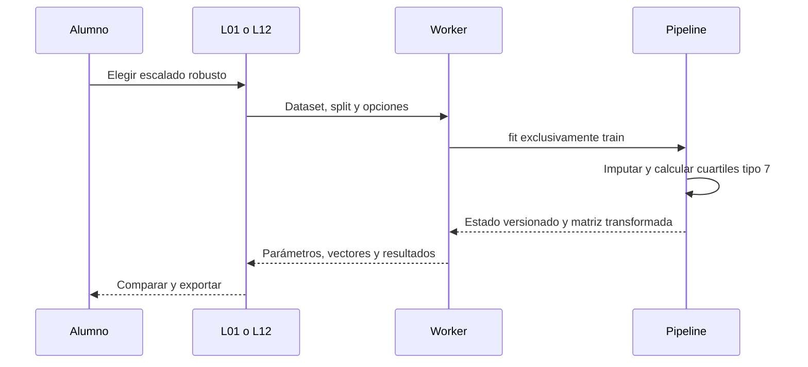

# Escalado robusto — D7

Incremento 0.8.2, 26 de octubre de 2026. Amplía L01 y L12 con el escalado robusto de RF-067 y su comparación A/B de RF-020. Las restantes transformaciones y fases conservan su estado pendiente.

## Contrato matemático

Por cada columna numérica seleccionada se imputa primero con el valor aprendido exclusivamente en train. Sobre ese train imputado se ordenan los valores y se calculan mediana, Q1 y Q3 con interpolación lineal tipo 7: posición `(n − 1) p`, interpolación entre los dos vecinos. IQR es `Q3 − Q1`.

La transformación es `(x − mediana) / IQR`. Si el IQR es cero pero hay valores distintos, se usa denominador 1; la interfaz avisa de esta situación. Las columnas constantes conservan el contrato anterior: cualquier muestra se transforma en cero. Los indicadores de ausencia y la codificación categórica no se escalan. No hay clipping ni borrado de outliers. Las filas externas a train nunca modifican las estadísticas.

Usar una imputación por media puede introducir sensibilidad adicional a extremos en datos con faltantes. La opción mediana permite estudiar ese efecto como una segunda decisión, evitando atribuirlo solo al escalador. El escalado robusto no garantiza mejores métricas ni hace inocuos los errores en las etiquetas.

## Uso didáctico y responsabilidades

En L01: generar datos con outliers, dividir, seleccionar «Robusto» en Preparar y ajustar con train. El resultado muestra mediana, cuartiles e IQR aprendidos; el vector transformado y el mapa usan esos parámetros reales.

En L12: copiar los datos preparados del laboratorio o cargar un ejemplo. Igualar arquitectura, semilla y demás controles A/B y cambiar solo Escalado B. El informe identifica `pipeline.scaling` como única decisión; las sondas comparten filas de validación y cada modelo conserva su propio pipeline. También puede utilizarse dentro de CV: cada fold vuelve a aprender sus estadísticas solo con su train. No se consulta el test final.

El dominio calcula y transforma; la aplicación valida formatos y procedencia; los Workers ejecutan los trabajos; las vistas presentan estadísticas y controles sin incorporar una segunda implementación matemática.

## Compatibilidad y persistencia

- El pipeline robusto usa versión 2 y añade `robust: {median,q1,q3,iqr}` solo en columnas numéricas. Los otros escaladores conservan exactamente la forma de versión 1 y sus hashes anteriores.
- Los experimentos robustos usan schema/engine 7, con independencia de las opciones de regularización. Se conserva el checkpoint completo y la reanudación exacta; los formatos 1–6 siguen disponibles para configuraciones anteriores.
- Los modelos de inferencia robustos usan schema 3, pipeline 2 y engine 1 o 2 según utilicen normalización por lotes. Exportan estadísticas, sin filas, y no reajustan el pipeline en inferencia. Los modelos ordinarios mantienen schema 1/2.
- La validación rechaza cuartiles incoherentes, IQR incorrecto, parámetros ausentes y combinaciones de versiones incompatibles. El hash verifica integridad; sin dataset, no demuestra por sí solo el origen de las estadísticas.
- Los datasets mantienen su formato 1/2/3 según su split: elegir escalado no cambia el dataset ni las etiquetas.

## Verificación

Pruebas unitarias con cuartiles esperados calculados de forma independiente, filas de validación/test alteradas, imputación previa, IQR cero y columnas constantes. Roundtrip y siguiente lote idénticos en clasificación binaria, multiclase y regresión; rechazo de estados corruptos y conservación de formatos anteriores. Playwright cubre el Worker de L01, móvil, comparación A/B con una sola diferencia, exportación, recuperación tras recarga y apertura del modelo independiente.

El plan mantiene pendientes features derivadas, dispersión de predicciones, escenarios de deriva, segmentos de entrenamiento, ampliación del proyector y fases D8–D10. Este documento no certifica una aceptación docente que no se ha realizado.

## Actualización 0.10.0

Los pendientes de D7 descritos en este informe histórico se completan en el [cierre técnico D7](44-cierre-d7.md). D8–D10 y la validación humana en aula continúan pendientes. Los números de pruebas y versiones anteriores se conservan como evidencia de su incremento.
