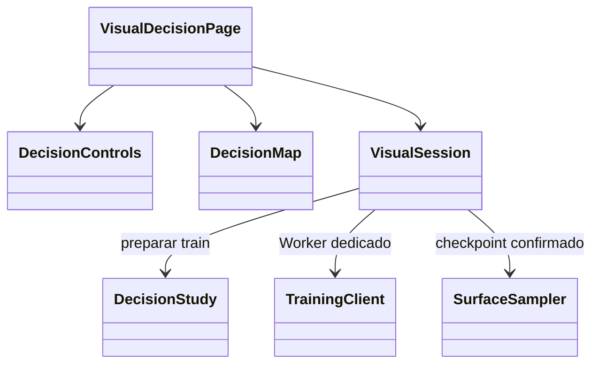
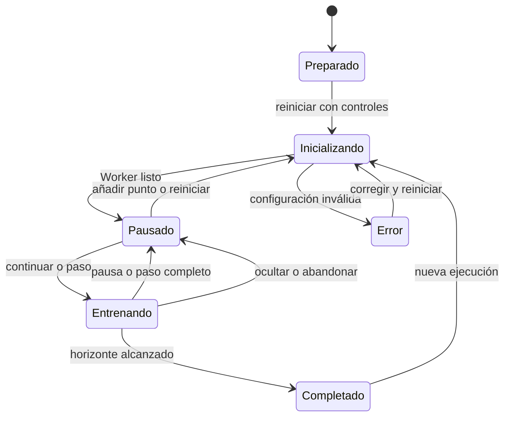
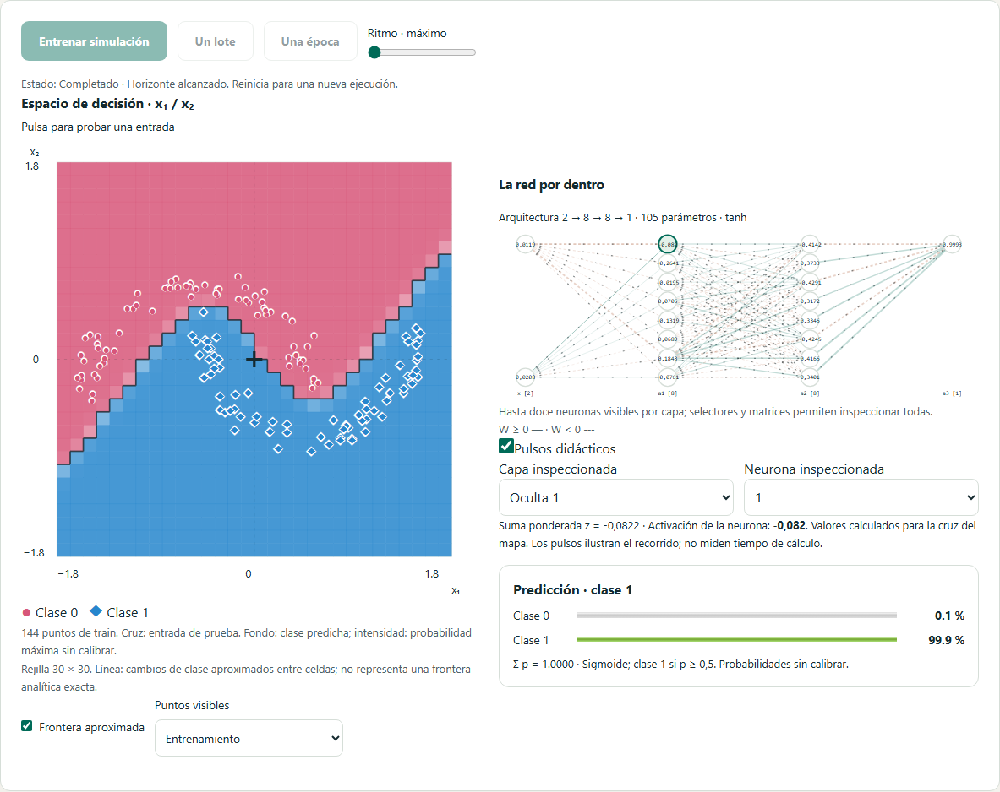
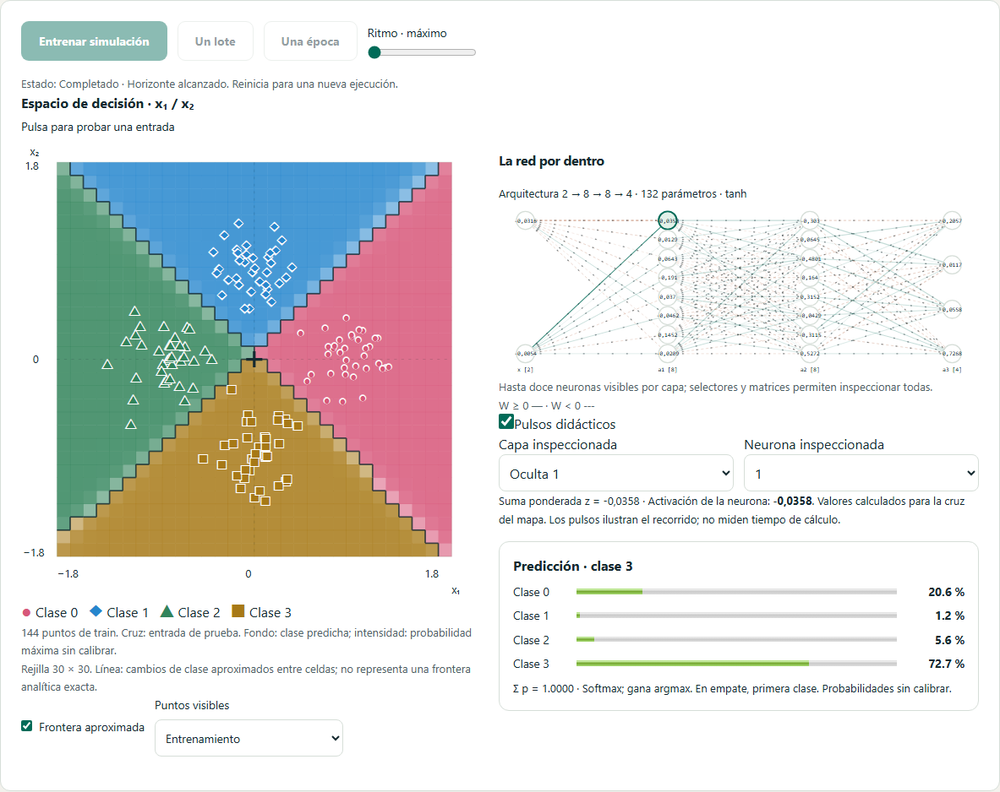
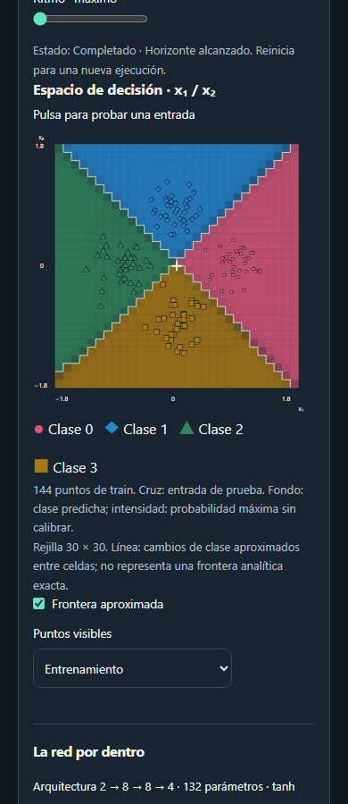

# Diseño de los laboratorios visuales de decisión

Solicitados el 26 de octubre de 2026 a partir de dos referencias visuales aportadas por el usuario. Se implementan dos espacios dentro de L03 y L09, sin sustituir sus actividades actuales.

## Objetivo y recorrido

**Separar dos clases**, `/lab/arquitectura/frontera`: observar cómo una frontera inicialmente arbitraria aprende a separar nubes, lunas, círculos, XOR o espirales. Plantear una hipótesis, elegir arquitectura/activación, inicializar, avanzar un lote o época y entrenar/pausar. Relacionar pesos y activaciones de la muestra seleccionada con la región que le asigna el modelo. Contrastar train y validación, sin revelar test.

**Clasificador visual**, `/lab/clasificacion/visual`: regiones de tres o cuatro clases, salida Softmax y clasificación de entradas nuevas. Ejemplos sintéticos de nubes, anillos, sectores y espirales. Mostrar el vector de probabilidades completo y la clase con mayor valor, incluyendo el criterio de desempate por orden de clase. No presentar las probabilidades como confianza calibrada.

## Diseño de pantalla

En escritorio, una columna de controles de 280–320 px y un escenario flexible. El escenario combina mapa cuadrado y red, con telemetría y curva debajo. En pantallas intermedias la red pasa debajo del mapa; en móvil todos los bloques forman una columna sin anchuras mínimas que causen desbordamiento. Se conserva la identidad Neural Atlas, los temas claro/oscuro y el panel global de ajustes.

El mapa usa dos coordenadas reales, x1 horizontal y x2 vertical creciente hacia arriba. Fondo por probabilidades y clase dominante; puntos con color y símbolo de su etiqueta, validación con borde distinto, entrada nueva marcada con una cruz. La frontera binaria p=0,5 es una aproximación por muestreo, no una curva analítica exacta. La multiclase muestra cambios de argmax entre celdas. Leyenda textual y probabilidades numéricas complementan el color. La selección mediante teclado mueve una cruz por el mapa; los campos numéricos ofrecen una alternativa al puntero.

## Requisitos funcionales

- RF-V01: entrenar redes reales en un Worker dedicado, con SGD/Momentum/RMSprop/Adam reutilizados del motor y límites explícitos de filas/capas/neuronas/épocas.
- RF-V02: iniciar, pausar, avanzar por lote/época y reiniciar con semilla reproducible; velocidad visual ajustable independiente de la animación de conexiones.
- RF-V03: mantener mapa, red, métricas y probabilidades referidos al mismo checkpoint; actualizar por estados confirmados, no por una animación que simule aprendizaje.
- RF-V04: elegir ruido, receta, semilla, capas, activación, lote, tasa y L2. Modificar controles no altera silenciosamente un modelo ya entrenado: la nueva configuración se aplica al reiniciar.
- RF-V05: probar una entrada sin entrenar; añadir un ejemplo etiquetado explícito exige reinicializar modelo y particiones, preservando los ejemplos anteriores y declarando el cambio.
- RF-V06: mostrar pérdida adecuada (BCE/entropía cruzada), exactitud train/validación y curvas, indicando las particiones; reservar test.
- RF-V07: exportar dataset, experimento reanudable y modelo independiente con los formatos existentes; no reemplazar la sesión de L06 por visitar estos laboratorios.
- RF-V08: permitir selección de neurona/capa y lectura de su activación para la entrada de prueba. Separar signo del peso, grosor y pulso didáctico; un pulso no representa un evento biológico ni una medición de tiempo.
- RF-V09: explicar intuición, cálculo y retos, con hipótesis y observación; vincular ambos espacios al catálogo y a las páginas existentes.

## Requisitos no funcionales

Reutilizar generador, split sin fuga, pipeline, entrenamiento, métricas y exportadores. Separar configuración/preparación, estado de sesión, muestreo del mapa y componentes de presentación. Cálculo de entrenamiento fuera del hilo principal; rejilla de visualización acotada y actualización por snapshots. Detener el entrenamiento al abandonar u ocultar la página. Respetar movimiento reducido, foco visible, controles etiquetados, uso táctil/teclado y ancho móvil de 360 px. Conservar los datos del usuario en los otros módulos. No enviar datasets a servicios externos.

## Arquitectura y estados

## Aceptación

Pruebas de determinismo y soporte de clases, escala y dirección de coordenadas, superficie constante/lineal, probabilidades finitas y suma Softmax, ausencia de fuga y límites. Integración de estados, cancelación y aislamiento. Playwright con Workers nativos: pérdida que mejora en un caso reproducible, cambios de mapa al entrenar, probabilidad al probar puntos, adición/reinicio, exportaciones, accesibilidad, teclado, móvil, temas y movimiento reducido. Documentar resultados reales y limitaciones después de verificar.

## Implementación y evidencia de 0.9.0

Disponibles como laboratorios independientes L13/L14 en el catálogo, además de los accesos desde Arquitectura y Clasificación. Comparten componentes de visualización y entrenamiento. Cinco recetas binarias y cuatro multiclase. Configuración acotada a 240 filas sintéticas, 40 puntos manuales, 3/4 clases en multiclase, hasta tres capas de 16 neuronas en el contrato interno y 500 épocas. Los controles de la interfaz ofrecen cero, una o dos capas; el límite interno cubre también entradas programáticas. Los datos completos y sus particiones viajan en la exportación del experimento.

`decision-study.ts` prepara datos, split y pipeline; `decision-surface.ts` muestrea el modelo; `useDecisionSession.ts` controla un Worker independiente por visita. `DecisionControls.vue`, `DecisionMap.vue` y `VisualDecisionPage.vue` reparten controles, interacción SVG y composición de pantalla. Dos componentes de entrada distintos evitan conservar la tarea binaria al navegar al clasificador multiclase.

La rejilla fija de 30×30 se calcula en el hilo de presentación, solo cuando cambia el checkpoint, y reutiliza las mismas funciones de inferencia que los modelos exportados. El entrenamiento y las evaluaciones del motor se ejecutan en el Worker. El mapa dibuja segmentos entre celdas de clase distinta; su resolución espacial es 0,12 unidades en el encuadre [−1,8;1,8]. No hay interpolación analítica ni promesa de frontera exacta. Los puntos fuera del encuadre se cuentan y se avisa; no se recortan del entrenamiento.

Los checkpoints de presentación llegan al finalizar épocas y pasos; los cambios por lote no garantizan una animación de cada operación individual. Las métricas indican la última época evaluada y pueden ser anteriores a los pesos de un paso parcial. El ritmo controla actualizaciones por segundo y el movimiento de conexiones respeta la preferencia global. La nota de hipótesis es temporal; los modelos y experimentos se conservan mediante exportación explícita, sin sobrescribir la recuperación de L06.

Verificación local: **448 pruebas unitarias/integración**, cobertura de líneas **95,06 %** y ramas **92,56 %**, con los umbrales originales. Los ocho recorridos nuevos de Chromium/WebKit pasan sin reintentos: dos tareas, mejora de pérdida, archivos, probabilidades, coordenadas por teclado, puntos manuales, cambio de tarea, accesibilidad automática, temas, móvil y movimiento reducido. CI ejecuta la batería completa de 83 casos por motor (249 en total). Las pruebas automáticas no sustituyen la validación docente en aula.

Capturas reproducibles con `scripts/capture-visual-decision.mjs`:

## Entradas independientes en el catálogo · 0.10.1

Los dos espacios visuales se presentan como laboratorios propios, con tarjeta, pregunta didáctica e identificación estable: L13 «Sandbox de dos clases» y L14 «Clasificador visual multiclase», en Evaluación y práctica. El catálogo contiene ahora 14 laboratorios (12 disponibles y 2 previstos); el diseño inicial de 12 se conserva como referencia histórica. Los contadores de la interfaz se calculan a partir del catálogo. Se mantienen las direcciones publicadas `/lab/arquitectura/frontera` y `/lab/clasificacion/visual`, las sesiones y los enlaces existentes. Cada vista permite volver a todos los laboratorios. Las pruebas de los dos simuladores comienzan desde sus respectivas tarjetas y verifican identificación, disponibilidad y destino antes de entrenar.
