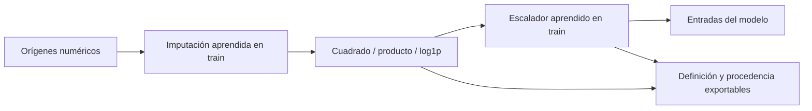
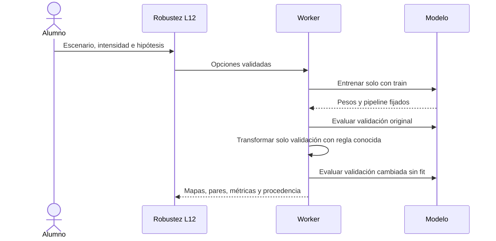
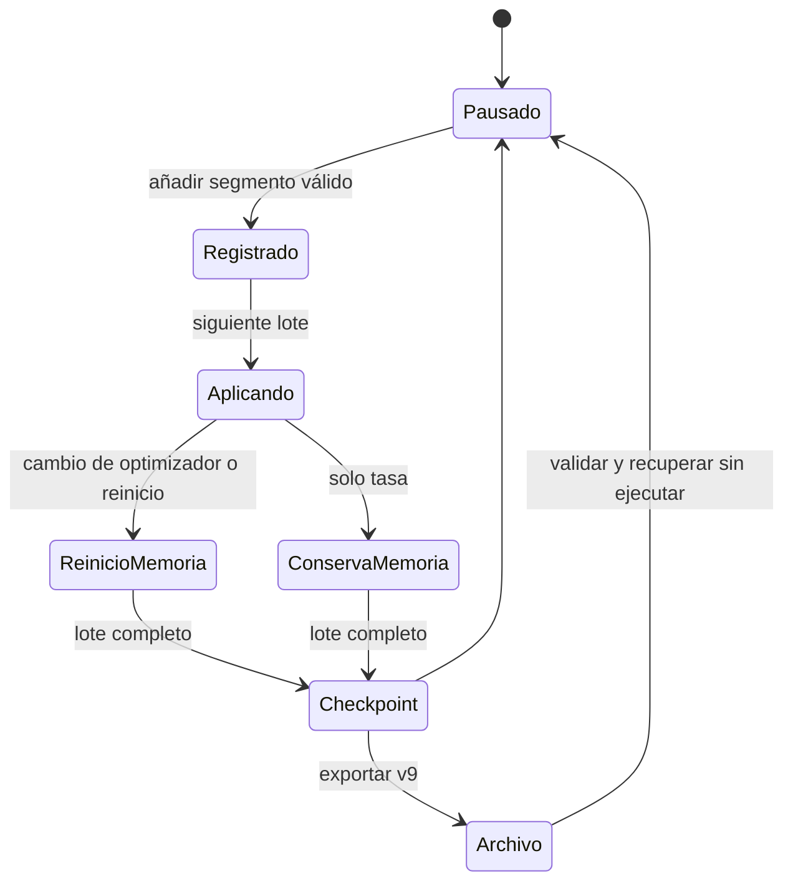
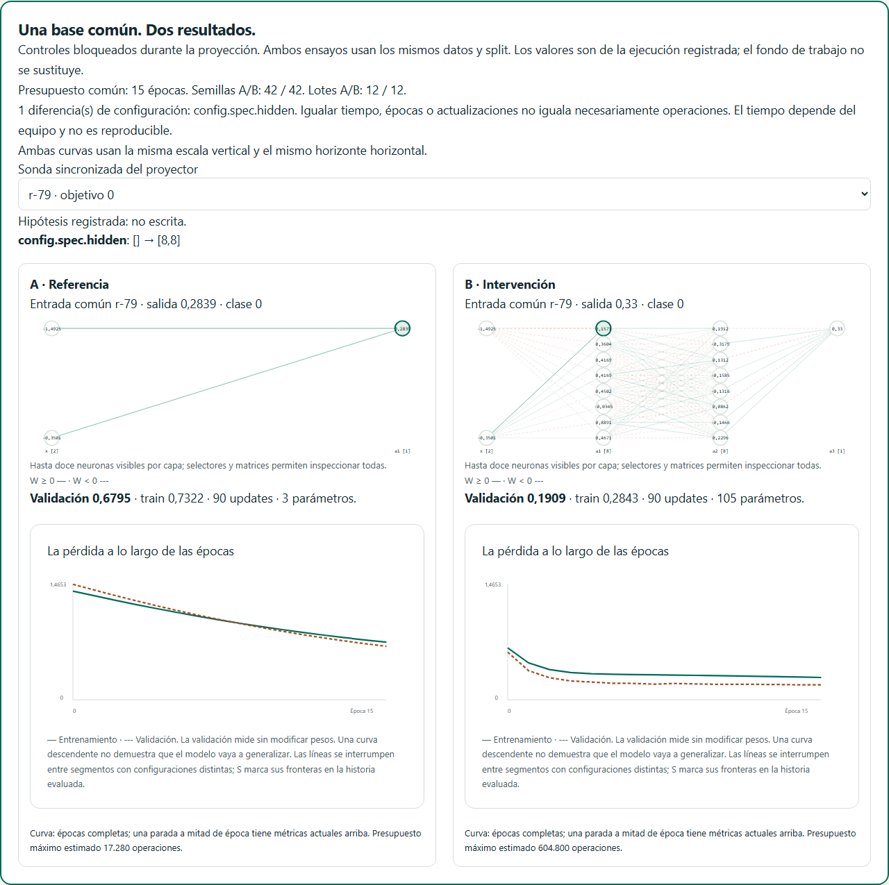
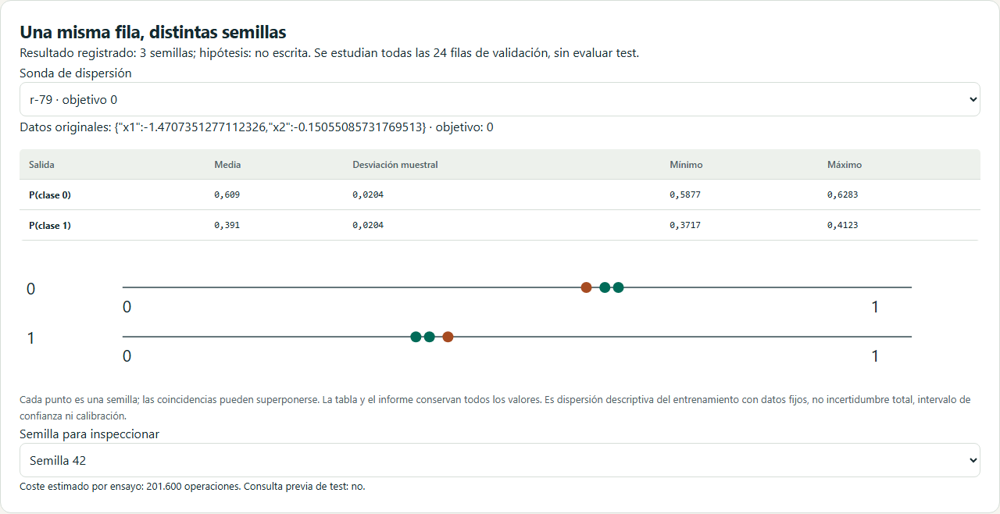
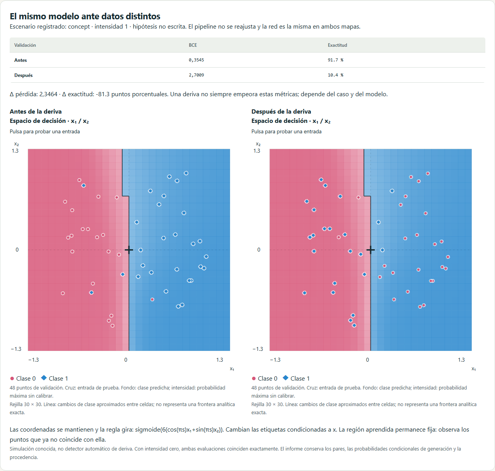
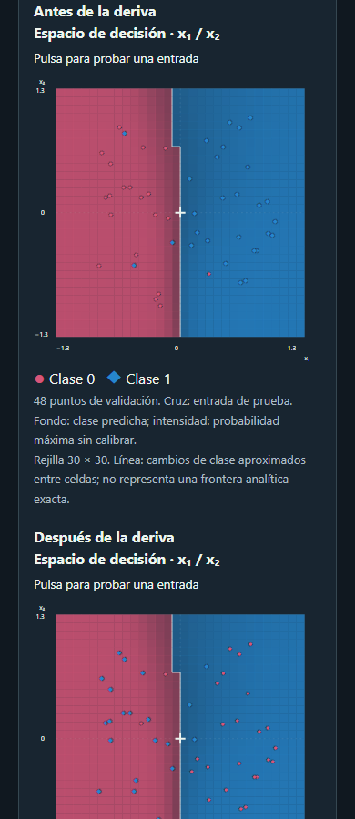
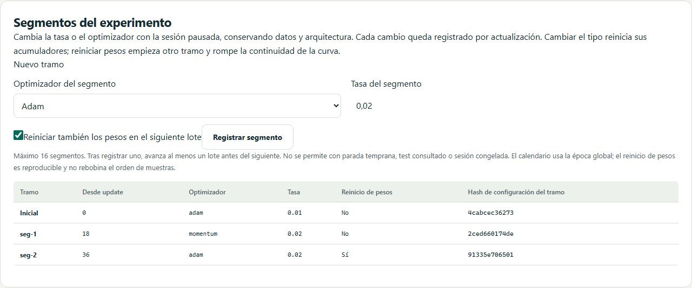
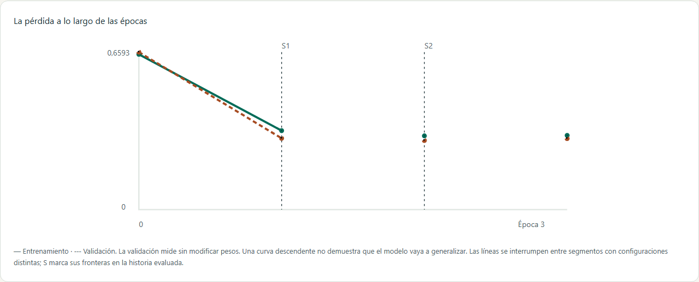

# Cierre técnico de D7

El alcance de esta entrega corresponde a US-012, US-032, US-040, US-043, US-054 y US-062. Este documento define primero los contratos y registra después la evidencia de implementación; no declara terminada una actividad antes de comprobarla.

## Criterios de aceptación

| Historia | Resultado requerido |
|---|---|
| US-012 | Editor declarativo de cuadrado/producto/log1p, imputación previa y escalado ajustado solo en train; límites y dominio; exportación y reanudación. Escalado robusto y curvas por tamaño ya disponibles. Dispersión de predicciones sobre las mismas filas entre semillas, sin confundirla con un intervalo de confianza. |
| US-032 | Comparación A/B aislada, diferencias explícitas, hipótesis y reflexión, sondas compartidas y presupuestos observados. |
| US-040 | CV aleatoria/estratificada/agrupada K=2–10, pipeline/modelo independientes por fold, sin selección por early stopping ni consulta al test. |
| US-043 | Covariate shift con selección de una misma distribución de etiquetas condicionada a x, concept drift con cambio de regla de etiquetas y train-serving skew con transformación aplicada solo al servir. Procedencia y parámetros visibles; pipeline entrenado congelado. |
| US-054 | Vista de proyección A/B, controles comunes sincronizados, diferencias, sondas/probabilidades y presupuestos visibles. Comparación por épocas, actualizaciones o límite temporal; advertir que tiempo fijo no es reproducible ni iguala operaciones. |
| US-062 | Segmentos explícitos al cambiar optimizador/tasa o reiniciar pesos con sesión pausada; identidad/configuración/update, separación de curvas y exportación completa. Reiniciar acumuladores cuando cambia el tipo de optimizador. |

## Derivadas

Máximo ocho definiciones, con ID estable, operación y uno/dos orígenes numéricos seleccionados. No se permite target, referencias a derivadas ni expresiones libres. El orden es imputar cada origen con train → derivar → ajustar el escalador en train → transformar cada partición. `log1p` exige x > −1 también al transformar datos nuevos; un dominio inválido bloquea la operación sin recortar ni sustituir silenciosamente. Máximo 32 entradas transformadas.

Pipeline v3 solo cuando hay derivadas; experimentos v8 y modelos de inferencia v4 conservan sus definiciones y estadísticas. Las configuraciones anteriores mantienen sus formatos y hashes. Las versiones posteriores que incorporen segmentos los identificarán explícitamente. Los datasets no cambian de formato por añadir transformaciones.

## Calidad y cierre

La aceptación incluye pruebas matemáticas con valores independientes, rechazo de fuga/dominio/configuración, roundtrip de modelos y siguiente lote idéntico, integración con Workers, cancelación, presupuestos, casos de deriva conocidos, segmentos recuperables, teclado, temas y móvil. La validación humana en aula sigue pendiente y no se sustituye por tests. D8–D10 y X1/X2 conservan su alcance separado.

## Implementación 0.10.0 y decisiones

### Dispersión de predicciones

L12 `/lab/experimentos/robustez` entrena 3/5/10 modelos con datos, particiones, pipeline y opciones comunes. Varían la semilla de inicialización, barajado y dropout; las semillas consecutivas se envuelven en uint32. Se predicen **todas las filas de validación**, no solo las ocho sondas del comparador A/B. Por cada salida se conservan los valores individuales, media, desviación muestral (n−1), mínimo y máximo. Binaria muestra las dos probabilidades complementarias; multiclase las salidas Softmax; regresión una salida numérica. No es un intervalo de confianza, una medida de calibración ni incertidumbre total por los datos. El informe declara épocas realmente seleccionadas cuando hay parada temprana y conserva el antecedente de test consultado.

### Tres escenarios de deriva controlados

Base: 240 filas sintéticas, x uniforme en [−1,1]², `P(y=1|x)=sigmoid(6*x1)` y etiquetas Bernoulli reproducibles. División **aleatoria** 60/20/20 independiente de las etiquetas; no estratifica la selección del conjunto que se va a transformar. Red 2→8→8→1 Tanh, Adam, lote 12 y Z-score aprendido solo en train. El entrenamiento precede a cualquier deriva. Se cambian exclusivamente las filas de validación, manteniendo el mismo modelo y pipeline en ambas evaluaciones.

- **Covariate shift:** `x1 = 2*u^(1/(1+3*s))−1` con intensidad s∈[0,1]. Cambia P(x), manteniendo el mismo oráculo condicional. Las etiquetas se generan según el nuevo x, con el mismo sorteo Bernoulli por fila; conservar P(y|x) no significa conservar cada etiqueta individual.
- **Concept drift:** mismas coordenadas; regla `sigmoid(6*(cos(pi*s)*x1+sin(pi*s)*x2))`. Gira la relación entre entradas y etiquetas.
- **Train-serving skew:** etiquetas originales y coordenadas físicas conservadas; se sirve `x1 = (1+4*s)*x1_físico+0.5*s`. Reproduce una transformación incompatible al inferir.

Con s=0 las dos evaluaciones coinciden exactamente. Se muestran BCE y exactitud antes/después, dos mapas con **la misma frontera congelada**, pares de filas y probabilidades condicionales del generador en el informe. No se reajusta el scaler, no se entrena con validación y no se evalúa test. Una deriva puede mejorar una métrica en un caso concreto; el laboratorio no promete degradación ni se presenta como detector automático de deriva real.

### Presupuestos y proyección

El comparador A/B admite épocas comunes, 1–10.000 actualizaciones o 50–3.000 ms de entrenamiento por ensayo. El tope de épocas sigue vigente y se declara si se alcanzó antes que el presupuesto. El tiempo se mide después de inicializar, entre lotes, excluyendo la evaluación terminal: puede exceder el límite por un lote, depende del equipo/JIT y no es reproducible. No se combina un presupuesto fijo con parada temprana. Las configuraciones sin presupuesto nuevo conservan la ruta numérica anterior.

Una parada a mitad de época exporta el checkpoint parcial **reanudable**, con cursor, orden y momentos reales. Sus métricas train/val se recalculan sobre esos pesos (train original cuando hay aumento), sin insertar una época ficticia en la historia. El informe identifica `stop.point.update`, tiempo observado y motivo. Las curvas muestran solo épocas completas.

La vista de proyección presenta ambos modelos, curvas, entradas y predicciones de una sonda sincronizada, diferencias concretas, semillas, lotes y presupuestos. Usa un horizonte horizontal común y, cuando la pérdida es comparable, la misma escala vertical. Si las funciones de pérdida difieren, advierte que no se comparan y conserva escalas verticales separadas. Bloquea la configuración mientras se proyecta para preservar la lectura de la ejecución registrada. Para otro contraste se sale de proyección, se editan controles y se ejecuta de nuevo. No afirma entrenamiento simultáneo ni equivalencia de operaciones al igualar tiempo/épocas/updates.

### Segmentos y recuperación

L06 permite registrar hasta 16 segmentos con la sesión pausada: tasa, optimizador y reinicio opcional de pesos. Cada registro fija un ID, actualización de inicio y configuración efectiva. A partir de la siguiente actualización se aplica el cambio. Si cambia el tipo o los coeficientes de memoria del optimizador, o se reinician pesos, se borran sus acumuladores. Adam usa una edad local desde ese reinicio para la corrección de sesgo, mientras el contador de actualizaciones sigue siendo global. Cambiar solo la tasa conserva momentos.

El reinicio crea de nuevo el modelo completo (pesos, sesgos y, cuando existe BN, gamma/beta y estadísticas móviles). Usa una semilla derivada del ID y la semilla de entrenamiento; no rebobina muestras, contadores, RNG de dropout ni la historia. El calendario de tasa usa la época global. Las curvas separan tramos y marcan sus fronteras; los puntos de evaluación situados exactamente en una frontera pertenecen al tramo anterior, antes de aplicar el siguiente lote. Las métricas parciales se distinguen de las épocas completas.

No se añaden segmentos con test consultado, modelo congelado, horizonte alcanzado o parada temprana. Tras registrar uno hay que avanzar al menos un lote antes de añadir otro. Estos límites evitan cambiar la trayectoria de selección de un mejor estado ya capturado o fingir una continuación tras terminar el horizonte.

Experimento v9 conserva el plan y una `timeline` con identidades completas (`configHash`), actualización y operación. Las identidades de tramos anteriores son estables al añadir uno posterior; se calculan sobre configuración efectiva, datos, split, pipeline y evento. El hash global del checkpoint identifica el plan completo. Importación y recuperación en disco validan ambos contratos; corrupción del timeline se rechaza. Modelos de inferencia no incorporan el plan ni los acumuladores porque solo transportan el estado aprendido.

### Responsabilidades y límites

`derived.ts` y `pipeline.ts` implementan las transformaciones; `pipeline-schema.ts` comparte contratos de archivo. `segments.ts` decide límites, configuración efectiva, reinicio e identidades; el kernel aplica los cambios dentro de la transacción del lote. La aplicación prepara estudios aislados y presupuestos (`study-budget.ts`, `prediction-dispersion.ts`, `distribution-shift.ts`). Los stores controlan cancelación y resultados completos; los componentes presentan editor, proyector, mapas y timeline.

Estudios ampliados: máximo 1.000 filas, 120 épocas, 5.000 parámetros por modelo, 200 millones de operaciones estimadas y 32 MiB de datos numéricos estimados para los ensayos retenidos. El comparador A/B conserva su límite combinado de operaciones. Las cotas numéricas no representan toda la memoria del navegador ni una garantía de duración. Las vistas de robustez usan una copia y conservan el laboratorio; sus informes incluyen controles de la ejecución, hipótesis, reflexión y consulta previa de test. Cancelar conserva el último estudio completo. Datos e informes siguen siendo locales y exportables; un informe analítico no es un checkpoint importable.

## Estado de aceptación técnica

Las seis historias de D7 quedan implementadas en 0.10.0 y cubiertas por los controles de entrega. La aceptación humana en aula permanece abierta; D8–D10 y las propuestas X1/X2 no se dan por terminadas.

| Control | Evidencia local |
|---|---|
| Tipos, lint, compilación, CSP y presupuesto | Correctos; JS inicial 60,24 KiB gzip y CSS 11,83 KiB gzip |
| Unidad e integración | **473 pruebas en 49 archivos**, todas correctas |
| Cobertura | **94,21 % líneas, 91,40 % ramas**, sin rebajar umbrales |
| Navegadores | **184 recorridos completos Chromium/WebKit**, sin reintentos; comprobaciones focalizadas para el ajuste final de escalas |
| CI | Batería obligatoria de **276 recorridos** en Chromium, Firefox y WebKit, antes de publicar main |
| Comprobación pública | El script de publicación incluye derivadas v8, presupuesto parcial, proyector, dispersión, concept drift y segmentos v9, además de los recorridos anteriores |

El ajuste móvil conserva las coordenadas completas mediante salto de texto, sin ocultarlas. Las pruebas comprueban temas, teclado, movimiento reducido, cancelación, copia del laboratorio y recuperación real en disco. Los ensayos analíticos no reemplazan automáticamente la sesión activa.

Capturas reproducibles con `scripts/capture-d7-completion.mjs`:

