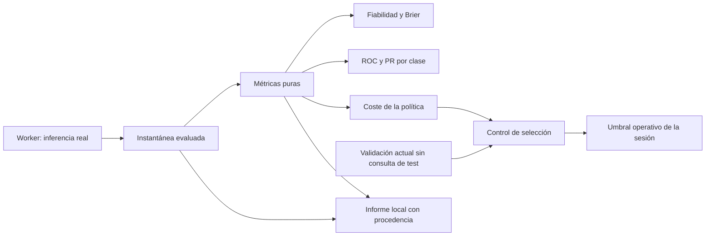
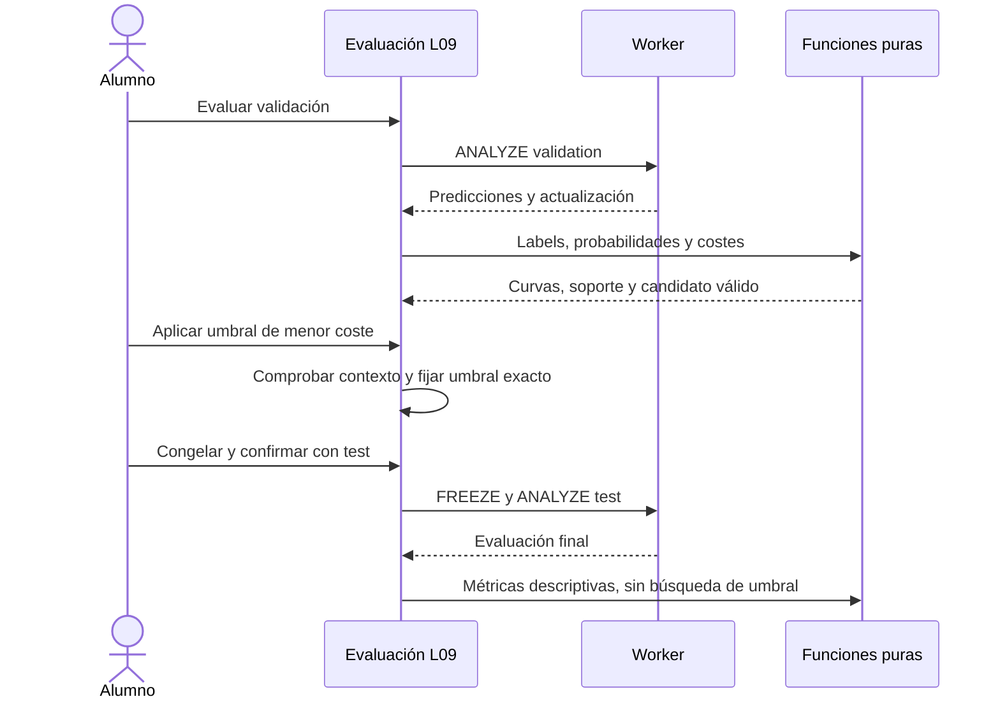
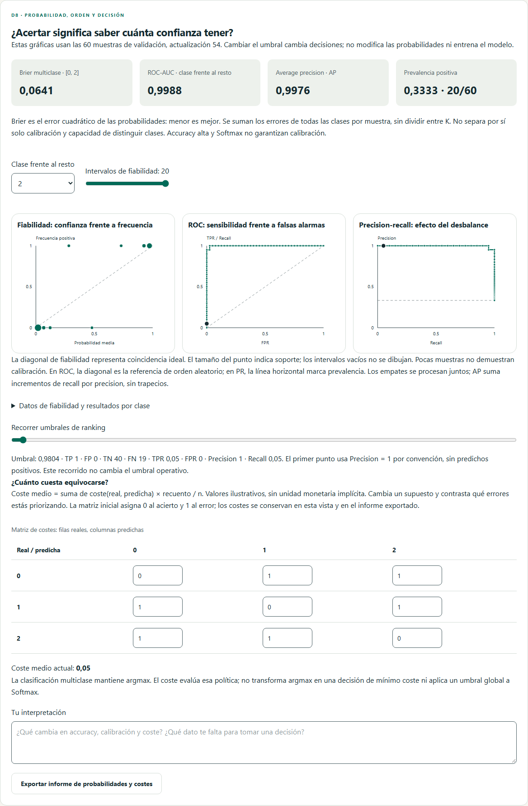

# D8.1 · Probabilidad, ranking y coste de decisión

Incremento de D8 en L09, versión 0.11.0. Cubre US-041 (RF-063/064) y amplía US-042 (RF-065); R²/RMSE y sus denominadores ya estaban disponibles en L10. **No cierra D8:** US-050 (aproximación de funciones) y US-064 (ética con grupos sintéticos) siguen pendientes, además de la aceptación docente en aula.

## Especificación y aceptación

| Requisito | Comportamiento observable |
|---|---|
| RF-063 | Brier con convención visible, fiabilidad one-vs-rest, 5–20 intervalos, soporte y datos tabulados; no afirmar calibración por accuracy o pocos puntos |
| RF-064 | ROC y PR con empates agrupados, extremos, ROC-AUC por trapecios y AP sin interpolación; selector de clase, prevalencia, macro con exclusiones explícitas e indefinidos |
| RF-065 | Matriz K×K editable, coste medio de la política actual y selección de umbral binario solo con validación actual y test sin consultar; umbral exacto conservado por el motor existente |
| RNF de integridad | Ninguna modificación de pesos, pipeline, split o probabilidades; no optimización sobre test/train ni una instantánea antigua; informe con procedencia |
| RNF de accesibilidad | Teclado, tablas equivalentes, nombres de controles/SVG, temas, móvil y movimiento reducido sin depender de animaciones |

La interfaz conserva las métricas y las tablas anteriores. El nuevo panel aparece después de evaluar clasificación. No inventa resultados cuando falta un modelo. El selector operativo de clase positiva controla también el diagnóstico binario; en Softmax se selecciona una clase para las curvas one-vs-rest sin cambiar la política argmax.

## Contratos matemáticos

- Sigmoide: Brier escalar `mean((p−y)²)`, rango [0,1], invariante al complementar clase positiva. Softmax: `mean(sum_k((p_k−1[y=k])²))`, rango [0,2], sin dividir entre K. No se presenta Brier como error de calibración puro.
- Fiabilidad: intervalos de igual anchura, `[a,b)`, último inclusivo en 1. Media de p, frecuencia de positivos y n. Los vacíos mantienen n=0 y valores null en tabla/informe, y se omiten del gráfico. Puntos con soporte visible, diagonal ideal; no se ajusta un calibrador.
- Ranking: puntuaciones descendentes; se consume cada grupo de empates completo. Primer punto sin positivos predichos, último con todos. `threshold=null` codifica el extremo por encima del máximo, sin Infinity en JSON. Precision inicial=1 por convención; recall/TPR null si no hay positivos; FPR null si no hay negativos.
- ROC-AUC es área por trapecios; null si falta cualquiera de las dos clases. AP es `sum(deltaRecall * precision_actual)`, sin trapecios; null sin positivos y puede valer 1 sin negativos. La media macro usa solo clases definidas y declara cuántas excluye; no es una media micro o ponderada.
- Coste: filas reales, columnas predichas. `sum(C[i,j]*count[i,j])/n`. Todos los valores, incluida la diagonal, son editables entre 0 y 1.000.000; el parser compartido admite coma/punto y exponente sin separadores ambiguos; un valor inválido conserva el anterior y muestra error. Matriz inicial diagonal 0, resto 1; unidades ilustrativas.
- Búsqueda binaria: puntuaciones únicas y extremos **operativos** 0/1, `p(positiva)>=t`; en empate de coste se elige t mayor. El umbral exacto no se redondea al aplicarlo; el rango admite `step=any`. Si hay p=1, t=1 conserva esos positivos: el extremo ROC «nadie» no es necesariamente una política desplegable con t≤1. Se advierte esta limitación.
- No hay búsqueda de umbral en train, test, modelo congelado, ejecución en marcha, instantánea antigua ni sesión con test previamente consultado. En multiclase se mide el coste de argmax; no se sustituye por una regla de coste esperado.

Referencias de contraste de las convenciones: [AP sin interpolación](https://sklearn.org/stable/modules/generated/sklearn.metrics.average_precision_score.html) y [evaluación probabilística/Brier](https://scikit-learn.org/stable/modules/model_evaluation.html). El código propio sigue el contrato matemático del proyecto; no añade dependencias de Python.

## Responsabilidades

`domain/training/probability-metrics.ts` valida y calcula ranking, fiabilidad, Brier y costes. No conoce Vue, Workers ni almacenamiento. Ordenación O(n log n), barrido por empates O(n), por clase; búsqueda de coste mediante recuentos acumulados, sin reevaluar la red para cada candidato. El entrenamiento y la inferencia permanecen en el Worker existente; las métricas operan sobre su instantánea ya recibida, como la matriz de confusión.

`ProbabilityEvaluation.vue` controla clase inspeccionada, bins, costes, reflexión y exportación. `ProbabilityChart.vue` dibuja ejes/curvas/puntos reutilizables en SVG: ROC lineal y PR escalonada conforme a AP. `EvaluationPage.vue` aporta contexto y aplica el umbral seleccionado a la sesión. No hay estados de motor duplicados.

## Informe y persistencia

Exportación JSON `neural-atlas.probability-evaluation-report`, schemaVersion=1: versión de aplicación, hashes de datos/split/pipeline/configuración, actualización evaluada y actual, split, orden de clases, clase positiva y clase inspeccionada, bins, umbral, matriz/coste, métricas completas, targets/probabilidades y reflexión (máximo 4.000 caracteres). Los indefinidos y el extremo de ranking usan null. El candidato solo se exporta en un contexto habilitado de validación. El informe no incluye un modelo ni admite importación como experimento.

El umbral/clase positiva siguen la recuperación y exportación de sesión existentes, sin cambiar los esquemas de modelo/checkpoint. Costes, bins y reflexión son estado de la vista: exportar para conservar la interpretación. La matriz puede editarse al analizar test como supuesto posterior, pero no habilita selección del umbral. El informe identifica test consultado; no convierte una consulta repetida en evidencia independiente.

## Verificación

Oráculos unitarios: ranking conocido (AUC=0,75, AP=5/6), empates, orden inverso/perfecto, clases ausentes, Brier binario/multiclase, intervalos vacíos y p=1, orientación/inversión de costes, umbrales extremos y entradas inválidas. Integración: todas las restricciones de selección, clase/bins/inspector, multiclase, errores y archivo exportado. Playwright con Worker real: validar Brier contra targets/probabilidades descargados, aplicar umbral sin redondeo, congelar test, Softmax one-vs-rest, temas/teclado/móvil y análisis de accesibilidad. La batería local completa supera **484 pruebas en 51 archivos**; cobertura **94,34 % de líneas y 91,55 % de ramas**, sin reducir umbrales. Tipos, lint, build, CSP/presupuesto (JS inicial 60,08 KiB gzip) y documentación correctos. Pasan 12 recorridos de evaluación/entrenamiento en Chromium y WebKit, más las comprobaciones focalizadas del ajuste final de campos y temas; sin reintentos. CI incorpora 282 recorridos obligatorios en los tres motores antes de publicar. La comprobación posterior de Pages verifica también el informe y recalcula Brier a partir de sus targets/probabilidades.

Captura reproducible mediante `tests/e2e/probability-evaluation.spec.ts`, caso Softmax. Las cifras pertenecen a este ejemplo, no a una garantía de rendimiento general.

El ensayo local completo del script de Pages pasa con el nuevo informe. Se añade una espera al fin del guardado del taller antes de recargar: el mensaje de éxito podía corresponder a una transacción anterior; el catálogo permanece deshabilitado mientras el guardado actual continúa. No se relajan las comprobaciones ni se cambia el comportamiento del taller.

### Control de estabilidad de CI

La primera ejecución de publicación pasó las funciones nuevas y el smoke público, pero una prueba previa de cancelar/abandonar L12 necesitó reintento en Firefox: volvía al mismo hash antes de que Vue Router confirmara la salida a Datos. La prueba ahora espera la URL y el título de Datos antes de regresar. Pasan cinco repeticiones en Chromium y otras cinco en WebKit. El Firefox local de Windows no inicia (`spawn UNKNOWN`), por lo que su comprobación se realiza en Linux mediante CI. Se activa `failOnFlakyTests` en CI: un reintento exitoso conserva el diagnóstico, pero impide publicar como si la prueba hubiera sido estable.
