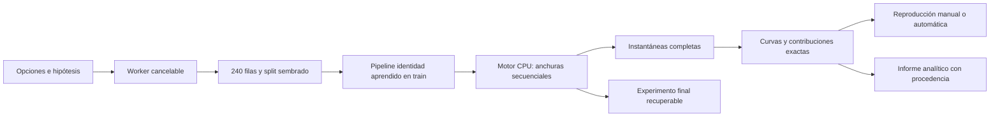
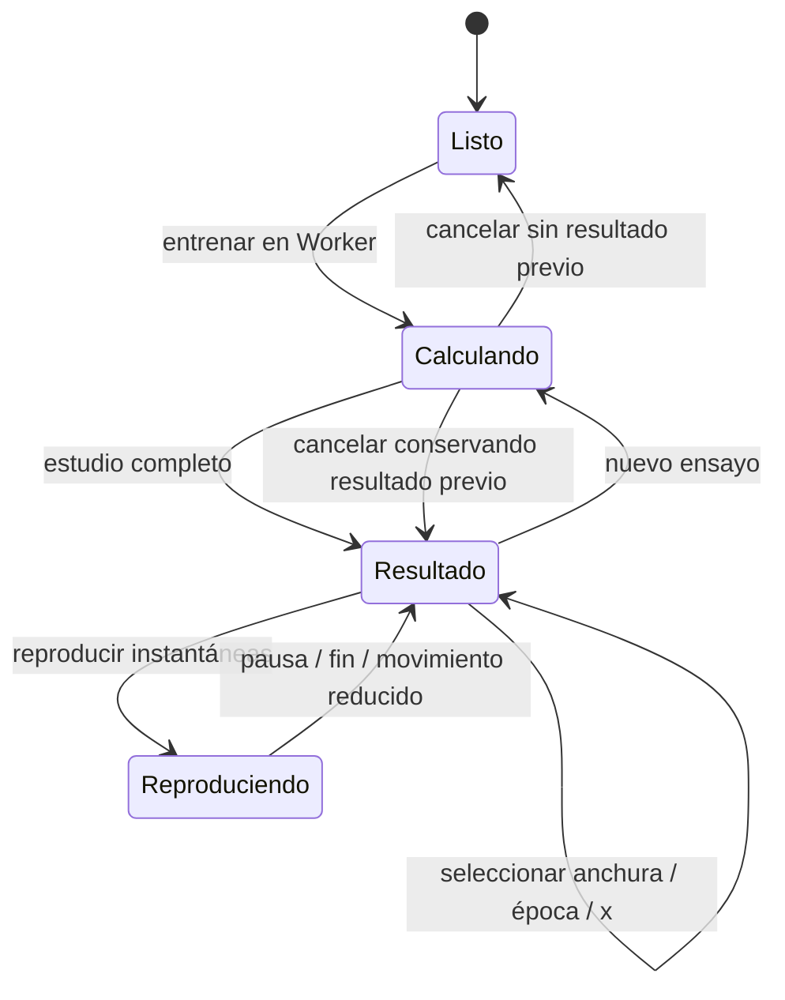
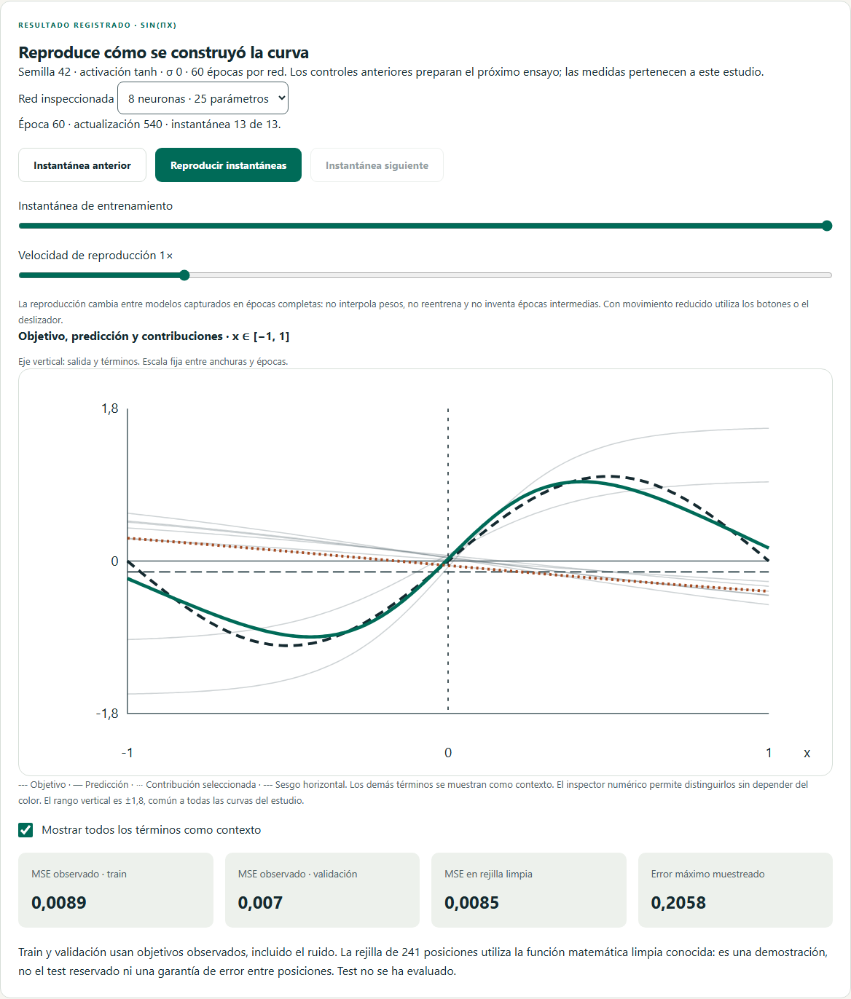
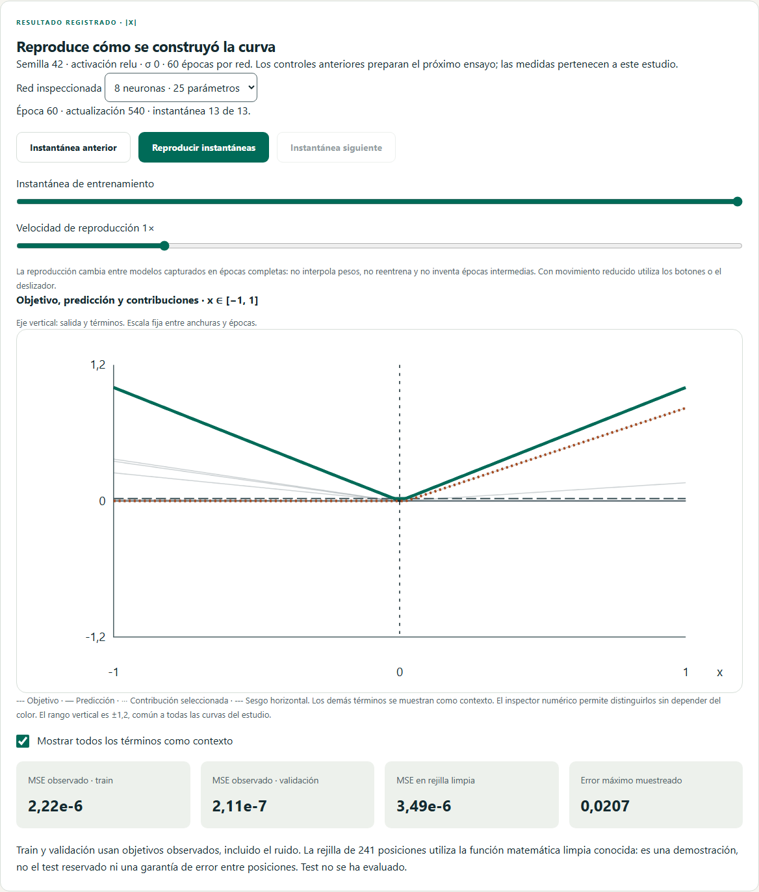
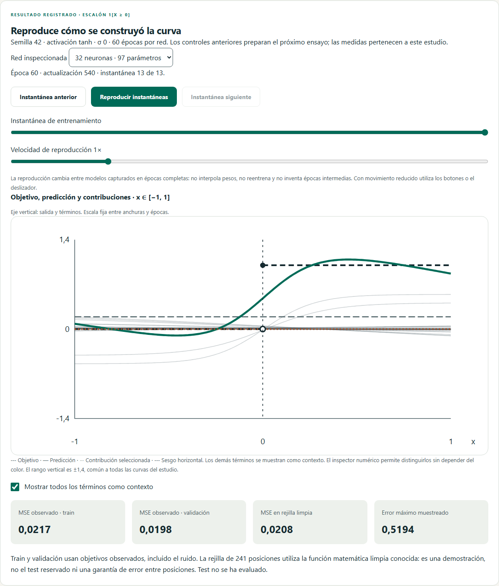
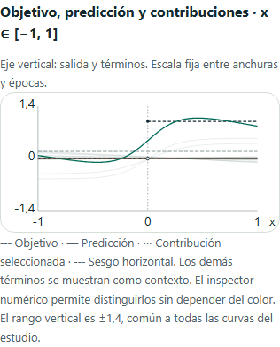

# D8.2 · Construir una función

Especificación de US-050 / RF-073 / P-Q05 y P-L10. Espacio independiente de L10 en `/lab/regresion/funciones`, versión 0.12.0. D8 conserva pendiente US-064 (ética por grupos) y la validación docente en aula.

## Comportamiento y aceptación

- Funciones conocidas en [−1,1]: `sin(πx)`, `|x|`, escalón `1[x≥0]`. Una feature x, salida lineal, una capa oculta con 1/2/8/32 neuronas. Activación Tanh, ReLU, Sigmoide o Lineal, esta última como control sin capacidad no lineal.
- Generación reproducible de 240 filas uniformes; ruido gaussiano aditivo σ entre 0 y 0,3 con stream separado. Train/validación/test 60/20/20 mediante split aleatorio sembrado. Cambiar σ mantiene x, particiones y el ruido estandarizado. Se conserva el target limpio en anotaciones.
- Adam, lote 16, 5–120 épocas, tasa entre 0,001 y 0,1; semilla uint32. Una anchura o comparación secuencial de las cuatro con los mismos datos, partición, pipeline, semilla y presupuesto de épocas. La cantidad de parámetros y las actualizaciones se declaran; misma semilla no implica los mismos tensores en arquitecturas distintas ni el mismo coste computacional.
- Pipeline identidad con estadísticas ajustadas solo sobre train. Entrenamiento e inferencia de las curvas en Web Worker cancelable. No se cambia la sesión de los otros laboratorios. Cancelar o abandonar conserva el último resultado completo e impide aceptar respuestas tardías.
- Instantáneas reales de modelos: época inicial, hasta doce intervalos de épocas completas y final. El reproductor recorre esas instantáneas; no interpola pesos ni fabrica épocas intermedias. Velocidad visual ajustable mediante preferencias; movimiento reducido mantiene controles manuales. Entrenar y reproducir son acciones distintas.
- Para cada x, `ŷ(x)=b_out+Σ_j w_out,j·a_j(x)`. Mostrar función objetivo, predicción, componente seleccionada, suma y tabla completa de términos/activaciones/pesos. Las contribuciones pueden cancelarse; no son importancia causal. Control de x con teclado y selección en la gráfica.
- Ejes comunes para objetivo, predicción, contribuciones y sesgo en cada instantánea; rango vertical declarado y sin recortes silenciosos. El escalón se dibuja con dos tramos, sin interpolar su salto como una rampa.
- MSE de train/validación frente a targets observados. MSE y error máximo sobre una rejilla **didáctica** de 241 posiciones frente a la función limpia, separados de la evaluación de holdout. No se evalúa test ni se usa para seleccionar anchura.
- En escalón, error junto al salto y cota rigurosa: por continuidad, el supremo del error es al menos `max(|ŷ(0)|, |ŷ(0)−1|)≥0,5`. Es una cota inferior del supremo, no el máximo muestreado. Una red continua no aproxima uniformemente un salto con error arbitrariamente pequeño en todo el intervalo. Error en media pequeño no contradice esa limitación.
- El teorema de aproximación para funciones continuas sobre compactos exige condiciones de activación/capacidad; no fija el número de neuronas ni garantiza que Adam encuentre una solución. Más neuronas o épocas no prometen menor error de validación. Una composición de capas lineales sigue siendo afín.

## Separación de responsabilidades

Dominio: funciones objetivo y descomposición verificable con forward. Aplicación: receta sembrada, límites, entrenamiento existente, capturas, curvas, métricas y archivos. Worker de datos: trabajo tipado aislado. Store: opciones, cancelación, resultados completos y selección. Componentes: gráfica, inspector y reproducción. El inspector de experimentos existente permite exportar modelo/experimento final y abrirlo mediante confirmación explícita.

## Límites y exportación

Máximo cuatro redes, 97 parámetros por red, 120 épocas y 1.080 actualizaciones por red. Las estimaciones de operaciones del motor y las curvas se acotan antes de entrenar; las cotas numéricas no representan todo el heap ni una promesa de duración. Máximo trece instantáneas por anchura y 241 posiciones por curva. No se necesita ninguna dependencia nueva.

Informe JSON `neural-atlas.function-approximation-report`, versión 1, con opciones efectivas, hipótesis, reflexión, semilla, hashes, splits, presupuestos, modelos/curvas/medidas de las instantáneas y experimentos finales con su formato existente. Es evidencia analítica, no un nuevo formato importable como modelo; los botones de modelo y experimento producen sus archivos habituales. Se exportan por separado la selección de anchura/instantánea/x para describir lo que se está inspeccionando. El estado de vista vive en memoria; exportar para conservarlo.

## Verificación requerida

Oráculos independientes: ReLU representa `|x|` con dos términos, suma+bias coincide con forward para todas las anchuras y activaciones, linealidad, continuidad/cota del salto. Receta/ruido/split reproducibles y sin fuga; instantáneas inicial/final, reanudación del experimento y compatibilidad de modelos. Integración: aislamiento, cancelación, respuestas tardías y reproducción. Navegadores con Worker real: las tres funciones, cuatro anchuras, contribuciones y archivos; teclado, temas, móvil y movimiento reducido. CI mantiene rechazo de flaky y publicación posterior a las comprobaciones.

## Evidencia local de implementación

Pasan **496 pruebas unitarias/integración en 53 archivos**, con **94,31 % de líneas y 91,45 % de ramas** cubiertas, sin rebajar umbrales. Tipos, lint, compilación, CSP, presupuesto y documentación correctos; transferencia JS inicial aproximada de 60,3 KiB gzip. Los seis recorridos nuevos de Chromium/WebKit pasan sin reintentos, incluidos archivos, apertura/reanudación, animación, aislamiento/cancelación y accesibilidad en ambos temas y móvil. La batería de CI pasa a 291 recorridos en los tres motores, con rechazo de flaky. Se amplía el límite global del job a 20 minutos para dar margen a la suite creciente (la entrega previa usó casi 13 minutos); las aserciones, límites por prueba y controles de calidad se mantienen.

El entrenamiento y las curvas completas se calculan en Worker; la sonda individual del inspector evalúa una sola entrada en el hilo de interfaz. El informe conserva modelos analíticos y los archivos habituales de experimentos finales; los checkpoints intermedios se exportan desde el inspector. El script de publicación comprueba además el escalón, la suma exacta, el checkpoint intermedio y que L06 conserva sus actualizaciones.

Referencia del alcance teórico: [Leshno, Lin, Pinkus y Schocken (1993)](https://www.sciencedirect.com/science/article/pii/S0893608005801315). La demostración no certifica optimalidad del entrenamiento ni sustituye la aceptación en aula.

Capturas reproducibles mediante `node scripts/capture-function-approximation.mjs` sobre el preview. Las cifras corresponden a la receta/semilla indicadas, no a garantías generales.

El ensayo local del script completo de Pages pasa a la primera, incluida la recuperación de L06 después del estudio de funciones. La verificación de aislamiento también parte de una sesión de entrenamiento ya iniciada y comprueba que conserva exactamente su checkpoint.
