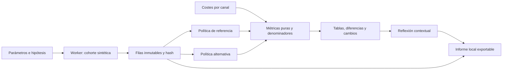
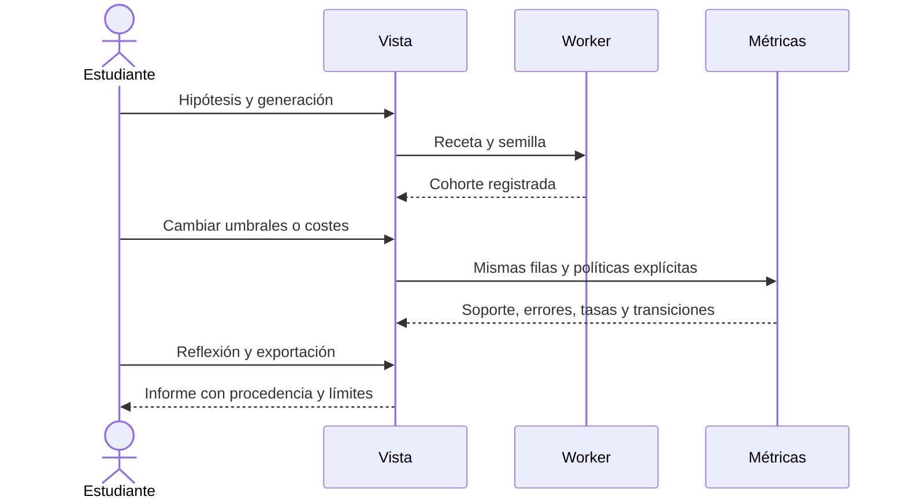

# D8.3 · Ética, evidencia y grupos sintéticos

Especificación de US-064 / RF-087 / P-Q19, versión 0.13.0. Ruta de L09: `/lab/clasificacion/etica`. Completa el alcance funcional de D8 junto con [evaluación probabilística](45-evaluacion-probabilidades.md) y [aproximación de funciones](46-aproximacion-funciones.md). El cierre técnico requiere las verificaciones y publicación; la aceptación docente en aula permanece abierta. D9/D10 y X1/X2 conservan su alcance separado.

## Caso y límites de interpretación

Caso ficticio: priorizar la revisión de solicitudes de un recurso formativo. Dos canales de entrada, G1 y G2, sin identidades ni características personales reales. La etiqueta 1 significa «marcada por la receta para revisión»; no mide necesidad real, mérito ni valor de una persona. FP deriva a revisión una etiqueta 0; FN no deriva una etiqueta 1. Los costes son supuestos editables del ejercicio, no valoraciones de personas ni costes universales.

El clasificador es una regla de juguete fija: `score=sigmoid(medición)`. **No es una red entrenada ni una probabilidad calibrada.** El canal no es argumento de esa regla; las distribuciones de las mediciones y etiquetas pueden diferir. Omitir el canal de la regla no demuestra igualdad de impacto.

Receta v1: etiqueta Bernoulli con prevalencia configurable por canal; medición `1,8·(2y−1)+offset+σ·N(0,1)`. Streams independientes por canal para etiquetas y ruido. Semilla uint32; 0–400 filas por canal, al menos 20 en total; prevalencias [0,1], σ [0,2,5], offsets [−2,2]. Variar el tamaño de un canal no cambia las filas del otro. No hay train/val/test: es una cohorte sintética de auditoría de una regla fija, no una evaluación final de generalización.

## Requisitos observables

| Área | Aceptación |
|---|---|
| Casos precargados | Agregado engañoso, medición comparable, prevalencias distintas y ausencia de representación |
| Políticas | Referencia con umbral común; alternativa común o, por elección explícita, dos umbrales por canal; `score≥umbral` |
| Error y soporte | N, positivos/negativos de referencia, TP/FP/TN/FN, exactitud y total por política/canal |
| Tasas | Selección, precision, recall/TPR, FPR y FNR con sus denominadores; null si falta denominador, nunca cero inventado |
| Agregado | Recuentos sumados y tasas calculadas sobre sus denominadores totales; no media simple de porcentajes de grupos |
| Diferencias | Canal 2 menos canal 1, en puntos porcentuales; null si alguno de los dos términos es indefinido; no son pruebas estadísticas ni certificaciones |
| Costes | FP y FN por canal, editables [0,20], aciertos con coste cero; coste total y medio ponderado por N, no por cantidad de grupos |
| Cambios | Identificar los casos que pasan a revisión o dejan de revisarse; errores corregidos e introducidos; datos/etiquetas/puntuaciones fijos |
| Visualización | Histogramas por canal de la misma cohorte, diez intervalos, clases de referencia y umbrales de ambas políticas, escala común de recuentos |
| Actividad | Hipótesis registrada al generar; reflexión sobre evidencia, información/contexto que falta y propuesta con participación/revisión; sin puntuación moral automática |
| Evidencia local | Informe JSON con receta, opciones efectivas, hash, filas, políticas, costes, métricas, cambios y reflexión; no es un modelo importable |
| Integridad | Generación en Worker cancelable, conservación del último resultado completo, descarte de respuestas tardías, aislamiento de laboratorios |
| Accesibilidad | Teclado, patrones/etiquetas además de color, tablas equivalentes, temas, responsive y movimiento reducido |

La edición de umbrales compara hipótesis de decisión, no reentrena ni cambia los datos. Usar umbrales distintos por canal es una elección que se debe justificar en contexto; el simulador no la autoriza ni prescribe. No se optimiza un umbral ni se elige una política «justa» automáticamente.

## Matemáticas y lectura crítica

`accuracy=(TP+TN)/n`, selección=`(TP+FP)/n`, prevalencia=`(TP+FN)/n`, precision=`TP/(TP+FP)`, recall=`TP/(TP+FN)`, FPR=`FP/(FP+TN)`, FNR=`FN/(TP+FN)`. Matriz: filas reales, columnas predichas. Coste total=`FP·C_FP+FN·C_FN`; coste medio=total/n. Si n=0, tasas y coste medio son null, con recuentos/coste total cero.

El total suma matrices y costes de ambos canales. Las diferencias firmadas son descriptivas, sin intervalos de confianza, significación ni conclusión causal. La semilla y el soporte permiten explorar variación; un grupo ausente no tiene rendimiento observado. Etiquetas/medición sesgadas, personas excluidas, subgrupos, efectos individuales, privacidad y uso real requieren información adicional. Ni exactitud alta, ni costes bajos, ni igualdad de una tasa certifican justicia, privacidad, causalidad o idoneidad.

Referencias de contraste: [Fairlearn: evaluación, daños y soporte](https://fairlearn.org/v0.13/user_guide/assessment/perform_fairness_assessment.html) y [NIST AI RMF](https://www.nist.gov/itl/ai-risk-management-framework/ai-risk-management-framework-faqs). Se usan como fundamentos de lectura crítica, sin añadir servicios, IA externa ni dependencias Python.

## Responsabilidades y flujo

Dominio: validación de filas/políticas/costes, métricas, agregación y transiciones. Aplicación: receta sembrada, presets, procedencia e informe. Worker de datos: generación tipada y acotada. Store: contexto registrado, comparación reactiva y cancelación. Componentes: controles, histogramas, tablas y reflexión.

## Verificaciones para cierre

Oráculos manuales de matriz, denominadores, agregación ponderada, diferencias firmadas y costes; grupos ausentes/sin positivos/sin negativos y políticas extremas; monotonicidad de selección al bajar umbral. Generador reproducible, streams independientes y regla idéntica por canal. Integración con sesión ya iniciada, cancelación y respuesta tardía; datos registrados frente a borrador. Navegadores con Worker real: presets, cambios y archivos, selección por canal, cero soporte, reflexión, temas/teclado/móvil. La publicación exige CI estable y comprobación pública posterior.

## Evidencia de implementación · 0.13.0

Verificación local: 508 pruebas unitarias y de integración en 55 archivos; cobertura de líneas 94,22 %, ramas 91,57 % y funciones 87,15 %. Comprobaciones de tipos, estilo, compilación, presupuesto/CSP y documentación superadas. Los tres escenarios E2E nuevos se verificaron en Chromium y WebKit; la revisión móvil detectó y corrigió el ancho del selector. Firefox se verifica en Linux mediante CI. El flujo completo de CI exige los tres navegadores y rechaza pruebas inestables.

Capturas reproducibles con `node scripts/capture-group-audit.mjs` sobre la previsualización local:

- [Cohorte y políticas](implementation/d8-ethics-cohort.png).
- [Métricas y denominadores](implementation/d8-ethics-metrics.png).
- [Distribuciones en móvil](implementation/d8-ethics-mobile.png).

## Cierre técnico de D8

| Historia | Requisitos | Evidencia |
| --- | --- | --- |
| US041 · calibración | RF063, RF064 | [Evaluación probabilística](45-evaluacion-probabilidades.md) |
| US042 · umbrales y costes | RF065 | [Evaluación probabilística](45-evaluacion-probabilidades.md) |
| US050 · aproximación universal | RF073 | [Aproximación de funciones](46-aproximacion-funciones.md) |
| US064 · ética y grupos | RF087 | Este documento, cohortes, políticas, informes y pruebas |

D8 queda implementado técnicamente. La aceptación docente en un aula real sigue pendiente y no se sustituye por las pruebas automáticas. D9 (visualizaciones 3D, CNN y talleres) y D10 (ampliación del catálogo y uso sin conexión) conservan su alcance pendiente en el plan general.
