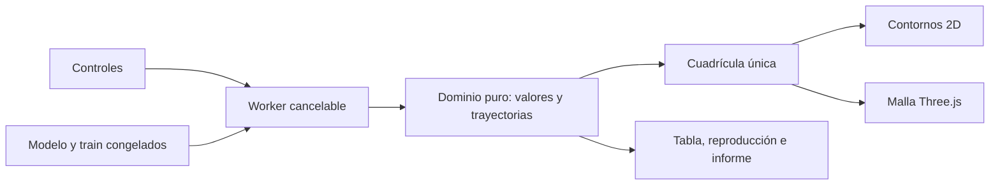
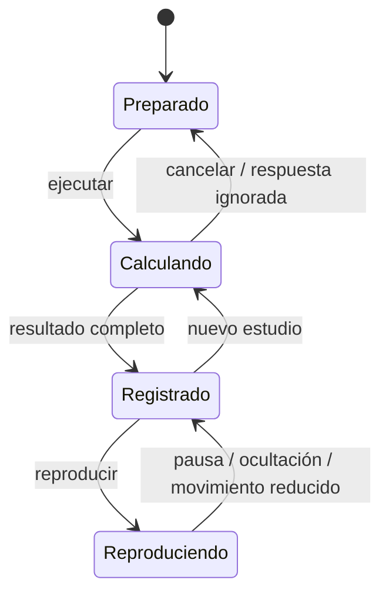

# D9.1 · Paisajes de pérdida

Diseño previo de US-023/RF-035 y US-024/RF-036. Ruta `/lab/optimizacion`. D8 se publicó en 0.13.0 con 508 pruebas unitarias/integración y 300 E2E, despliegue y recorrido público correctos en [CI](https://github.com/franmatias/neural-atlas/actions/runs/40411353170).

## Contrato didáctico

Dos modos explícitos: función ilustrativa y corte de dos parámetros de una red congelada. Cuenco `x²+3y²`, silla `x²−y²`, doble pozo `(x²−1)²+y²` y Rosenbrock `(1−x)²+100(y−x²)²`, con gradientes analíticos. Una trayectoria estacionaria no demuestra un mínimo. Salir del dominio, no finitud y agotamiento del presupuesto se identifican; no se recortan posiciones ni se reinicia un optimizador silenciosamente.

SGD, Momentum, RMSprop y Adam parten del mismo punto con la misma tasa y presupuesto, momentos cero y constantes del motor compartido. El clipping opcional actúa sobre la norma conjunta de las dos coordenadas; se muestran gradiente original y aplicado. No hay scheduler. La comparación no garantiza que una tasa sea igualmente apropiada para todos los métodos.

El corte usa copia de una sesión pausada o un ejemplo explícito. Se eligen dos pesos/sesgos distintos; el resto permanece congelado. Hasta 64 primeras filas de train, identificadas, sin consultar validación/test. Máximo 512 parámetros y presupuesto de 20 millones de productos estimados. Objetivo: pérdida media de datos (BCE/CE/MSE/MAE según tarea), sin penalización ni dropout; BN, si existe, usa estadísticas de inferencia congeladas. Los gradientes del corte usan diferencias centradas con h=1e-4, aproximación especialmente relevante en puntos no diferenciables. Cambiar cámara o reproducción nunca cambia el modelo ni su entrenamiento. Un mínimo del corte no implica mínimo del espacio completo.

## Interfaz y responsabilidades

Panel de modo/función, selección de parámetros y dominio, tasa, pasos y clipping. Muestreo 25×25 por defecto, 10–60 por eje. Generación en Worker cancelable, conserva último resultado completo y descarta respuestas tardías. Contornos D3 y malla Three.js comparten exactamente la cuadrícula. Selección de inicio en 2D y campos equivalentes. Vistas 3D con órbita, zoom y reinicio; altura normalizada con min/max escritos, nunca otra feature. Sin WebGL2 o ante pérdida de contexto se conserva 2D y tabla. Render bajo demanda, DPR máximo 1,5, sin autorrotación, liberación de geometrías/materiales/controles/renderer al salir.

Reproducción del prefijo de trayectorias, paso manual y velocidad de ajustes; movimiento reducido/ocultación detienen reproducción. Tabla numérica por optimizador, estado final y exportación JSON con cuadrícula, fórmulas/procedencia, parámetros congelados, filas y trayectorias. Temas, móvil, teclado y alternativas al color.

## Verificación prevista

Oráculos de valores/gradientes y primer paso de los cuatro optimizadores; finitud, divergencia, parada estacionaria, clipping y validación de límites. Corte contra pérdida directa, originales inmutables y filas solo train; presupuesto y ejes distintos. Integración Worker/cancelación/errores/selección. E2E con Worker real, comparación, informe, reproducción, móvil, accesibilidad, WebGL y fallback; rendimiento se registra como observación del equipo, sin inventar FPS universales. Referencias: [WebGLRenderer](https://threejs.org/docs/pages/WebGLRenderer), [liberación de recursos](https://threejs.org/manual/pages/how-to-dispose-of-objects.html), [OrbitControls](https://threejs.org/docs/pages/OrbitControls).

## Implementación · 0.14.0

Motor puro, protocolo Worker, store y vistas separados. Optimizadores reutilizados del motor de entrenamiento; informe con red serializada por el contrato compartido y hash SHA-256 de su procedencia. La superficie 3D incorpora ejes, malla y trazados superpuestos para evitar que la interpolación entre muestras los oculte. Cámara y reproducción solo inspeccionan.

516 pruebas unitarias/integración en 57 archivos superadas; cobertura local: líneas 92,33 %, funciones 85,61 %, ramas 90,97 %, manteniendo los umbrales de dominio/aplicación. Seis casos locales E2E correctos entre Chromium y WebKit, con Worker real, WebGL2, fallo de contexto, fallback forzado, temas y 360/390/1440 px. Primera vista y controles WebGL observados: 690 ms en Chromium y 1741 ms en WebKit en el equipo local; no son FPS ni garantía en otros dispositivos. Firefox corresponde a CI en Linux.

Compilación, tipos, estilo, CSP, enlaces y diagramas correctos. Transferencia inicial observada: 61,27 KiB JS gzip y 11,83 KiB CSS gzip; Three.js se carga solo al abrir 3D (~139 KiB gzip adicionales). El recorrido completo local verifica también el corte MSE `11/3` en el origen y conserva la sesión L06.

Capturas reproducibles mediante `node scripts/capture-landscape.mjs`:

- [Contornos y trayectorias](implementation/d9-landscape-contours.png).
- [Malla y cámara 3D](implementation/d9-landscape-3d.png).
- [Vista móvil](implementation/d9-landscape-mobile.png).

Este incremento implementa US-023 y US-024. La publicación requiere CI y recorrido público correctos; no cierra la CNN, los talleres restantes de D9 ni D10. La aceptación humana en aula sigue abierta.
