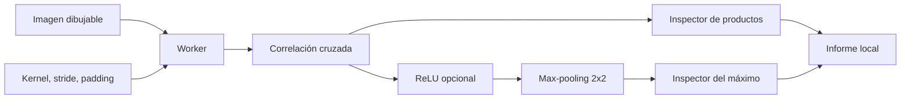
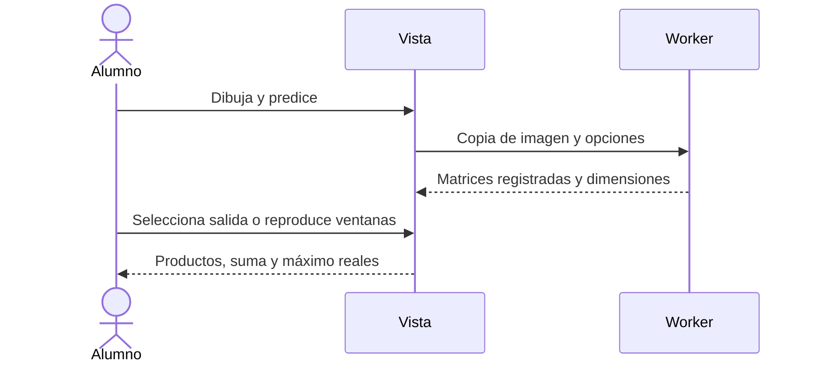

# D9.2 · Del píxel al mapa

Diseño previo de US-031/RF-047, ruta `/lab/vision`. Inspección didáctica de correlación cruzada, ReLU y max-pooling; no red CNN entrenable ni reconocimiento de dígitos. La imagen y los filtros son datos locales, sin cámara ni subida de archivos.

## Requisitos y cálculo

Imagen cuadrada dibujable 10–28 píxeles por eje, valores [0,1], patrones siete/cruz/diagonal/contorno y rotación exacta de 90°. Kernel editable 3×3 o 5×5, pesos [−5,5], presets identidad, media y bordes. Stride 1–3, padding valid/same. El kernel no se invierte: la operación es correlación cruzada, habitualmente llamada convolución en CNN.

Valid: `O=floor((N−K)/s)+1`, padding cero. Same: `O=ceil(N/s)`, total `P=max((O−1)s+K−N,0)`, anterior `floor(P/2)`, posterior `P−anterior`. Una salida es la suma explícita de K² productos, incluidos ceros de padding identificados. ReLU opcional `max(0,z)`; pooling 2×2 stride 2 sobre la activación, sin padding, `floor(O/2)`, empate por primer índice en orden de filas. Si O es impar se explica la última fila/columna descartada.

Generación del resultado completo en Worker cancelable. El inspector selecciona una salida registrada y muestra coordenadas de la ventana, entradas, pesos, productos, suma y activación; animación manual/automática de ventanas con velocidad común, pausa por ocultación y movimiento reducido. El inspector de pooling muestra los cuatro candidatos y el índice ganador. Cambiar el borrador nunca modifica las matrices registradas; hay que aplicar de nuevo.

## Diseño y calidad

Componentes separados para editor de imagen, mapa matricial y página; dominio puro para formas/productos/pooling, aplicación para informe, store para Worker/selección. SVG con valores, escalas y etiquetas además de color. Entrada equivalente por coordenadas y botón de pintura accesible con teclado; no obligar a recorrer cientos de celdas con Tab. Tablas numéricas, temas, responsive con desplazamiento interno en matrices grandes. Exportación JSON con imagen, kernel, dimensiones, resultados e inspector, sin afirmación de invariancia universal.

Pruebas: oráculos asimétricos que detectan inversión del kernel; valid/same con stride y padding asimétrico, negativos/ReLU, pooling y empates, rotación y límites. Integración con cancelación y borrador/resultado; E2E con Worker real, pintura por ratón/teclado, informe verificable, reproducción, temas y móvil. El laboratorio no acredita comprensión por una respuesta libre ni entrena una CNN.

## Implementación · 0.15.0

US-031 implementada con dominio puro, trabajo Worker tipado, store aislado y componentes SVG/editor/página. 523 pruebas unitarias/integración en 59 archivos correctas; cobertura local de líneas 91,97 %, funciones 85,24 % y ramas 90,84 %, con umbrales de dominio/aplicación conservados. Tipos, estilo, compilación, CSP, presupuesto y documentación correctos. Transferencia inicial observada: 61,39 KiB JS gzip y 11,83 KiB CSS gzip.

Seis casos locales E2E correctos en Chromium/WebKit: identidad y pintura por coordenadas/ratón; cada suma contrastada con un bucle independiente, kernel 5×5, stride/padding, negativos/ReLU, borde impar descartado, hipótesis registrada frente a borrador, reproducción y 28×28 en ambos temas a 360/390/1440 px, con Axe. Firefox y el recorrido público forman parte del control de publicación de CI.

Capturas revisables y reproducibles mediante `node scripts/capture-vision.mjs`:

- [Correlación, activación y pooling](implementation/d9-vision-maps.png).
- [Imagen registrada y ventana](implementation/d9-vision-window.png).
- [Mapas en móvil](implementation/d9-vision-mobile.png).

La hipótesis se registra al aplicar el filtro. El informe verifica de nuevo las matrices antes de exportar e incluye los productos de la salida seleccionada y el máximo de pooling. La respuesta libre se conserva sin nota automática. La sesión de entrenamiento de L06 permanece separada.

L01–L14 tienen ya experiencias implementadas. Los talleres T06–T12, los fallos plantados y D10 siguen pendientes; disponer de todas las tarjetas de laboratorio no cierra el proyecto ni la validación docente en aula.
