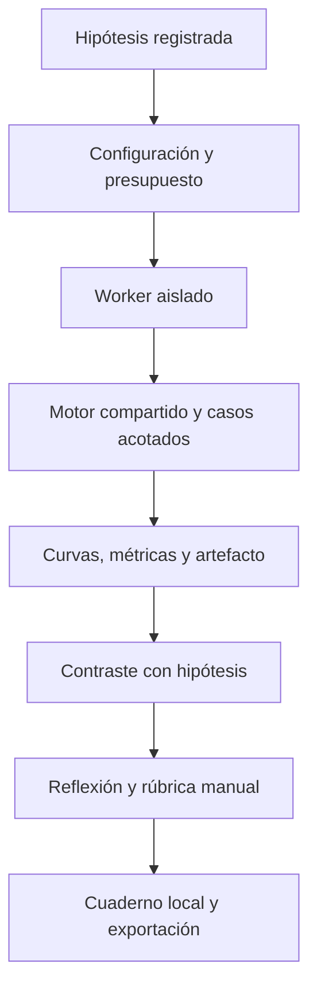

# D9.3 · Siete investigaciones y reparación reproducible

Diseño previo para US-045/RF-053 y US-047/RF-070. Amplía el taller existente a T01–T12 conservando las cinco fases: predecir, configurar, ejecutar, observar y explicar. T01–T05 conservan sus definiciones y hashes; controles avanzados opcionales para mantener cuadernos anteriores. L07 se publicó en 0.14.0 con 516 pruebas unitarias/integración, 309 E2E y recorrido público correcto en [CI](https://github.com/franmatias/neural-atlas/actions/runs/40468348420).

| Taller | Investigación y evidencia |
| --- | --- |
| T06 · Sobreajuste | Dos entrenamientos aislados de L08, mismo split e inicialización, referencia/L2; curvas train/val y normas. No se garantiza que L2 mejore validación ni que una brecha aislada pruebe alta varianza. |
| T07 · Desbalance y umbral | Puntuaciones sintéticas fijas, matriz y costes antes/después; soportes y denominadores explícitos. No se selecciona con test. |
| T08 · Proyecto de regresión | Dataset sintético, pipeline train-only, entrenamiento, validación, baseline, curvas y experimento completo exportable para continuar en L10. Test queda reservado hasta decisión final explícita en el laboratorio. |
| T09 · Datos defectuosos | Ausencias, outliers y duplicados con procedencia; reparación de ausencias por pipeline ajustado solo con train, nunca eliminación silenciosa de casos difíciles. |
| T10 · Gradientes y convergencia | Rosenbrock ilustrativo, misma tasa/inicio con/sin clipping; gradientes originales/aplicados y salida del dominio. No se recorta una posición divergente para ocultarla. |
| T11 · Evaluación y contexto | Cohorte ficticia por canales de L09, métricas/soportes/costes; exactitud agregada frente a errores por grupo y reflexión contextual. Sin certificado de justicia ni nota moral automática. |
| T12 · Reparación reproducible | Ocho fallos: inicialización cero, tasa excesiva, unidades, fuga en ejemplo independiente, salida incompatible, BN con lote uno, etiquetas parcialmente alteradas y ReLU inactiva en sonda. Evidencia real, modos seguros y experimento reparado exportable. |

## Contratos

Entrenamientos nuevos limitados a 5–20 épocas y datasets pequeños, presupuesto reconocido antes de los casos con entrenamiento. Semilla fija y test no consultado; fallos actúan solo en copias válidas dentro de límites del motor. La prueba de unidades modifica entradas de una sonda train para demostrar el error de uso, nunca el pipeline ni las filas protegidas. El resultado informa qué se modificó, qué se conservó y qué no se puede concluir. T12 no asegura detectar una causa real a partir de métricas heurísticas.

La evidencia mantiene tablas/curvas y métricas permitidas, admite null para denominadores ausentes y un experimento opcional del contrato común. La descarga del experimento se valida antes de ofrecer un archivo reutilizable. Los controles nuevos viven en un objeto avanzado opcional; los cuadernos antiguos sin él mantienen su configuración y hash. No se ejecuta código importado ni se añaden reglas arbitrarias.

Se conservan LocalStorage para el resumen e IndexedDB para textos/evidencias, cancelación de Worker, respuestas tardías descartadas y recuperación de progreso. Reflexiones libres requieren revisión humana; las reglas automáticas verifican evidencia y registro, no comprensión. Cada taller incluye prerrequisitos, hipótesis, variable controlada, pistas, explicación orientativa y rúbrica.

La biblioteca `FailureCase` conserva síntoma, presetId, evidencia, safeMode, causa plantada, intervenciones permitidas, pistas y solución docente. Dos casos se diagnostican con el validador real, sin ejecutar configuraciones inválidas. El ejemplo de fuga usa train ficticio [0,1,2] y holdout ficticio [100], independientes del experimento; queda marcado `illustrativeHoldoutConsulted=true`, mientras el test protegido del modelo sigue sin consultarse. La corrupción parcial cambia una de cada cinco etiquetas de una copia de train; un oráculo sintético permite contrastarlas, sin sugerir que ese oráculo existe en datos reales.

Los artefactos T08/T12 ejecutan el presupuesto pedido y conservan una época adicional en el horizonte para poder continuar un lote después de importarlos. Esto se verifica numéricamente. R² se calcula a partir de las predicciones de validación y su media; el baseline de MSE usa la media de train. Los campos score del historial original conservan MSE en regresión y exactitud en clasificación, identificados por `scoreKind`.

## Verificación prevista

Doce recorridos POE en integración; oráculos independientes por caso, igualdad de split/inicialización cuando se promete, ausencia de test, modelos exportados importables y reanudables, costes/denominadores, fallos reparados sin mutar sesiones. Archivos antiguos, casos desconocidos y campos excesivos siguen controlados. E2E de los siete talleres, persistencia, cancelación y archivos, con accesibilidad/temas/móvil. D9 no se declara completo antes de CI y despliegue correctos; aceptación en aula y D10 permanecen separados.

## Evidencia local · 0.16.0

552 pruebas unitarias/integración en 61 archivos superadas; cobertura de líneas 92,03 %, funciones 85,21 % y ramas 90,94 %, sin rebajar umbrales. Los doce recorridos POE se verifican en integración. Los oráculos nuevos contrastan baseline/R², reanudación del siguiente lote, igualdad con λ=0, costes por etiqueta, errores reales de validación, clipping, corrupción parcial y sonda ReLU/unidades. Se prueba también el rechazo de un artefacto corrupto y los denominadores nulos.

28 casos nuevos E2E locales correctos entre Chromium/WebKit: siete recorridos completos y siete variantes adicionales de T12 por navegador, con Worker nativo, exportación y recuperación. Dos pruebas adicionales comprueban Axe, temas y 360/390/1440 px; detectaron y corrigieron el selector de ensayos que desbordaba el panel móvil. El recorrido completo local verifica T08, el rechazo real de BN con lote uno y el experimento reparado con BN/lote 12, manteniendo L06 intacto.

Tipos, estilo, build, presupuesto/CSP y documentación verificados. JS inicial observado: 61,40 KiB gzip; CSS: 11,83 KiB gzip. No implica rendimiento universal. Capturas reproducibles con `node scripts/capture-investigations.mjs`:

- [T06 · referencia y L2](implementation/d9-workshop-t06.png).
- [T08 · proyecto de regresión](implementation/d9-workshop-t08.png).
- [T12 · configuración inválida y reparación](implementation/d9-workshop-t12.png).
- [Evidencia en móvil](implementation/d9-workshop-mobile.png).

## Cierre técnico de D9

| Historia | Requisito | Implementación |
| --- | --- | --- |
| US-023 | RF-035 | [L07 · contornos y malla 3D](48-paisajes-perdida.md) |
| US-024 | RF-036 | [Corte de dos parámetros congelados](48-paisajes-perdida.md) |
| US-031 | RF-047 | [L11 · correlación y pooling](49-vision-kernels.md) |
| US-045 | RF-053 | T06–T12, cinco fases y evidencias |
| US-047 | RF-070 | Ocho casos rotulados, modos seguros, validación y reparación |

El alcance funcional de D9 queda implementado; el cierre de publicación exige CI y recorrido público de esta versión. D10 y la aceptación docente en aula permanecen pendientes. Las extensiones X1/X2 siguen propuestas y no se confunden con el alcance de v1.1.
