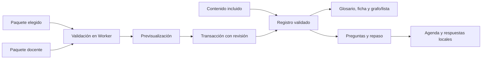
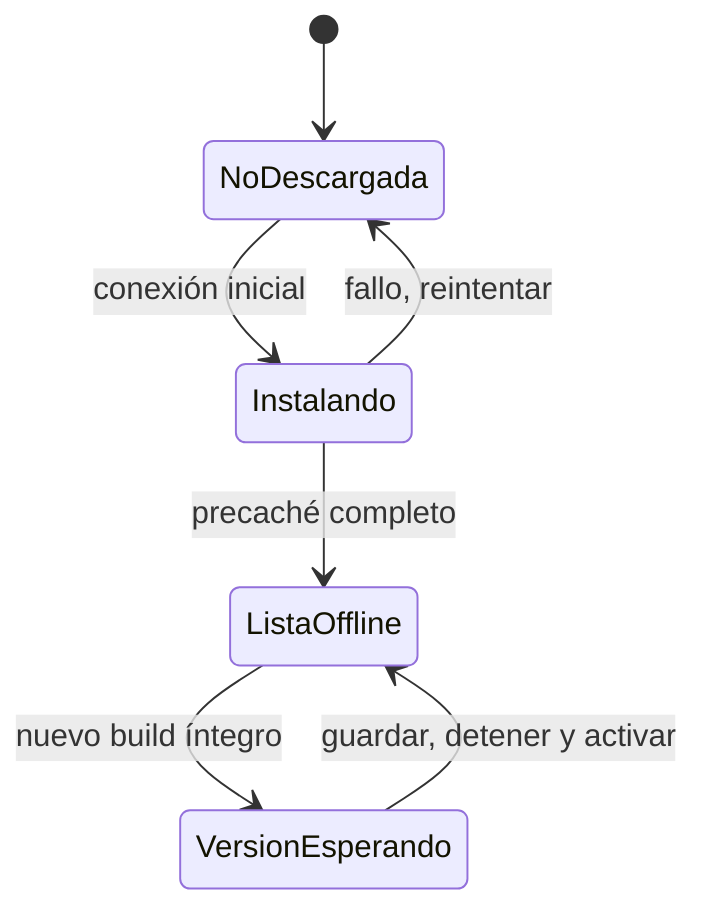

# D10 · Catálogo, repaso, paquetes y uso sin conexión

Diseño previo de US-038, US-044, US-051, US-052, US-053 y US-060. Se conserva el alcance acordado de v1.1; X1/X2 y aceptación docente en aula permanecen separados. Implementación por incrementos verificables, sin declarar terminada una función por disponer de una pantalla o un esquema.

## Catálogo y edición declarativa

Se publican las 152 fichas originales con sus IDs estables y se conservan las 500 fichas de consulta C153–C652. Los comparadores kNN/árbol, grid y permutación de X1 conservan su estado previsto; una explicación no los convierte en simuladores implementados. Siguiente ID sugerido C653, sin máximo global fijo.

Cada ficha desarrollada sigue el contrato del documento 06: títulos es/en y aliases, versión de contenido entera, categoría/nivel, definición, intuición y límite, notación/dimensiones, ejemplo estático con unidades, controles, error frecuente, pregunta con opciones y explicación, prerrequisitos, relacionados, actividad/evidencia, referencias y estado/entrega. Las cifras estáticas se rotulan; solo bindings registrados pueden mostrar valores de un laboratorio. No se evalúan fórmulas recibidas. El español es el contenido inicial; otros locales usan fallback explícito.

`neural-atlas.concept-pack` v1: packId, versión semántica, categorías y conceptos. Máximo 4 MiB UTF-8 y 500 registros simultáneamente; cada registro ≤32 KiB. No se exige que el máximo de registros quepa con textos máximos. JSON seguro, esquema estricto, IDs/slugs únicos, controles/presets registrados, fuentes HTTPS o referencias documentales conocidas, sin HTML ejecutable ni rutas arbitrarias. Se aceptan nuevas categorías declaradas, no funciones nuevas del motor.

Previsualización obligatoria con altas, cambios, versiones y procedencia antes de confirmar. ID existente requiere misma identidad/slug y versión superior; se distingue la restauración idéntica de una modificación. No se permite apropiación silenciosa de IDs de otro paquete. Contenido importado siempre se identifica como local sin revisión editorial, aunque el archivo declare reviewed. Las referencias deben existir en el catálogo resultante; los prerrequisitos forman un DAG y las relaciones pueden ser recíprocas. Validación completa antes de escribir; cancelación conserva el catálogo confirmado.

## Ficha, orientación y errores frecuentes

El glosario conserva búsqueda bilingüe, filtros, paginación y enlaces por ID. La ficha ampliada añade ejemplo, intuición, límites, actividad, controles y pregunta. El mapa distingue aristas de prerrequisito y relación; layout estable, búsqueda y vecindario acotado para no dibujar cientos de textos superpuestos. Una lista topológica paginada ofrece la alternativa completa para teclado/lector. Visitar, explicar y revisar son estados locales de actividad, no acreditación de dominio.

Los enlaces «Pruébalo» de errores frecuentes apuntan a los ocho FailureCase de D9. Antes de abrir otro intento se muestra qué caso se preparará. El taller conserva el intento anterior mediante su mecanismo existente; nunca sustituye pesos/datos de la sesión L06 por seguir un enlace del glosario. Una propuesta inválida continúa sujeta al validador común.

## Autoevaluación y calendario local

Preguntas MCQ/VF con IDs y opciones estables. Corrección por conjuntos de IDs, explicación visible tras responder; no evaluación semántica automática de texto libre. Cola de vencidas al visitar, búsqueda/repaso libre, sin avisos externos ni ranking. Calendario Leitner: correcto pasa a cajas 1–5, intervalos 1/3/7/14/30 días; incorrecto vuelve a caja inicial y propone mañana. Se usan días de calendario, no incrementos de 24 horas que fallen con cambios de hora.

Se conservan hasta cinco respuestas recientes por pregunta y versión. Cambiar el contenido reinicia la agenda compatible sin presentar la respuesta anterior como dominio del nuevo texto. Fecha local del navegador en infraestructura; algoritmo puro recibe hoy como argumento. El usuario puede exportar y restablecer su historial con vista previa de lo que se eliminará.

## Almacenamiento y transacciones

Migración aditiva de IndexedDB v3 a v4, conservando experimentos, evidencia y recuperación. Nuevos stores para catálogo local, repaso y paquetes docentes. LocalStorage mantiene únicamente preferencias/resúmenes pequeños. Revisión esperada dentro de transacción; confirmar complete antes de anunciar guardado. Error, bloqueo, corrupción o cuota conserva el registro anterior y permite trabajar en memoria/exportar, sin vaciar toda la base.

Paquetes locales comparten el presupuesto de 16 MiB previsto en ADR-004; repaso/evidencia comparte 8 MiB. El límite de archivo docente de 64 MiB no garantiza que pueda instalarse entero en el presupuesto local: se informa antes de guardar. No se expulsan automáticamente experimentos o paquetes ajenos. El origen de GitHub Pages comparte cuota con otros proyectos; estos nombres no constituyen aislamiento de seguridad.

## Paquete docente

`neural-atlas.teaching-pack` v1 contiene manifiesto, talleres declarativos, hasta 100 presets, datasets columnares, relaciones internas y guía docente obligatoria; soluciones opcionales. Máximo 64 MiB UTF-8 y 12 talleres. Validar todos los artefactos y referencias antes de una transacción de instalación. El paquete no carga rutas remotas ni ejecuta código recibido. Un preset que contiene un experimento usa el validador e integridad del contrato común, sin inventar un segundo códec de pesos.

La guía incluye objetivos, prerrequisitos, duración orientativa, secuencia, errores, debate, accesibilidad y atribuciones. Exportar sin soluciones las elimina del archivo; no se promete impedir el acceso a soluciones que sí se incluyan. Instalar guarda un paquete; aplicar su dataset/experimento o abrir una actividad es una acción explícita y revisable, conservando la sesión actual hasta confirmación. El docente puede preparar y volver a exportar el paquete local.

## PWA y actualización

App shell, contenido, iconos, fuentes locales, chunks y Workers bajo `/neural-atlas/`, HTTPS o localhost, sin CDN. Manifiesto y precaché de recursos del build; excluir mapas de fuentes, tests y documentación de desarrollo. «Disponible sin conexión» solo después de confirmar el precaché completo. Primera visita sin conexión no funciona; una descarga incompleta conserva el estado y permite reintentar.

El Service Worker solo gestiona estáticos de esta subruta; los experimentos permanecen en IndexedDB. Nueva versión queda esperando: sin skipWaiting automático ni recarga mientras se entrena. Guardar/exportar y detener el trabajo antes de activar; explicar versión activa/lista y recuperación disponible. Al activar, eliminar únicamente cachés antiguas de Neural Atlas, nunca otros datos del origen. Un fallo de instalación mantiene la versión anterior operativa.

## Diseño y verificación

Pruebas: límites simultáneos, duplicados/conflictos, ciclos y referencias, reversión de transacción, cuota/bloqueo/corrupción, dos pestañas y migración preservadora; preguntas y calendario en cambio de hora, versiones y últimos cinco intentos; paquete docente sin soluciones y referencias inválidas; Worker real, persistencia y ficheros; grafo/lista con teclado, temas y móvil; offline real con contexto sin red y actualización con entrenamiento activo. CI conserva sus umbrales y rechaza flakiness. El cierre final incluye revisión de RF/RNF, capturas y comprobación pública, con la aceptación en aula aún atribuida a personas.
