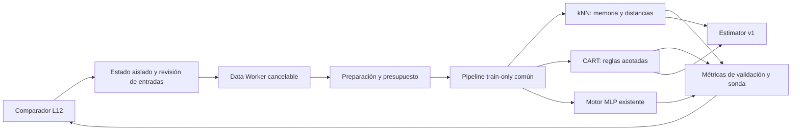
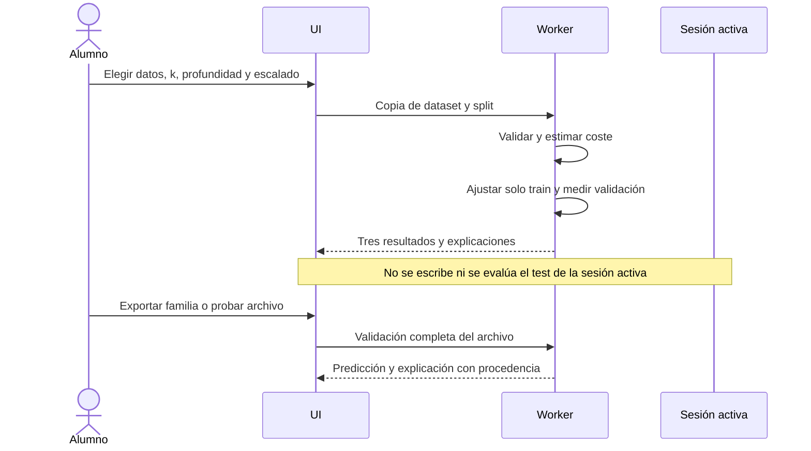
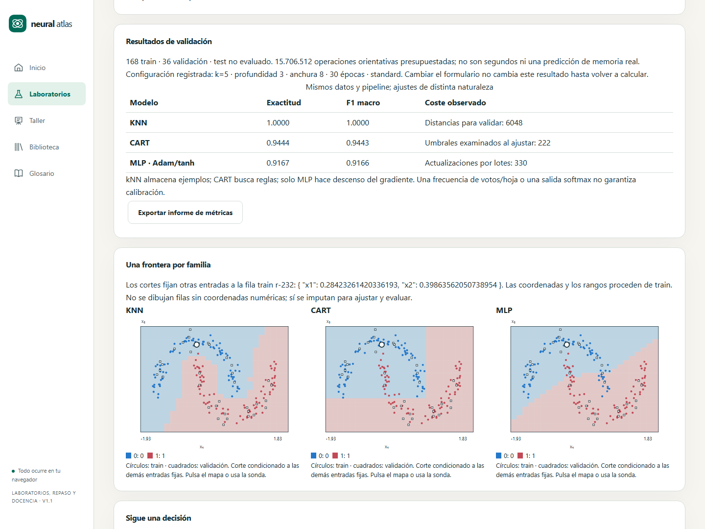
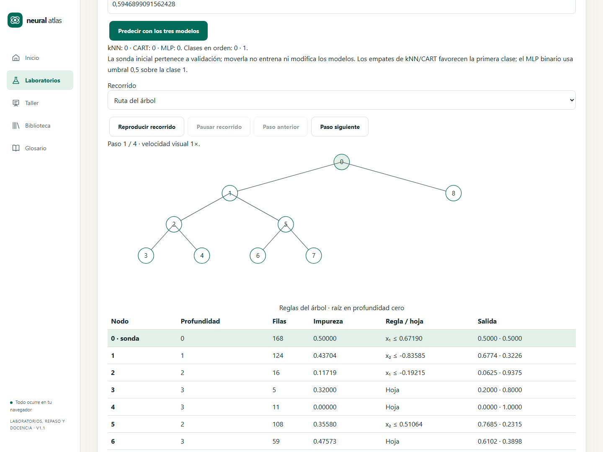

# X1.1 · Comparar memoria, reglas y una red

US-056 / RF-079 / P-Q11. La continuación solicitada tras v1.1 comienza X1 con kNN y CART acotados. Grid y permutación (US-057/058), X2 y aceptación con alumnado conservan su estado independiente.

## Contrato previo

- Una ejecución aislada compara kNN, CART y MLP sobre exactamente los mismos IDs train/validación y un pipeline común ajustado exclusivamente con train. Fuente JSON hasta 4 MiB y dataset hasta 600 filas, 8 features de entrada, 16 columnas transformadas; validación no vacía. No se consulta test ni se sustituye la sesión activa.
- kNN: k entero 1–min(15,Ntrain), distancia euclídea en el espacio transformado, voto uniforme o media numérica. Empates de distancia por ID de fila ASCII y empate de votos por índice de clase. Frecuencias no calibradas; almacenar train constituye su ajuste, no descenso del gradiente.
- CART: profundidad máxima 1–4, raíz profundidad cero, minLeaf=5; Gini para clasificación o varianza MSE para regresión. Hasta 32 umbrales entre valores distintos por feature, submuestreados uniformemente por rango de orden si hay más. Es una búsqueda aproximada por cuantiles, no CART exhaustivo. Desempates por ID de feature y umbral ascendente. Se divide solo si la ganancia supera 1e-12; hijos con al menos minLeaf. Máximo 31 nodos.
- MLP: motor existente, Adam, tanh, una capa de anchura 2–16, 5–60 épocas. Presupuesto previo ≤1e8 operaciones orientativas; no comparar épocas con el ajuste directo del árbol ni presentar costes como tiempo de pared. Métricas comunes de validación, contadores de distancias y candidatos, medidas por muestra y modelo exportable.
- Sonda y mapas: plano de las dos primeras features numéricas, otras fijadas a una fila train explícita. Cuadrícula 25×25; para regresión sin segunda feature se representa una curva. Los mapas son cortes condicionados, no una representación de todas las dimensiones. El inspector muestra vecinos/distancias/votos y ruta del árbol, con alternativa tabular. Animación de recorrido por pasos, ajustable y con movimiento reducido.

## Familias y archivos

Se conservan intactos `neural-atlas.model` para redes y `neural-atlas.experiment` para reanudación. Nuevo `neural-atlas.estimator` v1 con discriminante `family: knn|cart`, tarea, opciones, dataset **solo train**, opciones del pipeline, procedencia original (hashes data/split), pipeline y ajuste reproducibles. No contiene holdout, gradientes, optimizador ni checkpoints ficticios. kNN incluye ejemplos de entrenamiento: la interfaz avisa antes de exportar datos reales.

El códec reconstruye pipeline y modelo de forma determinista desde las filas train mediante la misma rutina de ajuste, verifica hash del estado aprendido e integridad del sobre. Los hashes originales son procedencia declarada, no prueba criptográfica de un holdout ausente. Límite 8 MiB UTF-8, esquemas estrictos, JSON seguro, tamaños y finitud comprobados antes del ajuste. Un archivo inválido no sustituye la última predicción válida. Importación/inferencia se ejecutan en Worker; cancelar termina ese Worker.

## Arquitectura

## Verificación

Oráculos manuales de distancia/voto/empate/media; Gini y reducción de MSE conocidas; profundidad, hojas, constantes, duplicados y finitud. Pipeline refactorizado sin modificar contratos anteriores; fuga comprobada con holdout extremo. Roundtrip de ambas familias, integridad, exclusión de test, rechazo del códec de red y archivos maliciosos. Integración del Worker, cancelación y preservación de resultados. E2E clasificación/regresión, sonda, archivo, teclado, temas, movimiento reducido y 360 px. CI completa antes de Pages.

Fuentes primarias: [vecinos próximos](https://scikit-learn.org/stable/modules/neighbors.html), [árboles](https://scikit-learn.org/stable/modules/tree.html). Estas fuentes describen algoritmos generales; la implementación didáctica usa los límites y desempates explícitos anteriores y no pretende reproducir bit a bit scikit-learn.

## Compatibilidad del catálogo local

C143 y C144 pasan a contentVersion 2 y enlazan los controles implementados; ahora hay 149 actividades implementadas y tres previstas. Si un paquete local guardaba una revisión igual o anterior, se conserva para exportarla pero prevalece la ficha incluida más reciente. El paquete conserva la propiedad de sus IDs: otro paquete no puede apropiárselos. Una revisión local posterior del mismo propietario puede activarse tras validar identidad, referencias y ciclos. Se prueba la recuperación de catálogos antiguos sin perder el paquete ni rechazar toda la biblioteca.

## Alcance de la entrega

La versión 1.2.0 implementa US-056 / RF-079 / P-Q11. X1 sigue abierto para US-057 (rejilla) y US-058 (permutación); X2 y la aceptación pedagógica en aula permanecen pendientes. El laboratorio conserva L12 y las catorce tarjetas existentes.

## Evidencia de verificación local · 27/10/2026

- 599 pruebas unitarias e integración en 73 archivos; cobertura: líneas 92,58 %, funciones 86,56 %, ramas 90,65 %. Se mantienen todas las puertas del proyecto.
- Ocho recorridos Playwright del comparador pasan en Chromium y WebKit: binaria/multiclase/regresión, copia de sesión, exportación/importación, teclado, Axe en ambos temas, 360/768/1440 px y movimiento reducido. Firefox se verifica en el CI Linux junto con la suite completa.
- TypeScript, lint, producción, presupuesto inicial y comprobaciones documentales pasan. Los ajustes finales de procedencia y conservación de entrada tienen 19 pruebas focalizadas adicionales sobre la misma batería.
- El smoke de Pages incluye tres mapas, sonda, árbol y roundtrip de un estimador con 168 filas train y sin split de holdout; el despliegue depende del workflow completo.

[Captura móvil](implementation/x1-classical-mobile.png). La aceptación con alumnado permanece pendiente.
