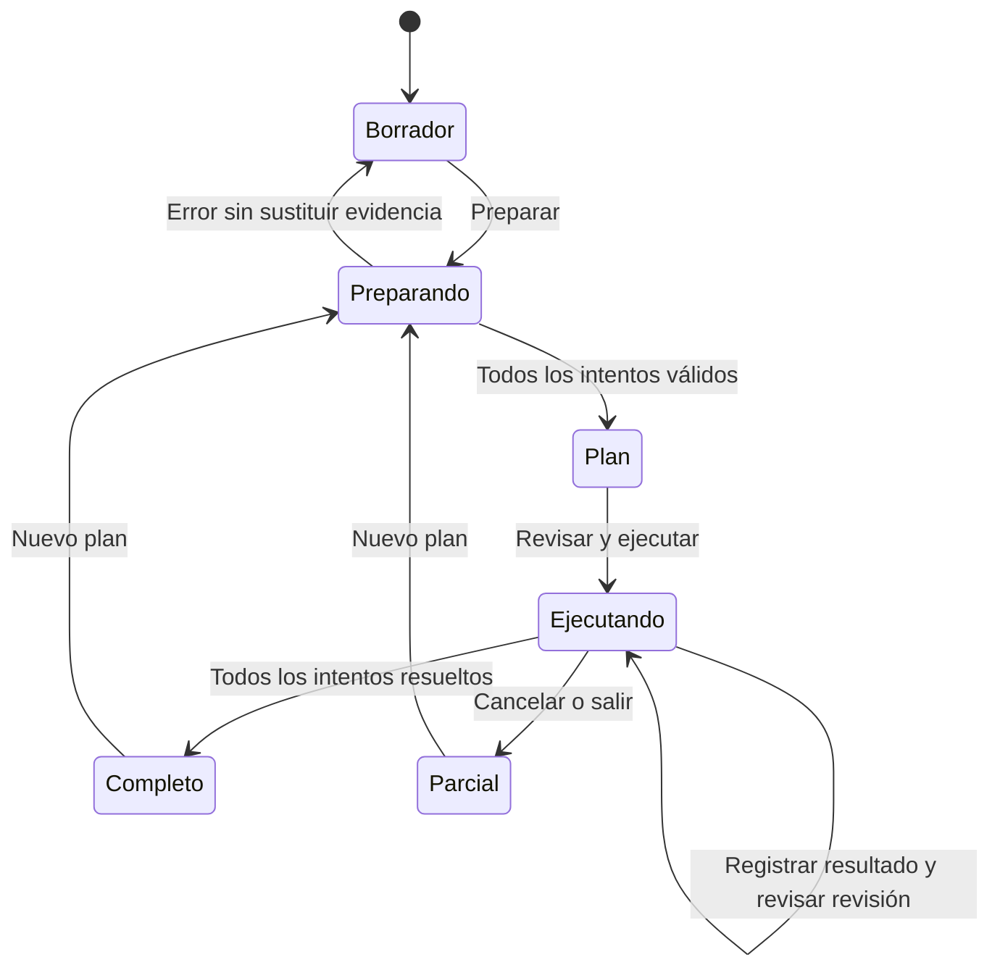
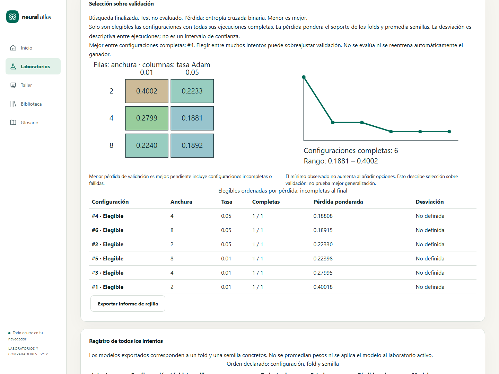
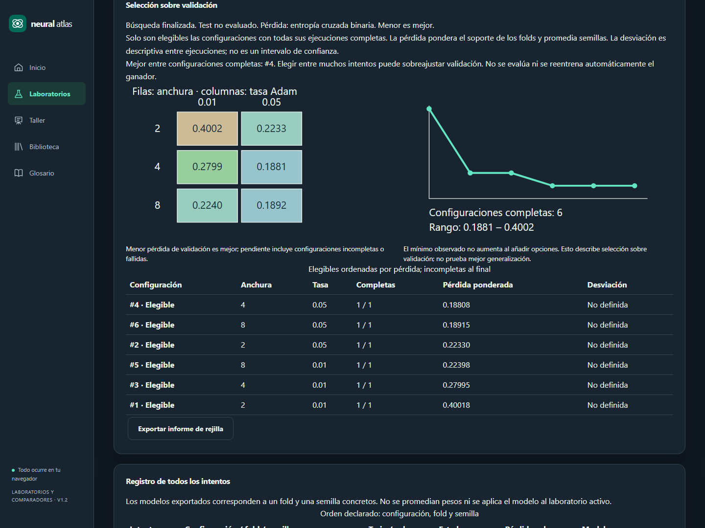

# X1.2 · Buscar con un presupuesto explícito

Especificación previa de US-057 / RF-080 / P-Q12 y actividades C145/C151. Continúa el comparador X1.1. La importancia por permutación (US-058), X2 y la aceptación con alumnado mantienen su alcance independiente.

## Requisitos funcionales

- Una rejilla de MLP cruza de una a tres anchuras de capa oculta (2–16 neuronas) con de una a tres tasas de Adam (0,0001–0,3). Valores únicos y finitos; orden declarado, hasta nueve configuraciones. Tanh, Xavier, lote 16 y horizonte común de 5–60 épocas; pérdidas BCE/CCE/MSE según la tarea. La búsqueda modifica hiperparámetros; cada entrenamiento aprende pesos distintos.
- Se admite una o tres semillas de entrenamiento, y validación fija o tres folds. El producto configuraciones × semillas × folds no puede superar 27. Las mismas semillas y particiones se reutilizan para todas las configuraciones. El orden es configuración, fold, semilla; empate de pérdida por orden declarado.
- Fuente aislada sintética o copia del laboratorio, con JSON hasta 4 MiB, 600 filas, ocho características y 16 columnas transformadas. Se conserva el pipeline seleccionado, ajustado de nuevo con el train de cada partición. Nunca se ajusta con validación ni se evalúa test.
- Los folds reutilizan el contrato `k-fold-v1`: redistribuyen exclusivamente train+validación y conservan el test original. Estratificación en clasificación, aleatorio en regresión y agrupado cuando existen grupos. Se rechazan divisiones temporales, selecciones parciales y folds anidados de origen para evitar protocolos implícitos.
- Preparar el plan en Worker verifica todos los candidatos y particiones antes de entrenar, muestra ejecuciones, parámetros, actualizaciones, operaciones y memoria numérica orientativas. Puerta global: operaciones superiores estimadas ≤2e8 y suma de memoria numérica ≤32 MiB, sin presentar estas cantidades como tiempo de pared o memoria total de JavaScript. La ejecución requiere revisar expresamente el plan.
- El plan es una instantánea independiente del formulario. Cambiar el formulario exige preparar un nuevo plan; los resultados históricos conservan su configuración y procedencia. Copiar o ejecutar no modifica la sesión activa.
- Cada ejecución usa un Worker cancelable. Antes de comenzar la siguiente se comprueba la revisión vigente; cancelar termina el Worker actual. Se conservan resultados terminados y se distinguen pendientes, ejecutándose, completos, fallidos, cancelados y no intentados. Una respuesta tardía no se aplica.
- Clasificación por pérdida media de validación, ponderando el soporte de cada fold y promediando semillas; dispersión descriptiva entre ejecuciones, sin intervalo de confianza. Solo se ordenan configuraciones con todas sus ejecuciones terminadas. Las demás quedan visibles con el motivo y denominador disponible; ningún resultado parcial se presenta como ganador final.
- Una matriz anchura/tasa y una tabla muestran los resultados. La curva del mejor valor observado usa el orden de configuraciones completadas: describe la selección sobre validación, no una mejora demostrada de generalización. Se explica que más intentos pueden adaptar la elección a validación y que una estimación independiente requeriría otro protocolo, por ejemplo validación anidada.
- Informe local versionado con plan, hashes, configuración, soporte, estados y mediciones de todos los intentos; no incluye filas del dataset. Los modelos individuales terminados pueden exportarse con el códec de inferencia existente; no se inventa un único modelo promediando pesos de folds/semillas. No se reentrena automáticamente el ganador ni se puntúa test.
- La procedencia conserva si el test ya había sido consultado en la sesión original. Iniciar una búsqueda o importar un modelo no restaura su independencia.

## Requisitos no funcionales

Separar planificación, entrenamiento de un intento, agregación, orquestación y representación. Reutilizar motor, split, pipeline, presupuesto y códecs comunes. Los cálculos costosos permanecen en Worker; la interfaz actualiza entre ejecuciones. Un error conserva la evidencia confirmada. Mantener archivos anteriores, rutas estables, teclado, tablas alternativas, temas claro/oscuro, movimiento reducido y adaptación desde 360 px. Las gráficas no requieren animación automática ni identifican resultados solo mediante color.

## Contratos y responsabilidades

`prepareGrid` valida y produce una huella de plan con particiones, candidatos y presupuestos; `runGridTrial` reconstruye y verifica la misma huella antes de entrenar un intento. `summarizeGrid` calcula elegibilidad, pérdidas ponderadas, dispersión y orden estable. El store conserva la solicitud congelada y estados inmutables, encadena trabajos individuales y descarta revisiones canceladas. La página muestra el plan confirmado y los resultados de su ejecución, separados del borrador del formulario.

```mermaid
flowchart LR
  Form[Formulario de búsqueda] --> Plan[Preparar plan en Worker]
  Plan --> Gate[Validación y presupuesto global]
  Gate --> Review[Plan revisado por el alumno]
  Review --> Queue[Cola secuencial del store]
  Queue --> Trial[Worker de un intento]
  Trial --> Pipeline[Pipeline train del fold]
  Pipeline --> MLP[Motor MLP existente]
  MLP --> Val[Pérdida de validación]
  Val --> Evidence[Evidencia y estado del intento]
  Evidence --> Queue
  Evidence --> Summary[Agregación de configuraciones completas]
  Summary --> Views[Matriz, tabla, curva e informe]
```

## Verificación prevista

Oráculos del producto cartesiano, límites 9/27, coste agregado, orden/desempates y media ponderada con soportes desiguales. Rechazar configuraciones duplicadas, no finitas, tamaños, fuentes sin split y protocolos incompatibles antes de aprender pesos. Comprobar train-only por fold y test extremo, determinismo, soporte agrupado, hashes y exportación de un intento sin refit. Integración de cola, errores, cancelación entre intentos y mensajes tardíos. Playwright real para plan, clasificación/regresión, multisemilla/folds, parcial, exportación, preservación de sesión, teclado, contraste, móvil y temas. CI completa y smoke público antes de declarar entregada la historia.

Fuente primaria: [búsqueda de hiperparámetros y riesgos de selección](https://scikit-learn.org/stable/modules/grid_search.html). La implementación usa el motor didáctico y los límites aquí especificados; no pretende reproducir `GridSearchCV` bit a bit.

## Evidencia local · 27/10/2026

La versión 1.2.1 implementa US-057 y activa C145/C151 (contentVersion 2): 151 actividades implementadas, C146 aún prevista y 500 fichas de consulta. Se conserva la política de recuperación de paquetes locales de X1.1. La rejilla utiliza el códec de modelos existente y un informe `neural-atlas.grid-report` v1; no añade checkpoints ni mezcla pesos.

- 611 pruebas unitarias/integración en 75 archivos. Cobertura: líneas 92,69 %, funciones 86,80 %, ramas 90,74 %. Sin rebajar puertas.
- Ocho recorridos nativos Chromium/WebKit cubren exportación real, revisión del presupuesto, nueve ejecuciones de regresión, rechazo de 81 intentos, cancelación, conservación de sesión, teclado, ambos temas, Axe y 360/768/1440 px. Los archivos descargados se vuelven a leer y se comprueba su contenido.
- Presupuesto orientativo del entrenamiento: no contabiliza el trabajo adicional de preflight, validación de archivos ni representación. Cada Worker de intento reconstruye el preflight y verifica la huella del plan congelado.
- La suite completa de los tres navegadores y el smoke de Pages son condición de publicación. La aceptación con alumnado, US-058 y X2 permanecen pendientes.

[Captura móvil](implementation/x1-grid-mobile.png).
