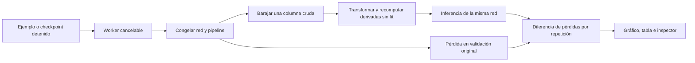
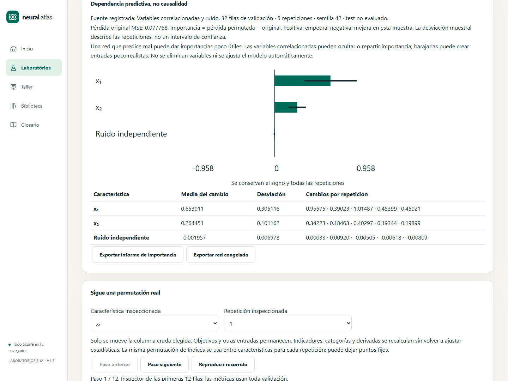

# X1.3 · Importancia por permutación

Diseño previo, 28/10/2026. US-058 / RF-081 / P-Q13 y C146; completa el alcance técnico de X1 después de comparadores y rejilla. X2 y la aceptación docente en aula permanecen separados.

Una copia de validación se evalúa con un MLP congelado. Para cada característica **cruda** seleccionada se barajan sus valores entre esas mismas filas, incluidos nulos y categorías. Se recomputan imputación, indicadores y derivadas con el pipeline congelado; no se vuelve a ajustar. Pesos, estadísticas, etiquetas, IDs y otras columnas no cambian. Fisher–Yates sembrado; se permiten puntos fijos, no se fuerza un desorden que altere la distribución del algoritmo.

Importancia = pérdida permutada − pérdida original, positiva si empeora. BCE/CCE estables para clasificación y MSE para regresión; cinco repeticiones por defecto, rango 2–10. Media y desviación estándar muestral descriptiva, sin intervalo de confianza. Se conservan valores negativos y cero. El mal rendimiento inicial, las características correlacionadas y entradas artificiales fuera de distribución limitan la interpretación; no es causalidad ni selección automática de variables.

Fuente: ejemplo sintético independiente (incluido caso con variables correlacionadas) que entrena una sola red antes de congelarla, o checkpoint detenido del laboratorio copiado a un Worker. La fuente queda identificada en el resultado. La copia del checkpoint conserva split, pipeline, red y consulta previa de test; no continúa ni sustituye la sesión activa. No se evalúa test.

Presupuestos: dataset de hasta 600 filas, ocho características crudas, 16 columnas transformadas, red de hasta 5000 parámetros; fuente hasta 8 MiB UTF-8, validación con al menos dos filas. Coste previo de inferencia ≤2e7 productos parámetro×muestra, más entrenamiento sintético acotado a 5–60 épocas y anchura 8. Cálculo en Worker cancelable; error, cancelación y respuestas tardías conservan el último resultado completo. Sin dependencias de red durante el cálculo.

Interfaz: gráfico con eje cero, media y desviación; tabla de todas las repeticiones; inspector de una permutación con IDs de origen/destino, valores crudos, objetivos y pérdida por muestra. Reproducción manual o explícita, velocidad de preferencias y respeto a movimiento reducido. Datos tabulares alternativos, temas y adaptación desde 360 px. Informe sin filas crudas, con métricas, presupuestos, procedencia y hashes; modelo congelado exportable por separado con el códec existente.

Verificación: oráculo lineal exacto con una variable relevante y otra ignorada; columna constante, nulos/categorías, derivadas y dependencias correlacionadas; signo negativo y dispersión; semillas y conservación del multiconjunto. Igualdad de red/pipeline antes y después, test extremo, límites y fuente incompatible. Integración de checkpoint, cancelación y error; navegador real para inspector, modelos e informes descargados, teclado, temas, contraste y móvil. CI completo y smoke público antes de publicar.

Fuente primaria: [Permutation feature importance](https://scikit-learn.org/stable/modules/permutation_importance.html). Algoritmo didáctico propio con el signo, pérdidas y límites anteriores.

## Evidencia de la versión 1.3.0

- 625 pruebas unitarias/integración en 78 archivos; cobertura de líneas 92,73 %, funciones 86,89 % y ramas 90,72 %, con los umbrales originales. Se comprueba también que ninguna desviación no finita se publique como un número válido.
- Doce recorridos locales pasan en Chromium/WebKit: laboratorio, checkpoint sin actualizaciones nuevas, reproducción, informe/modelo descargados, catálogo ampliado, búsqueda por siglas, enlaces C1001/C1100, paginación, temas, Axe y móvil. Firefox y la suite completa siguen siendo obligatorios en CI.
- El smoke público verifica el análisis del checkpoint, hashes de modelo/pipeline, informe sin datos crudos, las cien fichas y una referencia nueva sin conexión, conservando las actualizaciones del laboratorio.
- X1 queda implementado: US-056/057/058. La aceptación con alumnado y las extensiones X2 continúan pendientes.

