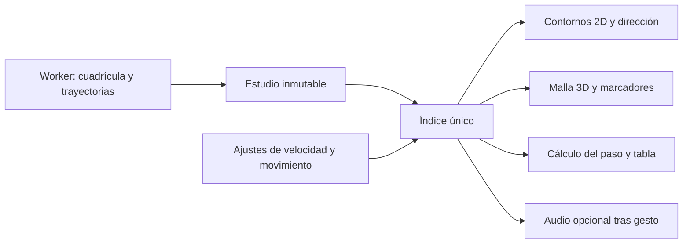
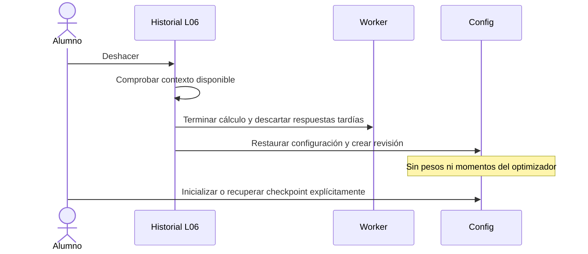
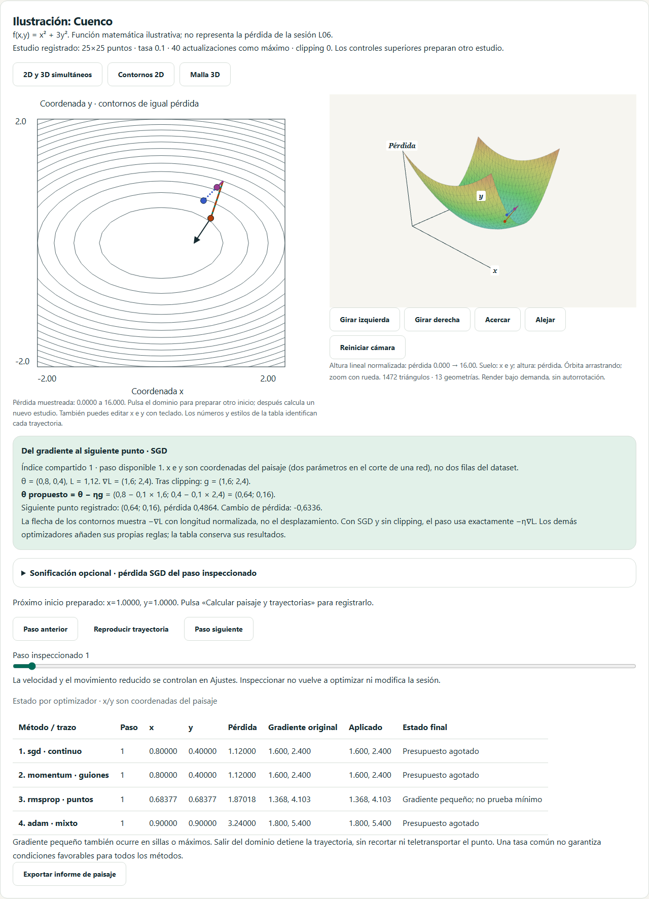
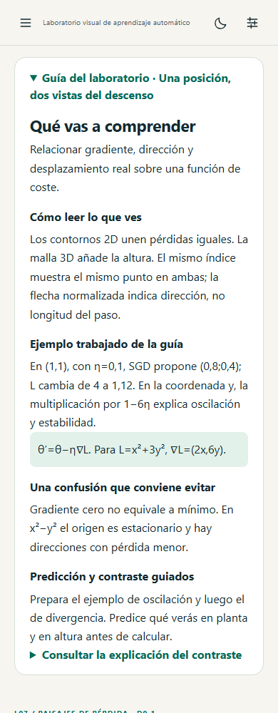
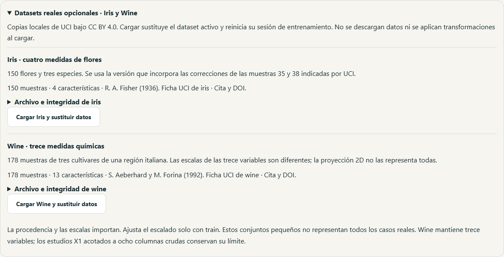

# X2 y descenso del gradiente guiado · diseño e implementación

Versión 1.4.0; diseño redactado antes de implementar. Reúne US-059/RF-082 (sonificación), US-061/RF-084 (historial de configuración), US-063/RF-086 (Iris/Wine), una ampliación de L07 y guías pedagógicas de los laboratorios. D1–D10 y X1 conservan sus contratos. La validación con alumnado no se puede sustituir por pruebas automatizadas: permanece abierta.

## Descenso simultáneo 2D/3D

L07 reutiliza la misma cuadrícula y trayectorias calculadas en Worker. Vista conjunta por defecto: contornos y malla Three.js montados simultáneamente, con un único índice, reproducción, velocidad y movimiento reducido. En pantallas estrechas se apilan sin perder sincronización. Siguen disponibles vistas individuales. Un fallo de WebGL conserva contornos, tabla y aviso; no se inventa una imagen 3D ni se pierde el estudio.

Una flecha representa la dirección del gradiente negativo de SGD, normalizada para que sea legible: su longitud no representa el paso. El inspector separa gradiente original, gradiente tras clipping y desplazamiento real. Ejemplo verificable: L=x²+3y², θ=(1,1), η=0,1, gradiente=(2,6), siguiente=(0,8;0,4), pérdidas 4→1,12. Casos guiados: cuenco con tasa prudente, oscilación cerca del límite, divergencia por tasa excesiva, silla con gradiente cero y valle de Rosenbrock. Los presets preparan controles; solo calcular registra otro estudio. Una red congelada sigue siendo un corte con el resto fijo, no toda su superficie.

## Historial de configuración

Historial de la configuración de entrenamiento L06 en RAM, hasta 50 estados inmutables incluyendo el actual; no guarda copias de pesos. Cada estado referencia por huella el dataset, split y pipeline presentes. Cambiar datos registra otro contexto; no permite volver a una configuración cuyo contexto ya no está disponible. La interfaz explica la causa y no restaura datos silenciosamente.

Deshacer/rehacer termina el Worker actual, crea una revisión y restaura solamente la configuración. La red anterior se descarta y se exige inicializar o recuperar explícitamente un checkpoint desde la biblioteca. La consulta previa de test se mantiene. Nueva edición tras deshacer descarta la rama de rehacer; cambiar parámetros del optimizador no simula recuperar sus momentos. Los presets/importaciones no se convierten en checkpoints mediante este historial. Se muestran posición, revisión, resumen y disponibilidad. Recargar termina este historial de RAM; los experimentos guardados conservan su mecanismo independiente.

## Datasets reales

Copias locales pequeñas de UCI Iris (150×4) y Wine (178×13), tres clases. Fuentes, autores, DOI, CC BY 4.0, hashes SHA-256 de archivos exactos y transformaciones se documentan y verifican. Se conserva el archivo original elegido; Iris debe identificar cómo se han tratado las diferencias de muestras documentadas por UCI. Carga voluntaria con un botón que explica la sustitución del dataset activo. Sin descargas en tiempo de ejecución, sin normalización ni división implícita. El alumno elige split y ajusta escalado solo con train. Se explican escala, procedencia, simplicidad y límites de representatividad. Los límites acotados de otros estudios siguen vigentes; Wine conserva sus 13 columnas.

## Sonificación opcional

Panel explícito de audio en L02, L06 y L07. Desactivado en cada apertura, creación de AudioContext únicamente tras gesto. Volumen inicial 0,1 y tope 0,2, silencio inmediato, desactivación al ocultar pestaña y al salir del componente; nunca reanudación automática. Mapeo visible: salida normalizada [0,1] o logaritmo de pérdida [10⁻⁴,10] a [220,880] Hz, con saturación declarada fuera del rango. En L07 representa la pérdida SGD del punto inspeccionado. Son datos redundantes con texto/tablas, sin alarmas ni diagnósticos sonoros. Fallo de audio deja intacta la simulación.

El registro sonoro también es ajustable: grave [110,440] Hz, normal [220,880] Hz y agudo [440,1760] Hz. Solo transpone la escala por 1/2, 1 o 2; no cambia los valores matemáticos ni el volumen máximo. La frecuencia propuesta se muestra antes de activar y se actualiza con cada dato.

## Explicaciones

Guía contextual accesible antes de cada laboratorio: objetivo, cómo leer el gráfico, ejemplo calculado, fórmula con dimensiones, error frecuente y actividad de predicción-observación-explicación con solución desplegable. Cobertura de las 14 tarjetas y guías propias para estudios avanzados. Se distinguen datos y parámetros, pérdida y exactitud, actualización y reproducción, asociación y causalidad. Se mantienen nombres de controles para conservar enlaces y accesibilidad.

Verificación: oráculos del cuenco y de los límites de tasa, misma coordenada/índice en ambas vistas, WebGL real y fallback, teclado, temas y 360/768/1440 px. Historial con 50 estados, bifurcación, independencia de objetos, contexto ausente, cancelación y preservación de test consultado. Audio con dobles del navegador y gesto real, rangos, silencio, salida y visibilidad. Datasets con hashes, tamaños, soportes, carga sin mutación/división, roundtrip y entrenamiento real. Guías con cálculos comprobados y rutas cubiertas. Se mantienen todas las puertas de cobertura, CI y smoke público.

## Evidencia y límites

- US-059 / RF-082 / P-Q14: paneles explícitos, pruebas del motor de audio y de visibilidad; actualización de valores sin activación automática. La frecuencia y el valor se mantienen como alternativa textual.
- US-061 / RF-084 / P-Q16: historial de configuración L06 en RAM; pruebas de 50 estados inmutables, nueva rama, contexto diferente, Worker descartado y conservación de test consultado. No se presenta como un historial global de todas las acciones de la aplicación.
- US-063 / RF-086 / P-Q18: [fuentes UCI, licencia y transformaciones](../src/content/datasets/README.md), hashes exactos, intercambio completo y entrenamiento de ambos datasets con todas sus columnas.
- `tests/unit/x2.test.ts`, `tests/integration/x2.test.ts` y `tests/e2e/x2.spec.ts` añaden oráculos, integración y recorridos nativos. La suite previa sigue activa, incluido WebGL perdido y ausencia de WebGL.
- Guías: 19 recorridos contextuales para las 14 tarjetas y cinco estudios avanzados; objetivos, lectura visual, ejemplos, errores y ejercicios. No califican automáticamente respuestas abiertas.

El primer control completo local pasó 635 pruebas; el intercambio/entrenamiento UCI y las regresiones de cancelación y espera máxima de audio elevan la suite a 638. Reiniciar un resultado antes de resolver `AudioContext.resume()` también silencia y cancela la activación, sin usar un valor descartado. Si el backend nunca responde, se cierra el intento a los dos segundos, se libera el contexto y una resolución tardía no puede iniciar el oscilador. El fallo nativo de Firefox en CI identificó esta espera; se mantiene el aviso de audio no disponible y el control de reintento. Se añaden doce recorridos repetidos de audio en los tres motores antes de la suite completa. Cobertura inicial: 92,78 % líneas, 91,89 % sentencias, 90,75 % ramas y 86,95 % funciones; umbrales sin cambios. Transferencia inicial: 69,73 KiB JS y 12,35 KiB CSS gzip. La evidencia final de tres motores se publica con el workflow de CI de esta entrega. Las comprobaciones automatizadas no sustituyen la validación docente de comprensión y uso en aula.

Fuentes: [Iris en UCI](https://archive.ics.uci.edu/dataset/53/iris), [Wine en UCI](https://archive.ics.uci.edu/dataset/109/wine), [CC BY 4.0](https://creativecommons.org/licenses/by/4.0/), [AudioContext.resume en MDN](https://developer.mozilla.org/en-US/docs/Web/API/AudioContext/resume) y [visibilidad de página en MDN](https://developer.mozilla.org/en-US/docs/Web/API/Page_Visibility_API). Consultadas el 28 de octubre de 2026.

