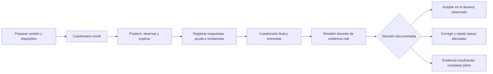

# Validación docente · paquete de aula v1.4.0

La implementación técnica está publicada y verificada. La aceptación pedagógica sigue **pendiente de ejecución con personas**. Este paquete prepara ese trabajo; no contiene participantes, respuestas ni resultados simulados.

## Material preparado

| Documento                                                      | Uso                                                              |
| -------------------------------------------------------------- | ---------------------------------------------------------------- |
| [Protocolo del piloto](classroom/00-protocolo.md)              | Organización, tiempos, asistencia, criterios y límites           |
| [Cuaderno del alumnado](classroom/01-cuaderno-alumnado.md)     | Doce actividades que recorren los catorce laboratorios           |
| [Cuestionarios A y B](classroom/02-cuestionarios.md)           | Ocho preguntas por forma, antes/después                          |
| [Solucionario y rúbrica](classroom/03-solucionario-rubrica.md) | Corrección de 0–2 puntos por pregunta y evidencias por actividad |
| [Acta de sesión y decisión](classroom/04-acta.md)              | Preparación, accesibilidad manual y aceptación motivada          |
| [Diccionario de registros](classroom/05-registros.md)          | Significado de columnas, denominadores y análisis                |
| [Paquete descargable](downloads/neural-atlas-aula-v1.4.0.zip)  | Markdown y CSV para conservar sin conexión                       |

Los CSV de `classroom/registros/` contienen exclusivamente cabeceras. El solucionario forma parte del archivo docente; para repartir solo tareas y preguntas, comparte los documentos 01 y 02. Es una evaluación formativa de un recurso público, sin pretensión de mantener secretas las respuestas.

Público principal: FP de especialización, adaptable a universidad. Propuesta inicial: 6–12 participantes y dos sesiones de 90 minutos; los tiempos son hipótesis que el piloto debe contrastar. La revisión rápida de todos los laboratorios no demuestra dominio de los 752 conceptos.

## Trazabilidad y estado

Este paquete concreta la aceptación humana de [la estrategia de pruebas](13-pruebas-y-aceptacion.md), especialmente P-A02, revisión GPU y claridad/carga cognitiva. Complementa [la entrega técnica v1.4.0](57-cierre-x2-y-descenso-guiado.md). Sus criterios son propuestas locales para decidir mejoras, no baremos educativos validados ni una certificación de accesibilidad.

| Preparación                                                             | Estado     |
| ----------------------------------------------------------------------- | ---------- |
| Protocolo, actividades y rúbricas                                       | Preparados |
| Formularios y registros vacíos                                          | Preparados |
| Observación con alumnado                                                | Pendiente  |
| Revisión con teclado, lector de pantalla y dispositivos reales del aula | Pendiente  |
| Análisis de respuestas e incidencias                                    | Pendiente  |
| Acta de aceptación firmada por el responsable docente                   | Pendiente  |

