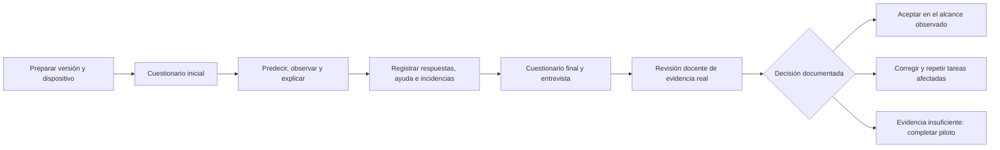

# Validación docente · paquete de aula 1.5.0-r1

La aplicación objetivo es **Neural Atlas 1.5.0**, con taller resuelto y experiencia semiguiada. La aceptación pedagógica sigue **pendiente de ejecución con personas**. El paquete 1.5.0-r1 prepara ese trabajo; no contiene participantes, respuestas ni resultados simulados. [Instrucciones de entrada](classroom/LEEME.md) y [registro de actualización](61-paquete-aula-v15.md).

La [lista actual de pendientes y revisión exploratoria de teclado](59-pendientes-y-revision-teclado.md) registra el primer avance de acceso. El lector de pantalla y los dispositivos reales del aula siguen pendientes; esta revisión del agente no sustituye la aceptación humana.

## Material preparado

| Documento                                                      | Uso                                                              |
| -------------------------------------------------------------- | ---------------------------------------------------------------- |
| [Protocolo del piloto](classroom/00-protocolo.md)              | Organización, tiempos, asistencia, criterios y límites           |
| [Cuaderno del alumnado](classroom/01-cuaderno-alumnado.md)     | Doce actividades que recorren los catorce laboratorios           |
| [Cuestionarios A y B](classroom/02-cuestionarios.md)           | Ocho preguntas por forma, antes/después                          |
| [Solucionario y rúbrica](classroom/03-solucionario-rubrica.md) | Corrección de 0–2 puntos por pregunta y evidencias por actividad |
| [Acta de sesión y decisión](classroom/04-acta.md)              | Preparación, accesibilidad manual y aceptación motivada          |
| [Diccionario de registros](classroom/05-registros.md)          | Significado de columnas, denominadores y análisis                |
| [Paso 2 · piloto](classroom/06-ejecucion-piloto.md) | Planificación, ensayo, recogida y cierre de sesión |
| [Paso 3 · análisis](classroom/07-analisis-resultados.md) | Revisión de datos, cálculos, incidencias e informe en blanco |
| [Paso 4 · aceptación](classroom/08-aceptacion-docente.md) | Evidencia, criterios, decisión y repetición de tareas |
| [G00 · acogida](classroom/09-acogida-talleres.md) | Diez minutos con el ejemplo resuelto y el recorrido propio |
| [Paquete descargable](downloads/neural-atlas-aula-v1.5.0.zip)  | Markdown, manifiesto y cinco CSV para conservar localmente |

Los cinco CSV de `classroom/registros/` contienen exclusivamente cabeceras. Se añade `introduccion.csv` para G00 sin modificar las cuatro cabeceras previas. El solucionario forma parte del archivo docente; para repartir tareas y preguntas, comparte los documentos 01, 02 y 09 según el momento. Mostrar G00 después del pre y registrar su exposición. Es una evaluación formativa de un recurso público, sin pretensión de mantener secretas las respuestas.

Público principal: FP de especialización, adaptable a universidad. Propuesta inicial: 6–12 unidades de observación y sesiones de 100 y 90 minutos; la primera incorpora diez minutos de acogida. Existe un recorrido focal de 100 minutos. Los tiempos son hipótesis que el piloto debe contrastar. La revisión rápida de todos los laboratorios no demuestra dominio de los 752 conceptos.

## Trazabilidad y estado

Este paquete concreta la aceptación humana de [la estrategia de pruebas](13-pruebas-y-aceptacion.md), especialmente P-A02, revisión GPU y claridad/carga cognitiva. Complementa [la base técnica v1.4.0](57-cierre-x2-y-descenso-guiado.md) y [la introducción v1.5.0](60-taller-resuelto-y-acompanamiento.md). Sus criterios son propuestas locales para decidir mejoras, no baremos educativos validados ni una certificación de accesibilidad. El [ZIP 1.4.0](downloads/neural-atlas-aula-v1.4.0.zip) se conserva como archivo histórico, con sus propios materiales.

| Preparación                                                             | Estado     |
| ----------------------------------------------------------------------- | ---------- |
| Protocolo, actividades y rúbricas                                       | Preparados |
| Formularios y registros vacíos                                          | Preparados |
| Procedimientos de los pasos 2–4 y acogida G00 | Preparados |
| Observación con alumnado                                                | Pendiente  |
| Revisión con teclado, lector de pantalla y dispositivos reales del aula | Pendiente  |
| Análisis de respuestas e incidencias                                    | Pendiente  |
| Acta de aceptación firmada por el responsable docente                   | Pendiente  |

