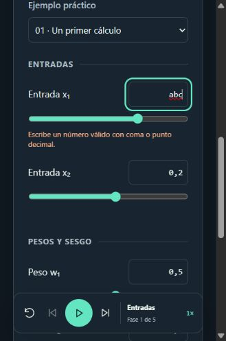
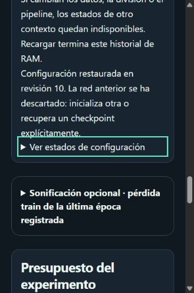

# Pendientes y primera revisión de acceso

Fecha: 28/10/2026. Publicación objetivo: Neural Atlas 1.4.0. Se mantienen D1–D10, X1 y X2 implementados y el [paquete de aula preparado](58-validacion-docente.md).

Actualización documental: el [paquete 1.5.0-r1](61-paquete-aula-v15.md) incorpora la introducción semiguiada y procedimientos completos para los pendientes 2–4. Están preparados, sin ejecutar; esta revisión de teclado conserva su alcance observado de 1.4.0.

## Lista actual de pendientes

| Orden | Pendiente real                                   | Estado y siguiente acción                                                                                                                                                                                                     |
| ----- | ------------------------------------------------ | ----------------------------------------------------------------------------------------------------------------------------------------------------------------------------------------------------------------------------- |
| 1     | Revisión de acceso y uso en el contexto del aula | Iniciada. Comprobada la navegación básica con teclado en los 14 laboratorios y recorridos detallados en L02/L06/L07. Faltan lector de pantalla real, equipos/entradas del centro y ampliar la exploración de los demás flujos |
| 2     | Piloto con alumnado                              | Pendiente. Concretar grupo, fechas y responsables; aplicar actividades y pre/post del paquete existente                                                                                                                       |
| 3     | Análisis de respuestas e incidencias             | Pendiente de datos reales. Revisar comprensión, ayudas, tareas incompletas y barreras, con los denominadores del protocolo                                                                                                    |
| 4     | Acta de aceptación docente                       | Pendiente de la revisión y el piloto. Delimitar alcance, condiciones, responsables y comprobaciones de las correcciones                                                                                                       |

Las frases de entregas antiguas que presentan D9/D10/X1/X2 como pendientes describen su momento histórico. No se convierten en historias de implementación abiertas de la versión actual. Ampliar actividades del catálogo o añadir otras funciones puede acordarse como trabajo futuro; no forma parte de estos cuatro pendientes de aceptación.

## Naturaleza de esta revisión

Observación exploratoria realizada por un agente mediante la interfaz del navegador integrado, con entradas de teclado y lectura del árbol de accesibilidad. Es evidencia de interacción real con la publicación, distinta de la batería Playwright del repositorio. **No es una prueba de lector de pantalla, una evaluación con alumnado ni una certificación de accesibilidad.**

Se empleó una pestaña de revisión separada. Las capturas tienen 329×497 píxeles y muestran la interfaz estrecha; esa dimensión no identifica un dispositivo físico ni acredita todas las resoluciones. No se modificaron preferencias de tema, sonido o movimiento para estos recorridos. Se utilizaron ejemplos sintéticos. Los cuestionarios y registros de alumnado permanecen vacíos.

## Recorridos observados

| ID  | Recorrido                      | Resultado observado                                                                                                                                                                                                                                                  |
| --- | ------------------------------ | -------------------------------------------------------------------------------------------------------------------------------------------------------------------------------------------------------------------------------------------------------------------- |
| K01 | Saltar al contenido            | Desde el contenido, cuatro Shift+Tab alcanzaron el botón; Enter devolvió el foco al contenido y Tab alcanzó la guía                                                                                                                                                  |
| K02 | Catálogo y guías L01–L14       | Desde el catálogo, el número de Tab correspondiente a cada tarjeta alcanzó su enlace. Enter abrió el laboratorio, el foco pasó al contenido y Tab alcanzó la guía. Enter abrió y cerró su explicación                                                                |
| K03 | L07: preparar y calcular       | Se eligió el primer ejemplo con teclado y se preparó el estudio. Tras 16 Tab desde Preparar se alcanzó Calcular. El resultado mostró inicio (1,1), tasa 0,1 y propuesta (0,8;0,4), pérdida 1,12                                                                      |
| K04 | L07: cámara y paso             | Los cinco botones de cámara se accionaron con Enter sin cambiar el índice. Paso siguiente llevó a 1; la flecha derecha del deslizador llevó a 2. El inspector y la tabla mostraron SGD (0,64;0,16), pérdida 0,4864                                                   |
| K05 | Ajustes                        | Al abrir, el foco fue a Cerrar ajustes; Shift+Tab alcanzó Restablecer; Tab volvió al inicio. Escape cerró y devolvió el foco al botón Ajustes. No se activó Restablecer                                                                                              |
| K06 | Menú estrecho                  | Al abrir, el foco fue a Cerrar navegación; Shift+Tab alcanzó Glosario. Tab y Escape permitieron cerrar y recuperar el foco del disparador. Se navegó al catálogo mediante teclado                                                                                    |
| K07 | L02: pestañas y error          | Flecha derecha cambió Explorar por Tu experimento y enfocó su pestaña. Tres Tab alcanzaron Entrada x₁. Se escribió `abc` y Enter: apareció el error y permaneció el foco en el campo. Se corrigió a `0,8`: desapareció el error sin perder el foco                   |
| K08 | L06: configuración e historial | Se cargaron lunas: 400 filas, split 280/60/60. Semilla 42→43 con flecha arriba y épocas 300→5 por teclado. Once Tab desde épocas alcanzaron Deshacer. Dos activaciones restauraron 42/300; dos Rehacer devolvieron 43/5. Tab continuó a Ver estados de configuración |

En K08 se revisaron los ajustes antes de inicializar un modelo: este recorrido no demuestra por sí solo recuperación de pesos, ejecución de un lote o persistencia. Esos comportamientos tienen pruebas técnicas independientes en el proyecto. No se ejecutó una evaluación de test para seleccionar ajustes.

Al deshabilitarse Calcular/Deshacer/Rehacer, el árbol de accesibilidad mostró temporalmente foco en el área raíz. En los casos observados, el siguiente Tab continuó en el control posterior esperado, sin reiniciar el recorrido al principio. Esto no fue un bloqueo de teclado en la exploración; queda por comprobar cómo lo anuncia el lector real del centro.

## Evidencia conservada

El [registro de las 14 guías](fixtures/keyboard-exploration-2026-10-28.json) contiene fecha, superficie y verificaciones efectivamente observadas. Sus booleanos corresponden solo a orden del catálogo, foco principal y apertura/cierre de la guía, no a completar todas las funciones de cada laboratorio. Las acciones K03–K08 se describen en la tabla anterior con sus valores observados.

No se encontraron bloqueos de teclado en estos recorridos concretos. Esto no acredita ausencia de barreras en el resto de la aplicación.

## Qué falta para cerrar el primer pendiente

1. Ampliar la revisión a tareas completas de datos, evaluación, visión, mapas de decisión y experimentos; abrir sus guías no equivale a completar esas tareas.
2. Con el lector real del centro, verificar nombres, agrupación, estados, alertas de errores y resultados nuevos, incluido el cambio temporal de foco al deshabilitar botones.
3. Completar al menos una tarea con teclado y otra con lector en el navegador/dispositivo físico previsto, registrando herramienta y versión en [el acta](classroom/04-acta.md).
4. Revisar zoom de texto, tema, movimiento reducido, entrada táctil y fallback WebGL en los equipos de aula que se vayan a utilizar.
5. Registrar barreras con pasos y evidencia, corregir las confirmadas y repetir las tareas afectadas. Solo después puede decidirse el cierre del alcance de acceso observado.

La primera revisión inicia el pendiente 1; no rellena ni firma el acta docente y no cambia los estados de aceptación del piloto.
