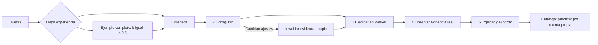
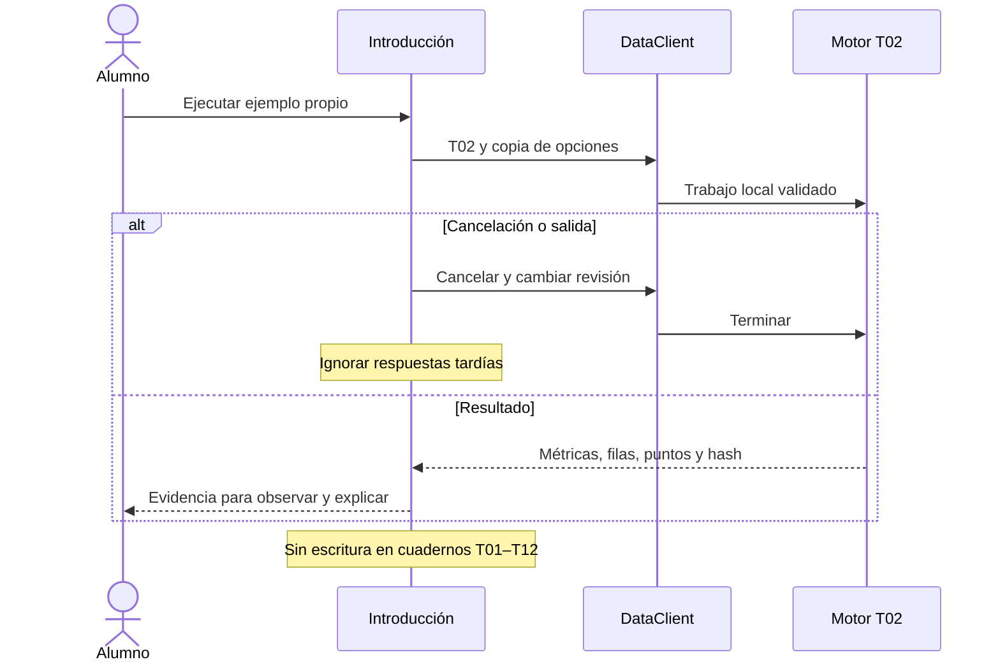
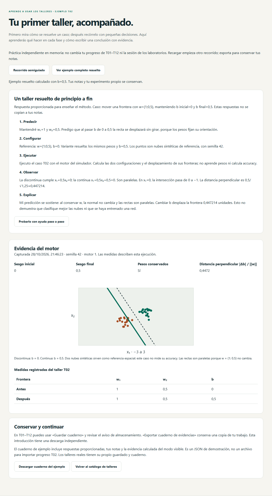
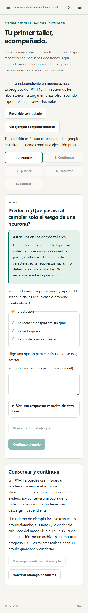
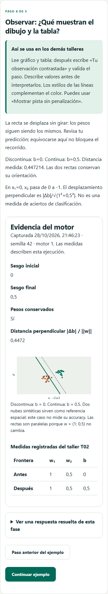

# Tu primer taller · ejemplo resuelto y experiencia semiguiada

Entrega 1.5.0; diseño redactado antes de implementar. Historia H-GUIA-01: como alumno que abre Talleres por primera vez, quiero ver un ejemplo completo y recorrer sus cinco fases con ayuda para entender qué se espera de mí.

## Diseño y criterios

- Entrada visible desde Talleres y ruta propia `/taller/ejemplo`. El catálogo conserva T01–T12.
- Caso introductorio basado en el motor real T02: pesos fijos (1;0,5), sesgo inicial 0, ejemplo resuelto con sesgo final 0,5. Frontera inicial x₁+0,5x₂=0; final x₁+0,5x₂+0,5=0. Misma normal, desplazamiento 0,5/√1,25≈0,447214. En x₁=0, la intersección vertical pasa de 0 a −1. No es entrenamiento ni medición de accuracy.
- Dos modos: ejemplo completo resuelto y recorrido semiguiado. El primero presenta hipótesis, configuración, ejecución, observación y conclusión del docente; calcula su evidencia con un Worker. El segundo pide elegir una predicción y permite modificar el sesgo, ejecutar y contrastar. Una predicción errónea recibe explicación sin bloquear el aprendizaje. Las notas son opcionales y no se califican.
- Cinco fases con progreso, Anterior/Continuar y ayuda contextual «Así se usa en los demás talleres». Ver el ejemplo resuelto no rellena ni sustituye las notas del alumno ni su resultado propio.
- El ejemplo de referencia siempre usa b=0,5. El experimento propio admite −1≤b≤1, incluido cero: en cero no se desplaza y se explica la diferencia con la consigna real de T02, que pide cambiar el sesgo.
- Cambiar el sesgo invalida la evidencia propia y exige recalcular. Cancelar/navegar termina el Worker y descarta respuestas tardías. Los errores conservan la información anterior identificada como tal.
- Aislamiento: no modifica datasets, redes, cuadernos ni progreso T01–T12. Estado del recorrido en RAM; exportación explícita de un JSON `neural-atlas.workshop-demo`, distinto de un cuaderno real de taller. Recargar comienza una práctica nueva. Los ejemplos de respuesta llevan etiqueta de solución proporcionada.
- Al completar se ofrece abrir el catálogo y practicar T02 con las propias palabras. «Recorrido de ejemplo terminado» no significa taller T02 aprobado ni aceptación docente.
- Teclado, foco en el título al cambiar de fase, estados anunciados, controles con etiquetas, temas claro/oscuro y anchuras estrechas. Se reutiliza la representación de evidencia T02 con gráfico y tabla; se respetan preferencias de movimiento existentes.

## Responsabilidades

`content/workshop-introduction.ts`: explicaciones y solución de las cinco fases. `features/workshops/useWorkshopIntroduction.ts`: estado y coordinación con DataClient, sin acceso a los stores de otros talleres. `WorkshopIntroductionPage.vue`: presentación y navegación. Motor T02 y `WorkshopEvidence.vue`: medidas y visualización existentes. La descarga usa el adaptador común de archivos.

## Verificación prevista

Oráculo independiente del desplazamiento, intersección y signo del sesgo; progresión y fases bloqueadas, predicción incorrecta, referencia separada de notas propias, invalidación, cancelación/error y respuestas tardías. Integración con Worker doble y comprobación de que otros stores no cambian. Playwright sobre Worker nativo: ambos modos, descarga diferenciada, regreso al catálogo, teclado, temas y móvil. Se mantienen las puertas completas de cobertura y CI; el smoke público incorpora el recorrido introductorio. La revisión con lector real y alumnado sigue pendiente.

## Evidencia local

- 644 pruebas unitarias/integración en 82 archivos; primera medición de cobertura de la entrega: 92,84 % líneas, 91,94 % sentencias, 90,89 % ramas y 86,94 % funciones. Umbrales conservados.
- Seis recorridos nuevos locales, tres por Chromium/WebKit, superados: solución y cinco fases, conservación del cuaderno T02 real, cero/negativo/invalidación, modos independientes, descarga, recarga, teclado, foco y accesibilidad automática. Anchuras 329/390/768/1440 y temas claro/oscuro.
- Worker real T02 tanto para la referencia como para el experimento propio. En tests de fallo/cancelación se usa un doble controlable del Worker. El caso no realiza entrenamiento ni mide accuracy.
- Entrada inicial medida: 69,96 KiB JS y 12,35 KiB CSS gzip; el primer build de la entrega incluye 134 recursos offline, aproximadamente 791 KiB gzip. La ruta introductoria se carga de forma diferida y entra en el manifiesto offline.
- CI añade un recorrido temprano de los tres casos nuevos en Firefox antes de la suite completa de los tres motores. La publicación exige sus puertas habituales y el smoke público ampliado.
- La revisión exploratoria de teclado del informe 59 corresponde a v1.4.0. Esta nueva página tiene pruebas automatizadas de teclado; su revisión con lector real y usuarios permanece abierta. El paquete de aula conserva su identificación 1.4.0: al usar esta entrega, registrar 1.5.0 y el alcance añadido.

Capturas reproducibles con `node scripts/capture-workshop-introduction.mjs` sobre el preview local:

