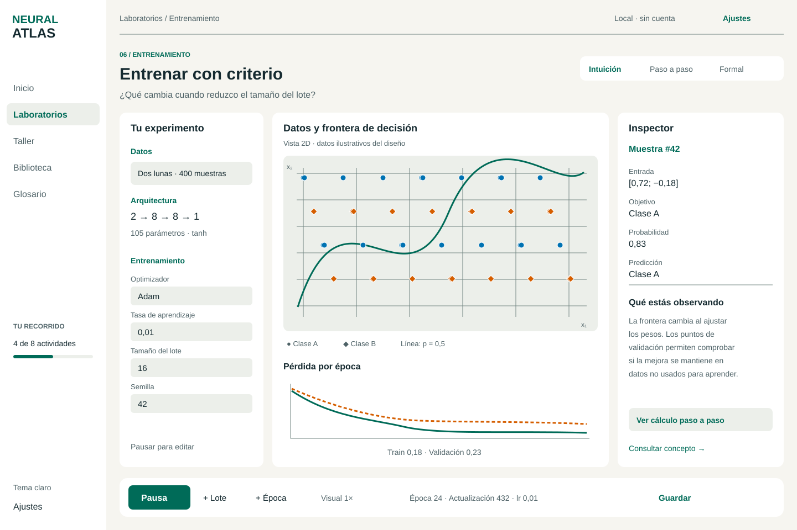

# Especificación para revisión · Neural Atlas 0.2

**Estado actual:** [Descenso simultáneo, guías y cierre X2 · v1.4.0](57-cierre-x2-y-descenso-guiado.md). D1–D10, X1 y X2 implementados; aceptación docente en aula pendiente. [Cierre X1](55-importancia-permutacion-x1.md), [100 conceptos nuevos](56-cien-conceptos-ia.md), [rejilla X1.2](54-rejilla-acotada-x1.md), [comparadores X1.1](53-comparadores-clasicos-x1.md) y [cierre v1.1](52-cierre-tecnico-v11.md) conservan evidencia histórica.

La [validación docente](58-validacion-docente.md) dispone de protocolo, doce actividades, cuestionarios A/B, rúbrica, acta y registros vacíos descargables. Su ejecución y aceptación siguen pendientes de evidencia humana.

Diseño inicial: 22/10/2026; estado de implementación: 27/10/2026. La especificación 0.2 se conserva como contrato histórico. Las entregas D1–D6 tienen informes de implementación y evidencia propios; el [cierre técnico D7](44-cierre-d7.md) reúne comparación/CV, transformaciones, dispersión, deriva, proyección y segmentos. [D8.1](45-evaluacion-probabilidades.md) añade evaluación probabilística y costes. D8 se completa con [ética por grupos](47-etica-y-cierre-d8.md); D9–D10 y la validación humana en aula siguen abiertos. Público: FP de especialización y universidad. Proyecto independiente: `simulator-neural-networks`.

La publicación continua de la versión estable se describe en [GitHub Pages](24-despliegue-pages.md); el hosting se adelanta por petición del usuario y mantiene la validación previa de CI.

## Resumen revisable

Alcance de diseño: 12 laboratorios, 12 talleres previstos, **152 conceptos iniciales más 500 nuevos de consulta (652 en total)**, **88 RF**, 24 RNF y **65 historias**. El catálogo contiene **30 diagramas Mermaid**: 26 de diseño y cuatro de implementación D3/D4. Vue con Composition API/TS, Tailwind/Vite, motor CPU en Worker y vistas D3/SVG/Canvas/Three.js por fases. Biblioteca, checkpoints y los cuadernos de los cinco talleres actuales usan IndexedDB; las preferencias usan LocalStorage. PWA, catálogo importable, grafo, repaso y paquetes docentes siguen en D10. Repositorio: [franmatias/neural-atlas](https://github.com/franmatias/neural-atlas).

La lista original se conserva y amplía con 52 conceptos; la ampliación [C153–C652](27-ampliacion-conceptos.md) incorpora otras 500 fichas de consulta; siguiente ID disponible C653, sin máximo fijo. Cada concepto lleva estado y entrega. MVP D1–D5 prioriza POE, diagnóstico y mapas junto al núcleo y T01–T05; v1.1 completa el alcance original; seis extensiones v1.2 quedan propuestas, no prometidas para el MVP.

Empieza por [la respuesta a las revisiones](20-revision-y-respuestas.md), que registra correcciones y decisiones; después revisa [la experiencia educativa transversal](22-experiencias-educativas.md). Los errores de fixtures, límites, almacenamiento y contratos Worker de 0.1 quedan sustituidos por esta revisión.

## Orden sugerido de revisión

1. [Visión y alcance](02-vision-y-alcance.md): acuerdos, límites y entregas.
2. [Laboratorios](05-laboratorios.md): preguntas, controles, ejemplos y actividades.
3. [Diseño de interfaz](07-diseno-de-interfaz.md): identidad, medidas, estados y ajustes.
4. [Diagramas](15-diagramas.md): clases, secuencias, estados y vistas arquitectónicas.
5. [Historias y Git](14-historias-y-plan-git.md): orden de implementación y criterios para integrar.

## Diseño visual de referencia

Son wireframes de especificación con cifras ilustrativas, no capturas del simulador funcionando.

[Escritorio oscuro](design/desktop-dark.svg) · [Vista móvil](design/mobile.svg)

## Índice completo

| Documento | Contenido |
|---|---|
| [01 · Auditoría](01-auditoria.md) | Evidencias del original y correcciones necesarias |
| [02 · Visión](02-vision-y-alcance.md) | Público, alcance, límites y fases |
| [03 · Requisitos funcionales](03-requisitos-funcionales.md) | RF-001–RF-068 con aceptación observable |
| [04 · Requisitos no funcionales](04-requisitos-no-funcionales.md) | RNF-001–RNF-024 medibles |
| [05 · Laboratorios](05-laboratorios.md) | L01–L12 y T01–T12, por entregas |
| [06 · Catálogo abierto](06-matriz-conceptos.md) | C001–C152, plantilla editorial y ampliación |
| [07 · Interfaz](07-diseno-de-interfaz.md) | Tokens, responsive, navegación y componentes |
| [08 · Taller y contenidos](08-taller-y-contenidos.md) | Secuencias docentes, rúbricas y datos sintéticos |
| [09 · Arquitectura](09-arquitectura.md) | Carpetas propuestas, responsabilidades, puertos y ADR |
| [10 · Motor](10-motor-matematico.md) | Fórmulas, convenciones, optimizadores y métricas |
| [11 · Contratos](11-datos-y-protocolo-worker.md) | Entidades, archivos, hashes y mensajería |
| [12 · Persistencia/offline](12-persistencia-offline-y-seguridad.md) | Cuotas, recuperación, PWA, Pages y seguridad |
| [13 · Pruebas](13-pruebas-y-aceptacion.md) | Unidad, integración, E2E, cobertura y calidad |
| [14 · Historias](14-historias-y-plan-git.md) | 65 historias, dependencias, esfuerzo y MVP |
| [15 · Diagramas](15-diagramas.md) | 30 diagramas y sus fuentes editables |
| [16 · Riesgos](16-riesgos-y-decisiones.md) | Decisiones propuestas y revisión |
| [17 · Desarrollo](17-guia-de-desarrollo.md) | Cómo comprobar y mantener esta fase |
| [18 · Fuentes](18-fuentes.md) | Referencias oficiales consultadas |
| [19 · Verificación](19-verificacion.md) | Comprobaciones realmente ejecutadas y límites |
| [20 · Revisión](20-revision-y-respuestas.md) | Respuesta y decisiones frente a ambas revisiones |
| [21 · Trazabilidad RF](21-trazabilidad-rf.md) | RF→módulo→historia→prueba→fase |
| [22 · Experiencias educativas](22-experiencias-educativas.md) | POE, diagnóstico, activaciones y extensiones |
| [23 · Implementación D1](23-implementacion-d1.md) | Neurona, interfaz y evidencia histórica |
| [24 · GitHub Pages](24-despliegue-pages.md) | CI, publicación y comprobación pública |
| [25 · Implementación D2](25-implementacion-d2.md) | Datos, formatos, split, pipeline y evidencia |
| [26 · Implementación D3](26-implementacion-d3.md) | MLP/perceptrón, activaciones, gradientes y lotes |
| [27 · Ampliación del catálogo](27-ampliacion-conceptos.md) | 500 conceptos C153–C652, agrupación y mantenimiento |
| [28 · Paginador del glosario](28-paginador-glosario.md) | Páginas numeradas, tamaños y navegación accesible |
| [29 · Implementación D4](29-implementacion-d4.md) | Entrenamiento CPU, recuperación, evaluación y predicción |
| [30 · Biblioteca D5](30-biblioteca-d5.md) | Guardado transaccional, reanudación e intercambio de experimentos |
| [31 · Modelos D5](31-modelos-inferencia-d5.md) | Modelos sin filas, preparación aprendida y predicción independiente |
| [32 · Taller POE D5](32-taller-poe-d5.md) | Cinco talleres, evidencias reales, rúbrica manual y cuadernos persistentes |
| [33 · Recuperación en disco D5](33-recuperacion-disco-d5.md) | Dos checkpoints automáticos, reanudación y conflictos entre pestañas |
| [34 · Generalización D6](34-generalizacion-d6.md) | L1/L2, recorte global y ensayos emparejados con checkpoints v2 |
| [35 · Parada temprana D6](35-parada-temprana-d6.md) | Validación, restauración completa, continuación explícita y checkpoints v3 |
| [36 · Dropout D6](36-dropout-d6.md) | Máscaras reales, RNG reproducible, inferencia sin máscara y checkpoints v4 |
| [37 · Normalización por lotes D6](37-normalizacion-lotes-d6.md) | Gradientes del lote completo, medias móviles, gamma/beta y modelos de inferencia v2 |
| [38 · Aumento de datos D6](38-aumento-datos-d6.md) | Copias fijas solo de train, oráculos, trazabilidad y experimentos v6 |
| [39 · Multisemilla D6](39-comparacion-multisemilla-d6.md) | Datos fijos, parejas reproducibles, dispersión y diferencias por semilla |
| [40 · Capacidad D6](40-capacidad-y-tamano-d6.md) | Curvas por tamaños anidados, tres arquitecturas y dataset v2 con selección reproducible |
| [41 · Experimentos D7](41-experimentos-y-validacion-cruzada-d7.md) | A/B, hipótesis, CV sin fuga, grupos, pipeline por fold y dataset v3 |
| [42 · Escalado robusto D7](42-escalado-robusto-d7.md) | Mediana/IQR, comparación sin fuga, experimentos v7 y modelos v3 |

## Revisión histórica de D0

La revisión inicial cubrió identidad, secuencia didáctica, prioridades, CNN, límites y formatos. Los informes de implementación registran las mediciones y pruebas realizadas; los objetivos de las fases pendientes conservan su carácter de diseño. Los controles documentales no sustituyen las pruebas funcionales ni la valoración docente.

[43 · Diseño e implementación de los laboratorios visuales](43-laboratorios-visuales-de-decision.md): sandbox binario y clasificador multiclase con entrenamiento real.

[44 · Cierre técnico D7](44-cierre-d7.md): estado de las seis historias, contratos, límites, versiones y evidencia.

[Construir una función · D8.2](46-aproximacion-funciones.md) implementa US-050 / RF-073 en L10; [US-064 (ética por grupos)](47-etica-y-cierre-d8.md) completa su alcance funcional. Las fases D9/D10 y la validación en aula siguen pendientes.

[Ética y cierre de D8 · D8.3](47-etica-y-cierre-d8.md) reúne US-041, US-042, US-050 y US-064 con evidencia de implementación y controles de publicación. La aceptación en aula y las fases D9/D10 siguen pendientes.

[Paisajes de pérdida · D9.1](48-paisajes-perdida.md) abre L07 con funciones ilustrativas y cortes reales. No cierra D9 ni D10.

[Visión y kernels · D9.2](49-vision-kernels.md) implementa L11 con operaciones y productos inspeccionables; quedan los talleres y D10.

[Talleres de investigación · D9.3](50-talleres-investigacion.md) completa las doce secuencias y la biblioteca de diagnóstico. El cierre de D9 exige CI y publicación; D10 permanece pendiente.

| [51 · Catálogo, repaso, docencia y offline](51-catalogo-repaso-y-paquetes.md) | Diseño D10 y contratos seguros |
| [52 · Cierre técnico v1.1](52-cierre-tecnico-v11.md) | Evidencia, ADR-009, pruebas y límites de aceptación |
| [53 · Comparadores clásicos X1.1](53-comparadores-clasicos-x1.md) | Diseño, límites y evidencia de kNN/CART/MLP |
| [54 · Rejilla acotada X1.2](54-rejilla-acotada-x1.md) | Plan, presupuesto, intentos y selección con validación |

| [55 · Importancia por permutación](55-importancia-permutacion-x1.md) | Modelo congelado, inspector y cierre X1 |
| [56 · Cien conceptos de IA](56-cien-conceptos-ia.md) | C1001–C1100, fuentes y revisión de duplicados |
| [57 · Cierre X2 y descenso guiado](57-cierre-x2-y-descenso-guiado.md) | Diseño simultáneo 2D/3D, guías, historial, audio y datos licenciados |
| [58 · Validación docente](58-validacion-docente.md) | Protocolo de aula, actividades, pre/post, rúbrica y registros vacíos |
